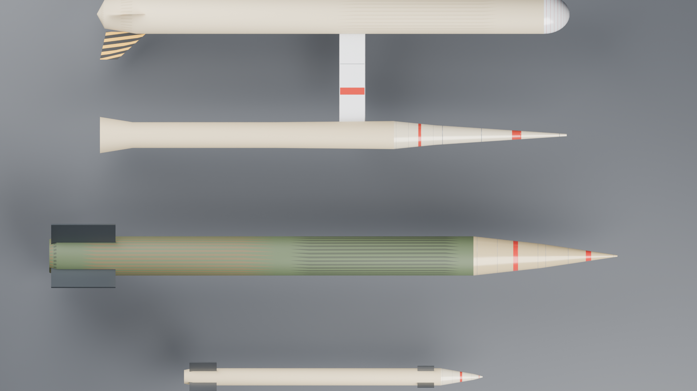
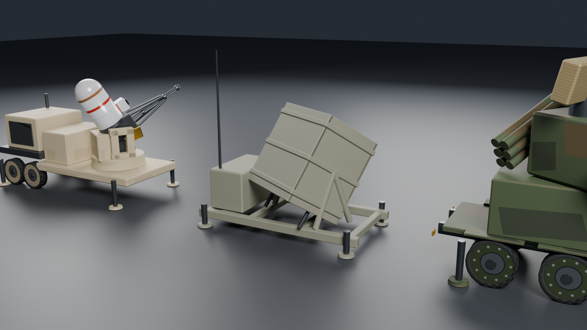
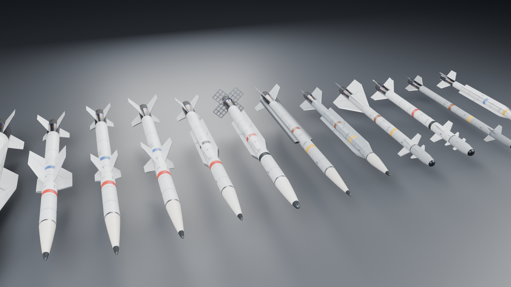
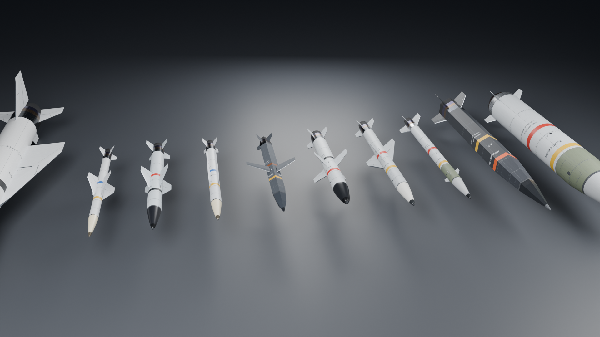
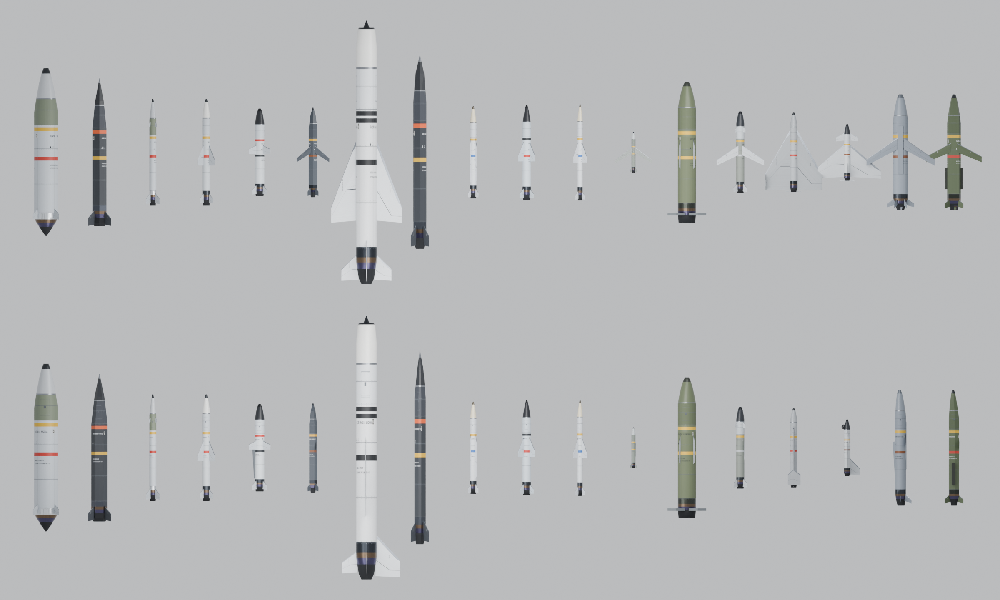
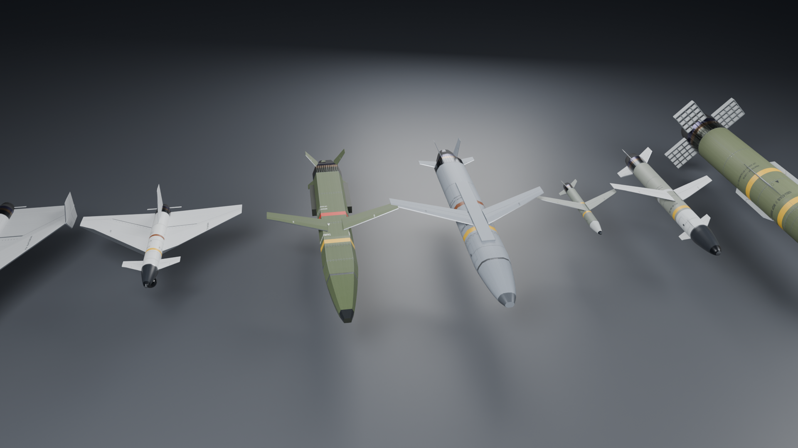

# NextGen BVR, Strategic & Air Defense Armory v5.0 (DCS World 2.9+)

A modular, non-destructive DCS World `Saved Games` weapon & SAM expansion featuring:
- **262 unique weapons** (`251` aircraft loadouts + racks + `23` ground/naval SAM interceptors) across Air-to-Air, Ballistic/MRBM, Precision Artillery (`GMLRS`, `Tornado-S`, `TRG-230/300`), Anti-Ship, SEAD, Cruise (`BGM-109 Tomahawk Blk IV/V`), Glide Bombs, Drones, and **KEKA Aerospace** troll payloads (`Troposphère 4/5/6`, `KEKA Baguette-II AAM`, `KEKA Njiwa-1 MicroSat Booster`)
- **11 high-detail animated Surface Air Defense Systems** (`Centurion C-RAM Phalanx CIWS`, `Iron Dome 5x4 Tamir + EL/M-2084 MMR`, `IRIS-T SLM 8x8 + TRML-4D AESA`, `SAMP/T Aster 30 B1NT`, `Pantsir-SM 96K6`, `Patriot M903 PAC-3 MSE`, `THAAD M1120 8-Tube Exo-ABM`, `S-400 Triumf 5P85SM2 40N6 TEL`, and `KEKA Aerospace Troposphère Pad`)
- **Calibrated Mach-Indexed DCS Aerodynamic Polars** (`mod/Database/polar_profiles.lua`) built from real DCS World polar families (`AIM-120C`, `SD-10`, `9M723`, `AGM-84H`, `X-101`, `LS-6`, `AGM-88`, `RIM-7M`, `AGR-20A`)
- **79 custom `+X Forward` `.edm` 3D shapes** & **159 2K PBR texture maps** (beveled cabover 8×8 MAN HX / KamAZ-6560 / HEMTT / MAZ-543 twin-cab chassis, bolted wheel hubs, radiator louvers, AESA T/R grids, slotted C-RAM U-barbette + brass 20mm link chute)

## Catalogue Complet & Fiches 1-par-1 (262 Armes + 11 Systèmes Sol-Air + 79 Rendus)

> **[Ouvrir le Catalogue Complet (`docs/CATALOG.md`)](docs/CATALOG.md)** — Accès direct aux **262 fiches individuelles** ([`docs/missiles/`](docs/missiles/)), **11 fiches sol-air / C-RAM** ([`docs/air-defense/`](docs/air-defense/)) et **79 rendus studio 3D** ([`docs/renders/`](docs/renders/)).

### Fiches Défenses Sol-Air & C-RAM (11)

- [Centurion C-RAM Phalanx CIWS](docs/air-defense/NG_CRAM_Centurion.md) (`ng_cram_centurion`)
- [Iron Dome 5×4 Tamir Launcher](docs/air-defense/NG_IronDome_Launcher.md) (`ng_iron_dome_ln`) · [Radar EL/M-2084 MMR](docs/air-defense/NG_IronDome_ELM2084.md) (`ng_iron_dome_radar`)
- [Diehl IRIS-T SLM 8×8](docs/air-defense/NG_IRIST_SLM_Launcher.md) (`ng_irist_slm_ln`) · [Radar Hensoldt TRML-4D AESA](docs/air-defense/NG_TRML_4D_Radar.md) (`ng_trml_4d_radar`)
- [Eurosam SAMP/T Aster 30 B1NT](docs/air-defense/NG_SAMPT_Aster30_Launcher.md) (`ng_sampt_aster30`)
- [Pantsir-SM 96K6 SPAAGM](docs/air-defense/NG_Pantsir_SM.md) (`ng_pantsir_sm`)
- [Patriot M903 PAC-3 MSE 16-Cell](docs/air-defense/NG_Patriot_PAC3_MSE_LN.md) (`ng_patriot_pac3_ln`)
- [THAAD M1120 8-Tube Exo-ABM](docs/air-defense/NG_THAAD_Launcher.md) (`ng_thaad_ln`)
- [S-400 Triumf 5P85SM2 40N6 TEL](docs/air-defense/NG_S400_TEL.md) (`ng_s400_tel`)
- [KEKA Aerospace Troposphère Pad (Troll SAM)](docs/air-defense/NG_KEKA_LaunchPad.md) (`ng_keka_launcher`)

## Visual Showcase & Orthographic Audit

| v5 HQ Ground SAM / C-RAM Rework | Missiles & Backlog Showcase |
|---|---|
|  |  |
|  |  |
|  |  |
|  |  |
|  |  |

## Highlights Added in v5.0

- **AAA Hard-Surface Air Defense Overhaul (`mod/Database/units_air_defense.lua` + `weapons_sam_interceptors.lua`)**:
  - `Centurion C-RAM`: Gooseneck step trailer, louvered generator, 4 hydraulic leveling outriggers, slotted U-barbette, brass 20mm ammo link feed chute, white Ku-band radome with dark collar & FLIR optronic pod, A-frame 6-barrel Vulcan (`M246_20_HE_gr`, 4,500 rpm, 0.25s reaction, `DrawArg 0/1/23`).
  - `Iron Dome 5x4 Battery` (`NG_IronDome_Launcher`) + `EL/M-2084 MMR` S-band AESA radar (`DrawArg 11`): 20-cell corrugated cage on dual A-frame trunnion stanchions with hydraulic rams & low-RCS C-RAM/cruise engagement profile.
  - `IRIS-T SLM 8x8` (`ng_irist_slm_ln`) + `Hensoldt TRML-4D` AESA radar (`NG_TRML_4D_Radar`) on MAN HX 8×8 chassis.
  - `THAAD M1120` 8-Tube HEMTT open painted-tan truss firing `NG_SAM_THAAD` exo-atmospheric KKV (`H_max = 150 km`, Mach 8.2).
  - `S-400 Triumf 5P85SM2` MAZ-543 twin-cab TEL firing `NG_SAM_40N6` 380 km ABM/AWACS killer.
  - Plus `NG_SAM_SM3_IIA`, `NG_SAM_SM6_IB`, `NG_SAM_SM2_IIIC`, `NG_SAM_ESSM_B2`, `NG_SAM_RIM116C`, `NG_SAM_ARROW3`, `NG_SAM_STUNNER`, `NG_SAM_BARAK_MX`, `NG_SAM_CAMM_ER`, `NG_SAM_CHEONGUNG2`, `NG_SAM_HQ19`, `NG_SAM_ASTER15`.
- **Backlog Expansion to 262 Weapons (`dcs_missiles_backlog_2026.md`)**:
  - **Cruise & Anti-Ship**: `BGM-109 Tomahawk Blk IV/V` (+ `2x Heavy Rack`), `Exocet MM40 Blk 3c`, `YJ-62`, `C-802A`, `SSM-700K Haeseong`, `HF-2`, `Sea Venom`, `Marte ER`, `Teseo Mk2/E`, `Penguin Mk 3`, `Blue Spear`, `KD-88`, `CM-400AKG`.
  - **Precision Artillery / MRBM / ALBM**: `M31A2 GMLRS`, `ER-GMLRS` (+ `6x Pod`), `Tornado-S 9M544`, `TRG-230`, `TRG-300 Kaplan`, `Tayfun`, `Bora/Khan`, `Hyunmoo-IV`, `Pralay`, `KN-23`, `Fateh-313`, `Zolfaghar`, `ROCKS ALBM`.
  - **AAM / SEAD / ATGM / Smart Glide / Drones**: `AIM-9X Blk II+`, `AIM-120D-1`, `IRIS-T Blk II`, `Sky Sting`, `Gökhan`, `Akdoğan`, `PL-10`, `PL-16`, `R-74M`, `R-27EA`, `SkySniper`, `AGM-78D`, `Kh-25MPU`, `Kh-28`, `Kornet-EM`, `PARS 3 LR`, `HJ-10`, `HJ-12`, `L-UMTAS`, `OMTAS`, `Stugna-P`, `AGM-65E2/L`, `MAM-L`, `MAM-T`, `ASELSAN Tolun` (+ `4x Rack`), `ALTIUS-700M`, `HERO-30`, `Green Dragon`, `Kargu-3`, `RAM II`, `Orbiter 1K`.
  - **KEKA Aerospace Troll Lineup**: `KEKA Baguette-II AAM`, `KEKA Njiwa-1 MicroSat Booster`, `Troposphère 4/5/6`, `2x Twin Pod`, & `KEKA Troposphère Pad`!

## Installation & Sync to `D:\DCS MODDING`

```powershell
.\sync_to_saved_games.ps1
python tools\verify_mod.py
```
