<div align="center">

# NextGen BVR, Strategic & Air Defense Armory v5.0

   -79-8957e5?style=for-the-badge) 


**[Catalogue Complet (`docs/CATALOG.md`)](docs/CATALOG.md) · [262 Fiches Missiles](docs/missiles/) · [11 Fiches Sol-Air / C-RAM](docs/air-defense/) · [79 Rendus 3D](docs/renders/)**


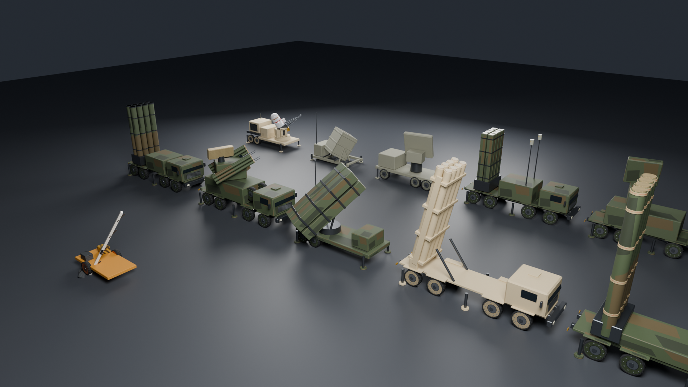

</div>

---


## Vue d'Ensemble Visuelle — Tous les 79 Modèles 3D (`.edm`)


### 1. Défenses Sol-Air, Radars AESA & C-RAM (11 Systèmes)

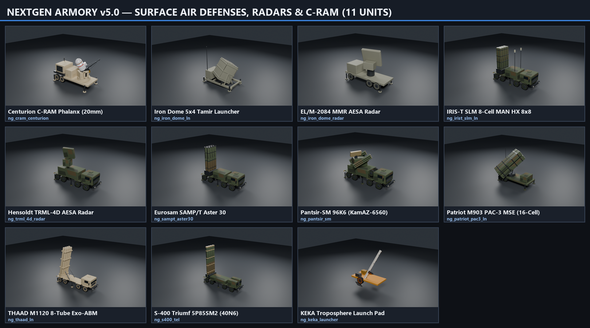


| Aperçu | Système Sol-Air (Fiche 1-par-1) | Radar / Rôle | Portée / Plafond | Armement / Cadence |
|---|---|---|---|---|
| [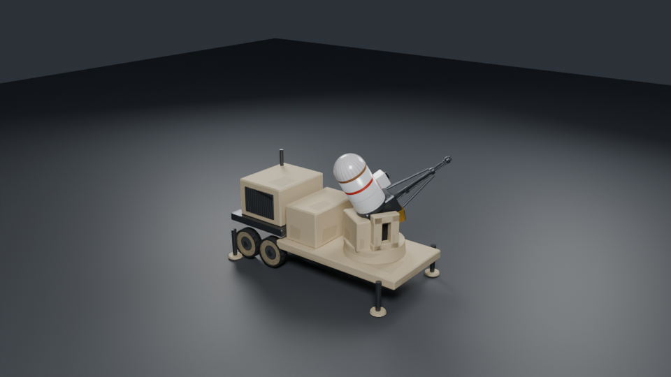](docs/air-defense/NG_CRAM_Centurion.md) | **[Centurion C-RAM Phalanx CIWS (NextGen)](docs/air-defense/NG_CRAM_Centurion.md)**<br>`NG_CRAM_Centurion` · `ng_cram_centurion.edm` | `C_RAM_Phalanx`<br>Détect `14 km` · Réaction `0.25s` | `2 km` / `4 km` | 20mm M246 HE-IT C-RAM (1550) |
| [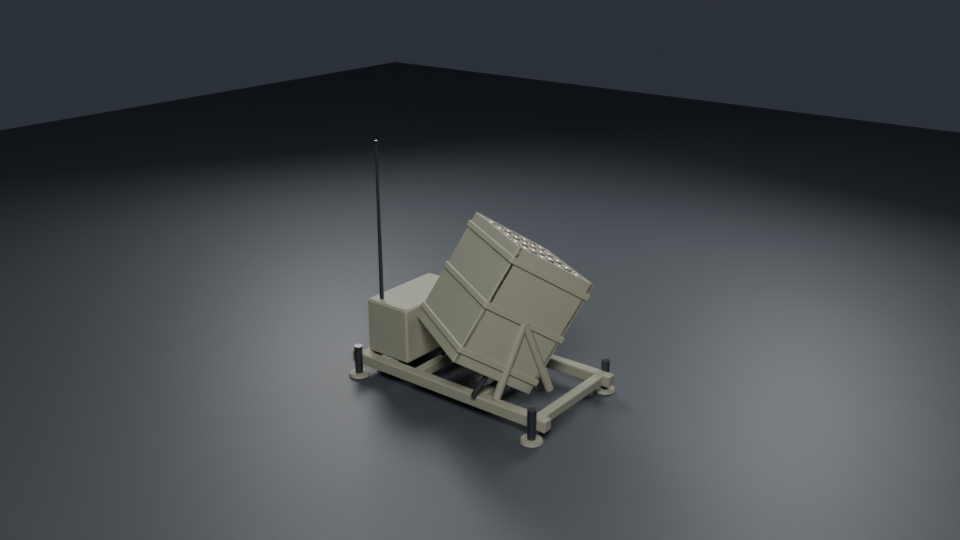](docs/air-defense/NG_IronDome_Launcher.md) | **[Iron Dome 20-Cell Tamir Launcher (NextGen)](docs/air-defense/NG_IronDome_Launcher.md)**<br>`NG_IronDome_Launcher` · `ng_iron_dome_ln.edm` | `Tor 9A331`<br>Détect `75 km` · Réaction `1.0s` | `70 km` / `15 km` | [NG_SAM_TAMIR](docs/missiles/NG_SAM_TAMIR.md) ×20 |
| [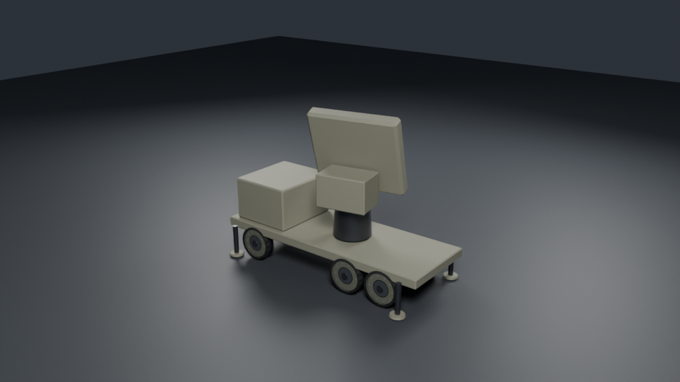](docs/air-defense/NG_IronDome_ELM2084.md) | **[EL/M-2084 MMR Iron Dome Radar (NextGen)](docs/air-defense/NG_IronDome_ELM2084.md)**<br>`NG_IronDome_ELM2084` · `ng_iron_dome_radar.edm` | `NASAMS_Radar_MPQ64F1`<br>Détect `250 km` · Réaction `1.0s` | `0 m` / `40 km` | N/A (0) |
| [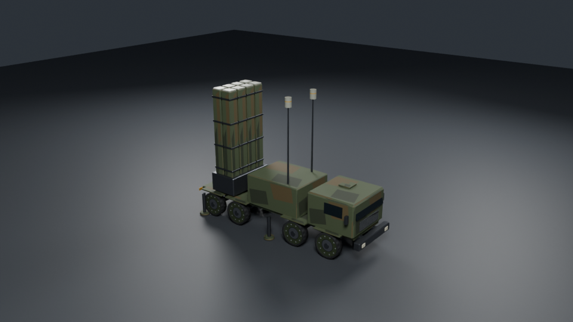](docs/air-defense/NG_IRIST_SLM_Launcher.md) | **[IRIS-T SLM 8-Cell VLS Truck (NextGen)](docs/air-defense/NG_IRIST_SLM_Launcher.md)**<br>`NG_IRIST_SLM_Launcher` · `ng_irist_slm_ln.edm` | `Tor 9A331`<br>Détect `60 km` · Réaction `1.2s` | `45 km` / `20 km` | [NG_SAM_IRIST_SLM](docs/missiles/NG_SAM_IRIST_SLM.md) ×8 |
| [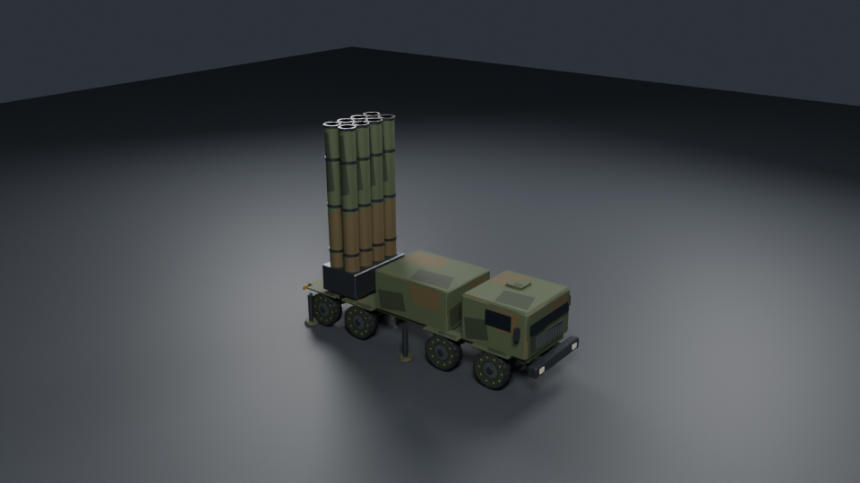](docs/air-defense/NG_SAMPT_Aster30_Launcher.md) | **[SAMP/T Aster 30 B1NT 8-Cell VLS (NextGen)](docs/air-defense/NG_SAMPT_Aster30_Launcher.md)**<br>`NG_SAMPT_Aster30_Launcher` · `ng_sampt_aster30.edm` | `Patriot str`<br>Détect `180 km` · Réaction `1.5s` | `150 km` / `30 km` | [NG_SAM_ASTER30](docs/missiles/NG_SAM_ASTER30.md) ×8 |
| [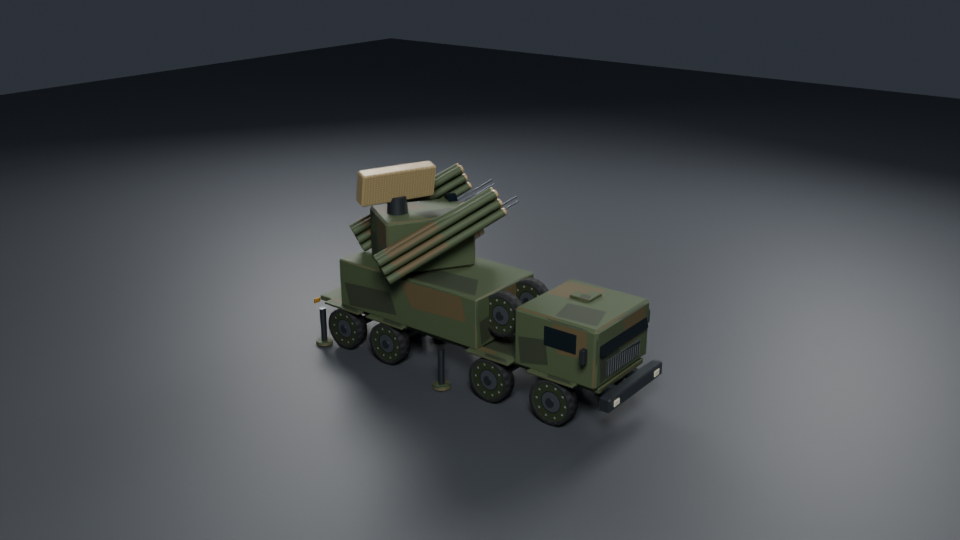](docs/air-defense/NG_Pantsir_SM.md) | **[Pantsir-SM 96K6 SPAAGM (NextGen)](docs/air-defense/NG_Pantsir_SM.md)**<br>`NG_Pantsir_SM` · `ng_pantsir_sm.edm` | `Tor 9A331`<br>Détect `45 km` · Réaction `1.0s` | `32 km` / `18 km` | [NG_SAM_57E6M](docs/missiles/NG_SAM_57E6M.md) ×12 |
| [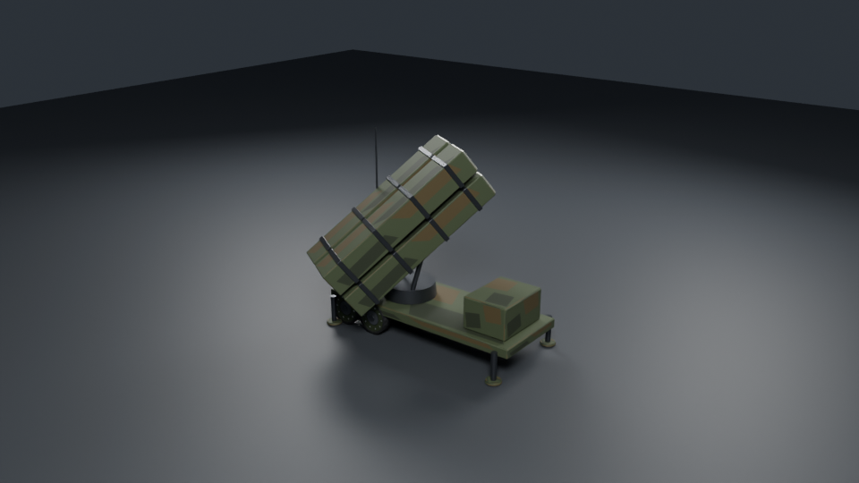](docs/air-defense/NG_Patriot_PAC3_MSE_LN.md) | **[Patriot M903 PAC-3 MSE 16-Cell (NextGen)](docs/air-defense/NG_Patriot_PAC3_MSE_LN.md)**<br>`NG_Patriot_PAC3_MSE_LN` · `ng_patriot_pac3_ln.edm` | `Patriot str`<br>Détect `160 km` · Réaction `1.8s` | `120 km` / `35 km` | [NG_SAM_PAC3_MSE](docs/missiles/NG_SAM_PAC3_MSE.md) ×16 |
| [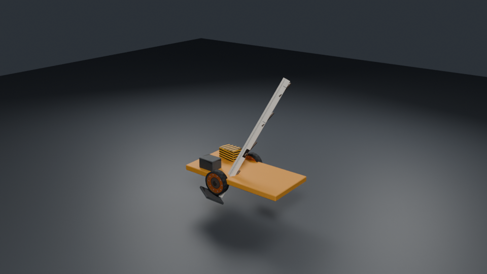](docs/air-defense/NG_KEKA_LaunchPad.md) | **[KEKA Aerospace Troposphere Pad (Troll SAM!)](docs/air-defense/NG_KEKA_LaunchPad.md)**<br>`NG_KEKA_LaunchPad` · `ng_keka_launcher.edm` | `Tor 9A331`<br>Détect `80 km` · Réaction `2.2s` | `95 km` / `35 km` | [NG_SAM_KEKA_T6](docs/missiles/NG_SAM_KEKA_T6.md) ×4 |
| [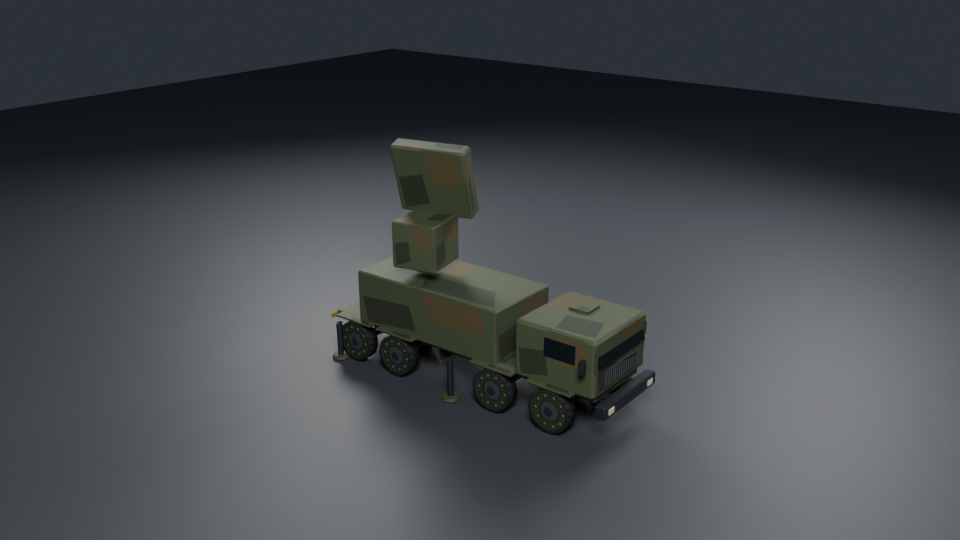](docs/air-defense/NG_TRML_4D_Radar.md) | **[TRML-4D AESA Air Surveillance Radar (NextGen)](docs/air-defense/NG_TRML_4D_Radar.md)**<br>`NG_TRML_4D_Radar` · `ng_trml_4d_radar.edm` | `NASAMS_Radar_MPQ64F1`<br>Détect `250 km` · Réaction `1.0s` | `0 m` / `40 km` | N/A (0) |
| [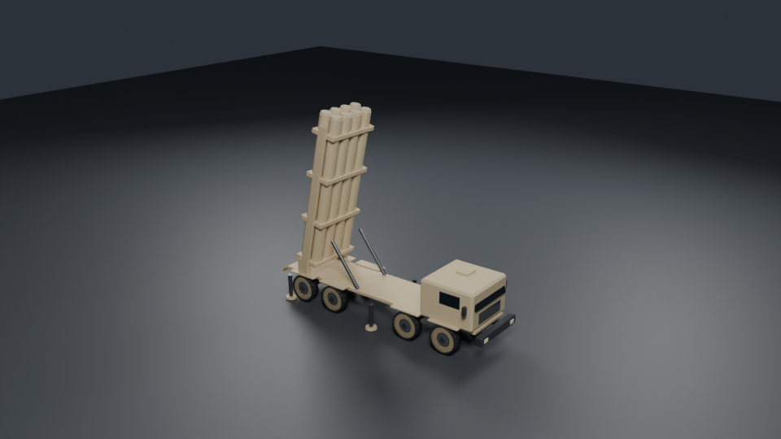](docs/air-defense/NG_THAAD_Launcher.md) | **[THAAD M1120 8-Tube Exo-ABM TEL (NextGen)](docs/air-defense/NG_THAAD_Launcher.md)**<br>`NG_THAAD_Launcher` · `ng_thaad_ln.edm` | `Patriot str`<br>Détect `240 km` · Réaction `2.0s` | `200 km` / `150 km` | [NG_SAM_THAAD](docs/missiles/NG_SAM_THAAD.md) ×8 |
| [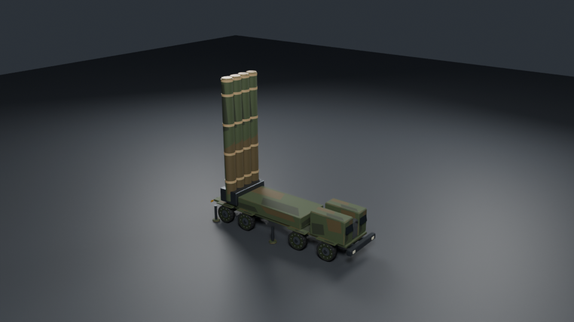](docs/air-defense/NG_S400_TEL.md) | **[S-400 Triumf 5P85SM2 40N6 TEL (NextGen)](docs/air-defense/NG_S400_TEL.md)**<br>`NG_S400_TEL` · `ng_s400_tel.edm` | `Tor 9A331`<br>Détect `400 km` · Réaction `2.0s` | `380 km` / `35 km` | [NG_SAM_40N6](docs/missiles/NG_SAM_40N6.md) ×4 |

### 2. Missiles Air-Air (BVR / WVR / Ramjet) & Intercepteurs SAM (28 Modèles)

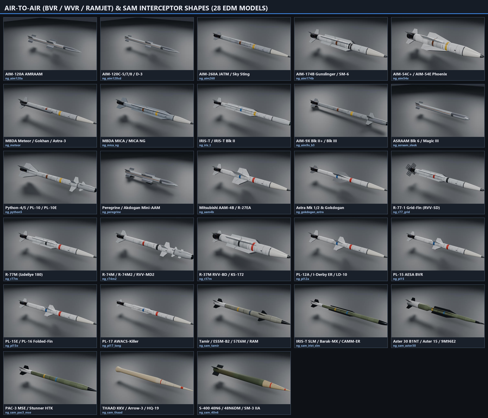


### 3. Missiles de Croisière, Anti-Navires, SEAD, Balistiques & Hypersoniques (23 Modèles)

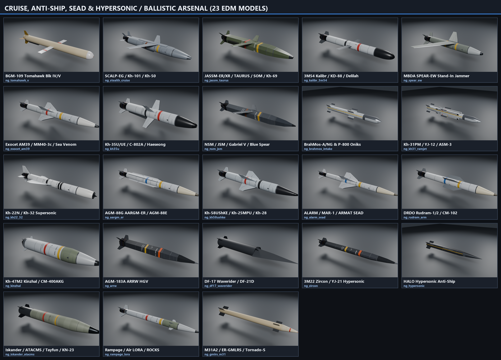


### 4. Bombes Planantes, Drones, ATGMs, Roquettes & Collection Troll KEKA (17 Modèles)

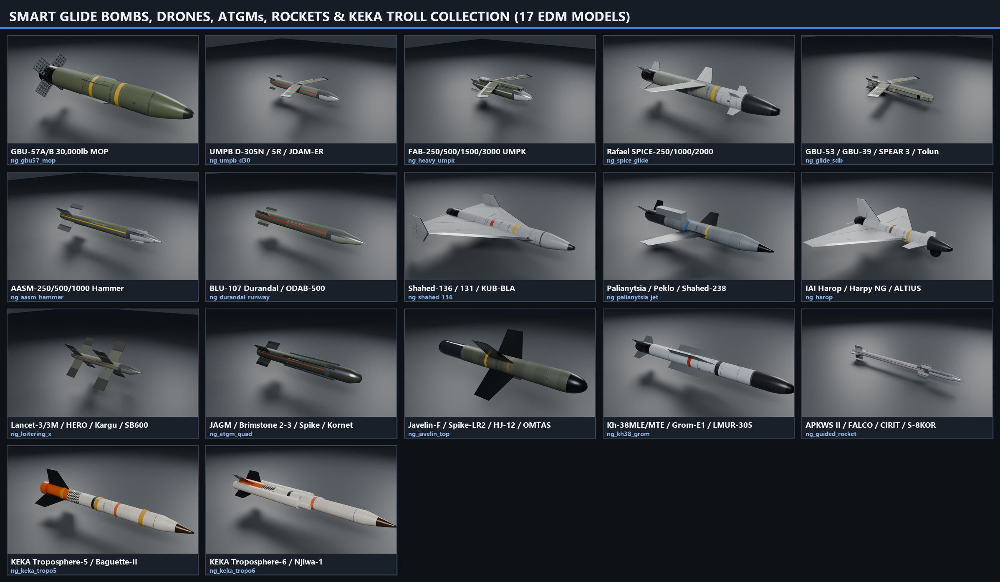


---


## Catalogue Intégral des 262 Armes (Déplier Chaque Catégorie)


> Cliquez sur n'importe quelle catégorie ci-dessous pour afficher **toutes les armes directement ici** avec accès 1-clic à leur **fiche détaillée** (`docs/missiles/<ID>.md`) et leur **rendu 3D** (`docs/renders/<shape>.png`). Vous pouvez aussi tout consulter d'un bloc dans [`docs/CATALOG.md`](docs/CATALOG.md).


<details open>
<summary><strong>Air-to-Air BVR & Long-Range — 35 armes</strong> (cliquer pour déplier)</summary>


| Arme (Fiche 1-par-1) | ID / CLSID | Modèle 3D | Mach | Portée | Masse / Charge | Polaire |
|---|---|---|---|---|---|---|
| **[AIM-120A AMRAAM (NextGen)](docs/missiles/NG_AIM_120A.md)** | `NG_AIM_120A`<br>`{NEXTGEN_AIM_120A}` | [`ng_aim120a`](docs/renders/ng_aim120a.png) | M4.0 | 75 km | 152 kg / 22.0 kg | `FM_AAM_BVR` |
| **[AIM-120C-5 AMRAAM (NextGen)](docs/missiles/NG_AIM_120C5.md)** | `NG_AIM_120C5`<br>`{NEXTGEN_AIM_120C5}` | [`ng_aim120cd`](docs/renders/ng_aim120cd.png) | M4.1 | 105 km | 157 kg / 20.0 kg | `FM_AAM_BVR` |
| **[AIM-120C-7 AMRAAM (NextGen)](docs/missiles/NG_AIM_120C7.md)** | `NG_AIM_120C7`<br>`{NEXTGEN_AIM_120C7}` | [`ng_aim120cd`](docs/renders/ng_aim120cd.png) | M4.2 | 120 km | 162 kg / 20.0 kg | `FM_AAM_BVR` |
| **[AIM-120C-8 / D Export (NextGen)](docs/missiles/NG_AIM_120C8.md)** | `NG_AIM_120C8`<br>`{NEXTGEN_AIM_120C8}` | [`ng_aim120cd`](docs/renders/ng_aim120cd.png) | M4.3 | 150 km | 162 kg / 20.0 kg | `FM_AAM_BVR` |
| **[AIM-120D-3 AMRAAM (NextGen)](docs/missiles/NG_AIM_120D3.md)** | `NG_AIM_120D3`<br>`{NEXTGEN_AIM_120D3}` | [`ng_aim120cd`](docs/renders/ng_aim120cd.png) | M4.5 | 180 km | 162 kg / 20.0 kg | `FM_AAM_BVR` |
| **[AIM-260A JATM (NextGen)](docs/missiles/NG_AIM_260.md)** | `NG_AIM_260`<br>`{NEXTGEN_AIM_260}` | [`ng_aim260`](docs/renders/ng_aim260.png) | M5.2 | 260 km | 168 kg / 22.0 kg | `FM_AAM_ULTRA` |
| **[AIM-174B Gunslinger (NextGen)](docs/missiles/NG_AIM_174B.md)** | `NG_AIM_174B`<br>`{NEXTGEN_AIM_174B}` | [`ng_aim174b`](docs/renders/ng_aim174b.png) | M5.5 | 380 km | 860 kg / 60.0 kg | `FM_AAM_ULTRA` |
| **[AIM-54C+ Sea Phoenix (NextGen)](docs/missiles/NG_AIM_54C_PLUS.md)** | `NG_AIM_54C_PLUS`<br>`{NEXTGEN_AIM_54C_PLUS}` | [`ng_aim54e`](docs/renders/ng_aim54e.png) | M4.6 | 185 km | 465 kg / 60.0 kg | `FM_AAM_ULTRA` |
| **[Mitsubishi AAM-4B AESA (NextGen)](docs/missiles/NG_AAM_4B.md)** | `NG_AAM_4B`<br>`{NEXTGEN_AAM_4B}` | [`ng_aam4b`](docs/renders/ng_aam4b.png) | M4.5 | 120 km | 222 kg / 24.0 kg | `FM_AAM_BVR` |
| **[Rafael I-Derby ER (NextGen)](docs/missiles/NG_I_DERBY_ER.md)** | `NG_I_DERBY_ER`<br>`{NEXTGEN_I_DERBY_ER}` | [`ng_pl12a`](docs/renders/ng_pl12a.png) | M4.2 | 100 km | 118 kg / 23.0 kg | `FM_AAM_BVR` |
| **[MBDA Meteor Ramjet (NextGen)](docs/missiles/NG_METEOR.md)** | `NG_METEOR`<br>`{NEXTGEN_METEOR}` | [`ng_meteor`](docs/renders/ng_meteor.png) | M4.8 | 220 km | 190 kg / 24.0 kg | `FM_AAM_ULTRA` |
| **[DRDO Astra Mk 1 BVR (NextGen)](docs/missiles/NG_ASTRA_MK1.md)** | `NG_ASTRA_MK1`<br>`{NEXTGEN_ASTRA_MK1}` | [`ng_gokdogan_astra`](docs/renders/ng_gokdogan_astra.png) | M4.5 | 110 km | 154 kg / 15.0 kg | `FM_AAM_BVR` |
| **[DRDO Astra Mk 2 Dual-Pulse (NG)](docs/missiles/NG_ASTRA_MK2.md)** | `NG_ASTRA_MK2`<br>`{NEXTGEN_ASTRA_MK2}` | [`ng_gokdogan_astra`](docs/renders/ng_gokdogan_astra.png) | M4.6 | 160 km | 165 kg / 15.0 kg | `FM_AAM_BVR` |
| **[Astra Mk 3 / Gandiva SFDR (NG)](docs/missiles/NG_ASTRA_MK3.md)** | `NG_ASTRA_MK3`<br>`{NEXTGEN_ASTRA_MK3}` | [`ng_meteor`](docs/renders/ng_meteor.png) | M5.0 | 300 km | 185 kg / 18.0 kg | `FM_AAM_ULTRA` |
| **[TUBITAK Gokdogan BVR (NextGen)](docs/missiles/NG_GOKDOGAN.md)** | `NG_GOKDOGAN`<br>`{NEXTGEN_GOKDOGAN}` | [`ng_gokdogan_astra`](docs/renders/ng_gokdogan_astra.png) | M4.2 | 100 km | 160 kg / 20.0 kg | `FM_AAM_BVR` |
| **[Denel R-Darter BVR (NextGen)](docs/missiles/NG_R_DARTER.md)** | `NG_R_DARTER`<br>`{NEXTGEN_R_DARTER}` | [`ng_pl12a`](docs/renders/ng_pl12a.png) | M4.0 | 75 km | 120 kg / 18.0 kg | `FM_AAM_BVR` |
| **[MBDA MICA EM/RF (NextGen)](docs/missiles/NG_MICA_RF.md)** | `NG_MICA_RF`<br>`{NEXTGEN_MICA_RF}` | [`ng_mica_ng`](docs/renders/ng_mica_ng.png) | M4.0 | 80 km | 112 kg / 12.0 kg | `FM_AAM_WVR` |
| **[MICA NG RF Dual-Pulse (NextGen)](docs/missiles/NG_MICA_NG_EM.md)** | `NG_MICA_NG_EM`<br>`{NEXTGEN_MICA_NG_EM}` | [`ng_mica_ng`](docs/renders/ng_mica_ng.png) | M4.2 | 105 km | 115 kg / 12.0 kg | `FM_AAM_WVR` |
| **[PL-12A / SD-10A Improved (NG)](docs/missiles/NG_PL_12A.md)** | `NG_PL_12A`<br>`{NEXTGEN_PL_12A}` | [`ng_pl12a`](docs/renders/ng_pl12a.png) | M4.4 | 110 km | 199 kg / 22.0 kg | `FM_AAM_BVR` |
| **[PL-15 AESA BVR (NextGen)](docs/missiles/NG_PL_15.md)** | `NG_PL_15`<br>`{NEXTGEN_PL_15}` | [`ng_pl15`](docs/renders/ng_pl15.png) | M5.0 | 220 km | 210 kg / 24.0 kg | `FM_AAM_BVR` |
| **[PL-15E Fold-Fin Export (NextGen)](docs/missiles/NG_PL_15E.md)** | `NG_PL_15E`<br>`{NEXTGEN_PL_15E}` | [`ng_pl15e`](docs/renders/ng_pl15e.png) | M4.8 | 160 km | 205 kg / 22.0 kg | `FM_AAM_BVR` |
| **[R-77-1 / RVV-SD Grid-Fin (NG)](docs/missiles/NG_R_77_1.md)** | `NG_R_77_1`<br>`{NEXTGEN_R_77_1}` | [`ng_r77_grid`](docs/renders/ng_r77_grid.png) | M4.5 | 110 km | 190 kg / 22.5 kg | `FM_AAM_BVR` |
| **[R-77M Izdeliye 180 (NextGen)](docs/missiles/NG_R_77M.md)** | `NG_R_77M`<br>`{NEXTGEN_R_77M}` | [`ng_r77m`](docs/renders/ng_r77m.png) | M5.0 | 190 km | 195 kg / 22.5 kg | `FM_AAM_BVR` |
| **[R-37M RVV-BD Long-Range (NG)](docs/missiles/NG_R_37M.md)** | `NG_R_37M`<br>`{NEXTGEN_R_37M}` | [`ng_r37m`](docs/renders/ng_r37m.png) | M6.0 | 320 km | 510 kg / 60.0 kg | `FM_AAM_ULTRA` |
| **[KS-172 AAM-L AWACS-Killer (NG)](docs/missiles/NG_KS_172.md)** | `NG_KS_172`<br>`{NEXTGEN_KS_172}` | [`ng_r37m`](docs/renders/ng_r37m.png) | M5.5 | 400 km | 750 kg / 50.0 kg | `FM_AAM_ULTRA` |
| **[AIM-120D-1 AMRAAM Datalink (NG)](docs/missiles/NG_AIM_120D_BLK1.md)** | `NG_AIM_120D_BLK1`<br>`{NEXTGEN_AIM_120D_B1}` | [`ng_aim120cd`](docs/renders/ng_aim120cd.png) | M4.4 | 160 km | 162 kg / 20.0 kg | `FM_AAM_BVR` |
| **[Rafael Sky Sting 6th-Gen BVR (NG)](docs/missiles/NG_SKY_STING.md)** | `NG_SKY_STING`<br>`{NEXTGEN_SKY_STING}` | [`ng_aim260`](docs/renders/ng_aim260.png) | M5.2 | 250 km | 175 kg / 22.0 kg | `FM_AAM_ULTRA` |
| **[TUBITAK Gokhan Ramjet BVRAAM (NG)](docs/missiles/NG_GOKHAN.md)** | `NG_GOKHAN`<br>`{NEXTGEN_GOKHAN}` | [`ng_meteor`](docs/renders/ng_meteor.png) | M4.9 | 240 km | 195 kg / 24.0 kg | `FM_AAM_ULTRA` |
| **[PL-16 J-20 Compressed Bay BVR (NG)](docs/missiles/NG_PL_16.md)** | `NG_PL_16`<br>`{NEXTGEN_PL_16}` | [`ng_pl15e`](docs/renders/ng_pl15e.png) | M5.2 | 260 km | 200 kg / 22.0 kg | `FM_AAM_ULTRA` |
| **[R-27EA Active Alamo (NextGen)](docs/missiles/NG_R_27EA.md)** | `NG_R_27EA`<br>`{NEXTGEN_R_27EA}` | [`ng_aam4b`](docs/renders/ng_aam4b.png) | M4.5 | 130 km | 350 kg / 39.0 kg | `FM_AAM_BVR` |
| **[SkySniper / Air Stunner Long-AAM](docs/missiles/NG_PYTH_STUN.md)** | `NG_PYTH_STUN`<br>`{NEXTGEN_SKY_SNIPER}` | [`ng_aim174b`](docs/renders/ng_aim174b.png) | M5.5 | 260 km | 420 kg / 35.0 kg | `FM_AAM_ULTRA` |
| **[PL-17 AWACS-Killer (NextGen)](docs/missiles/NG_PL_17.md)** | `NG_PL_17`<br>`{NEXTGEN_PL_17}` | [`ng_pl17_long`](docs/renders/ng_pl17_long.png) | M5.5 | 350 km | 450 kg / 45.0 kg | `FM_AAM_ULTRA` |
| **[Raytheon Peregrine Mini-BVR (NG)](docs/missiles/NG_PEREGRINE.md)** | `NG_PEREGRINE`<br>`{NEXTGEN_PEREGRINE}` | [`ng_peregrine`](docs/renders/ng_peregrine.png) | M4.2 | 90 km | 68 kg / 9.0 kg | `FM_AAM_BVR` |
| **[AIM-54E Sea Phoenix (NextGen)](docs/missiles/NG_AIM_54E.md)** | `NG_AIM_54E`<br>`{NEXTGEN_AIM_54E}` | [`ng_aim54e`](docs/renders/ng_aim54e.png) | M5.0 | 220 km | 460 kg / 60.0 kg | `FM_AAM_ULTRA` |
| **[TC-2C Sky Sword II BVR (NextGen)](docs/missiles/NG_SKY_SWORD_2C.md)** | `NG_SKY_SWORD_2C`<br>`{NEXTGEN_SKY_SWORD_2C}` | [`ng_aim120cd`](docs/renders/ng_aim120cd.png) | M4.8 | 110 km | 184 kg / 22.0 kg | `FM_AAM_BVR` |

</details>


<details>
<summary><strong>Air-to-Air WVR & HOBS — 22 armes</strong> (cliquer pour déplier)</summary>


| Arme (Fiche 1-par-1) | ID / CLSID | Modèle 3D | Mach | Portée | Masse / Charge | Polaire |
|---|---|---|---|---|---|---|
| **[MBDA MICA IR (NextGen)](docs/missiles/NG_MICA_IR.md)** | `NG_MICA_IR`<br>`{NEXTGEN_MICA_IR}` | [`ng_mica_ng`](docs/renders/ng_mica_ng.png) | M4.0 | 60 km | 112 kg / 12.0 kg | `FM_AAM_WVR` |
| **[MICA NG IR Matrix (NextGen)](docs/missiles/NG_MICA_NG_IR.md)** | `NG_MICA_NG_IR`<br>`{NEXTGEN_MICA_NG_IR}` | [`ng_mica_ng`](docs/renders/ng_mica_ng.png) | M4.2 | 80 km | 115 kg / 12.0 kg | `FM_AAM_WVR` |
| **[IRIS-T IIR TVC (NextGen)](docs/missiles/NG_IRIS_T.md)** | `NG_IRIS_T`<br>`{NEXTGEN_IRIS_T}` | [`ng_iris_t`](docs/renders/ng_iris_t.png) | M3.2 | 28 km | 87 kg / 11.4 kg | `FM_AAM_WVR` |
| **[IRIS-T SL Extended (NextGen)](docs/missiles/NG_IRIS_T_SL.md)** | `NG_IRIS_T_SL`<br>`{NEXTGEN_IRIS_T_SL}` | [`ng_sam_irist_slm`](docs/renders/ng_sam_irist_slm.png) | M3.8 | 45 km | 118 kg / 11.4 kg | `FM_AAM_WVR` |
| **[Mitsubishi AAM-5B IIR (NextGen)](docs/missiles/NG_AAM_5B.md)** | `NG_AAM_5B`<br>`{NEXTGEN_AAM_5B}` | [`ng_iris_t`](docs/renders/ng_iris_t.png) | M3.5 | 35 km | 95 kg / 11.0 kg | `FM_AAM_WVR` |
| **[Rafael Python-4 WVR (NextGen)](docs/missiles/NG_PYTHON_4.md)** | `NG_PYTHON_4`<br>`{NEXTGEN_PYTHON_4}` | [`ng_python5`](docs/renders/ng_python5.png) | M3.5 | 18 km | 105 kg / 11.0 kg | `FM_AAM_WVR` |
| **[TUBITAK Bozdogan WVR (NextGen)](docs/missiles/NG_BOZDOGAN.md)** | `NG_BOZDOGAN`<br>`{NEXTGEN_BOZDOGAN}` | [`ng_aim9x_b3`](docs/renders/ng_aim9x_b3.png) | M3.8 | 30 km | 102 kg / 11.0 kg | `FM_AAM_WVR` |
| **[Denel A-Darter 5th-Gen IIR (NG)](docs/missiles/NG_A_DARTER.md)** | `NG_A_DARTER`<br>`{NEXTGEN_A_DARTER}` | [`ng_iris_t`](docs/renders/ng_iris_t.png) | M3.5 | 26 km | 93 kg / 10.0 kg | `FM_AAM_WVR` |
| **[TC-1 Sky Sword I WVR (NextGen)](docs/missiles/NG_TC1_SKYSWORD.md)** | `NG_TC1_SKYSWORD`<br>`{NEXTGEN_TC1_SKYSWORD}` | [`ng_python5`](docs/renders/ng_python5.png) | M3.2 | 18 km | 89 kg / 10.0 kg | `FM_AAM_WVR` |
| **[RVV-MD2 Internal-Bay WVR (NG)](docs/missiles/NG_RVV_MD2.md)** | `NG_RVV_MD2`<br>`{NEXTGEN_RVV_MD2}` | [`ng_r74m2`](docs/renders/ng_r74m2.png) | M3.4 | 50 km | 108 kg / 8.0 kg | `FM_AAM_WVR` |
| **[AIM-9X Block II+ Stealth LOAL (NG)](docs/missiles/NG_AIM_9X_BLK2P.md)** | `NG_AIM_9X_BLK2P`<br>`{NEXTGEN_AIM_9X_BLK2P}` | [`ng_aim9x_b3`](docs/renders/ng_aim9x_b3.png) | M3.2 | 32 km | 86 kg / 9.4 kg | `FM_AAM_WVR` |
| **[IRIS-T Block II Modernized (NG)](docs/missiles/NG_IRIS_T_BLK2.md)** | `NG_IRIS_T_BLK2`<br>`{NEXTGEN_IRIS_T_BLK2}` | [`ng_iris_t`](docs/renders/ng_iris_t.png) | M3.4 | 32 km | 89 kg / 11.4 kg | `FM_AAM_WVR` |
| **[TUBITAK Akdogan Mini-AAM (NG)](docs/missiles/NG_AKDOGAN.md)** | `NG_AKDOGAN`<br>`{NEXTGEN_AKDOGAN}` | [`ng_peregrine`](docs/renders/ng_peregrine.png) | M3.4 | 35 km | 62 kg / 9.0 kg | `FM_AAM_WVR` |
| **[PL-10 Domestic IIR HOBS (NextGen)](docs/missiles/NG_PL_10.md)** | `NG_PL_10`<br>`{NEXTGEN_PL_10}` | [`ng_python5`](docs/renders/ng_python5.png) | M4.0 | 38 km | 105 kg / 11.0 kg | `FM_AAM_WVR` |
| **[R-74M Improved Archer (NextGen)](docs/missiles/NG_R_74M.md)** | `NG_R_74M`<br>`{NEXTGEN_R_74M}` | [`ng_r74m2`](docs/renders/ng_r74m2.png) | M3.2 | 38 km | 106 kg / 8.0 kg | `FM_AAM_WVR` |
| **[Rafael Python-5 (NextGen)](docs/missiles/NG_PYTHON_5.md)** | `NG_PYTHON_5`<br>`{NEXTGEN_PYTHON_5}` | [`ng_python5`](docs/renders/ng_python5.png) | M4.0 | 35 km | 105 kg / 11.0 kg | `FM_AAM_WVR` |
| **[AIM-9X Block III LOAL (NextGen)](docs/missiles/NG_AIM_9X_BLK3.md)** | `NG_AIM_9X_BLK3`<br>`{NEXTGEN_AIM_9X_BLK3}` | [`ng_aim9x_b3`](docs/renders/ng_aim9x_b3.png) | M3.4 | 45 km | 88 kg / 10.0 kg | `FM_AAM_WVR` |
| **[AGR-20 FALCO Counter-Drone AAM (NG)](docs/missiles/NG_AGR_20_FALCO.md)** | `NG_AGR_20_FALCO`<br>`{NEXTGEN_AGR20_FALCO}` | [`ng_guided_rocket`](docs/renders/ng_guided_rocket.png) | M2.4 | 14 km | 15 kg / 4.2 kg | `FM_AAM_WVR` |
| **[MBDA ASRAAM Block 6 (NextGen)](docs/missiles/NG_ASRAAM_BLK6.md)** | `NG_ASRAAM_BLK6`<br>`{NEXTGEN_ASRAAM_BLK6}` | [`ng_asraam_sleek`](docs/renders/ng_asraam_sleek.png) | M3.8 | 50 km | 88 kg / 10.0 kg | `FM_AAM_WVR` |
| **[R-74M2 (K-74M2) WVR (NextGen)](docs/missiles/NG_R_74M2.md)** | `NG_R_74M2`<br>`{NEXTGEN_R_74M2}` | [`ng_r74m2`](docs/renders/ng_r74m2.png) | M3.2 | 40 km | 105 kg / 8.0 kg | `FM_AAM_WVR` |
| **[PL-10E HOBS WVR (NextGen)](docs/missiles/NG_PL_10E.md)** | `NG_PL_10E`<br>`{NEXTGEN_PL_10E}` | [`ng_python5`](docs/renders/ng_python5.png) | M4.0 | 35 km | 105 kg / 10.0 kg | `FM_AAM_WVR` |
| **[Matra Magic III NG (NextGen)](docs/missiles/NG_MAGIC_3.md)** | `NG_MAGIC_3`<br>`{NEXTGEN_MAGIC_3}` | [`ng_asraam_sleek`](docs/renders/ng_asraam_sleek.png) | M3.5 | 38 km | 92 kg / 12.5 kg | `FM_AAM_WVR` |

</details>


<details>
<summary><strong>Ballistic, MRBM, ALBM & Precision Artillery — 22 armes</strong> (cliquer pour déplier)</summary>


| Arme (Fiche 1-par-1) | ID / CLSID | Modèle 3D | Mach | Portée | Masse / Charge | Polaire |
|---|---|---|---|---|---|---|
| **[Kh-22N Burya Mach 4.6 ASM (NG)](docs/missiles/NG_KH_22N.md)** | `NG_KH_22N`<br>`{NEXTGEN_KH_22N}` | [`ng_kh22_32`](docs/renders/ng_kh22_32.png) | M4.6 | 600 km | 5820 kg / 960.0 kg | `FM_HYPERSONIC` |
| **[Kh-32 Deep-Strike Cruise (NextGen)](docs/missiles/NG_KH_32.md)** | `NG_KH_32`<br>`{NEXTGEN_KH_32}` | [`ng_kh22_32`](docs/renders/ng_kh22_32.png) | M4.6 | 1000 km | 5800 kg / 500.0 kg | `FM_HYPERSONIC` |
| **[3M22 Tsirkon Scramjet Mach 9 (NG)](docs/missiles/NG_ZIRCON.md)** | `NG_ZIRCON`<br>`{NEXTGEN_ZIRCON}` | [`ng_zircon`](docs/renders/ng_zircon.png) | M8.8 | 1000 km | 2800 kg / 350.0 kg | `FM_HYPERSONIC` |
| **[HALO Hypersonic Mach 6+ ASM (NG)](docs/missiles/NG_HALO_HYPER.md)** | `NG_HALO_HYPER`<br>`{NEXTGEN_HALO_HYPER}` | [`ng_zircon`](docs/renders/ng_zircon.png) | M6.2 | 450 km | 1450 kg / 320.0 kg | `FM_HYPERSONIC` |
| **[M31A2 GMLRS Unitary Air-Launch](docs/missiles/NG_M31A2_GMLRS.md)** | `NG_M31A2_GMLRS`<br>`{NEXTGEN_M31A2_GMLRS}` | [`ng_gmlrs_m31`](docs/renders/ng_gmlrs_m31.png) | M2.6 | 85 km | 302 kg / 91.0 kg | `FM_HYPERSONIC` |
| **[ER-GMLRS 150km Precision Rocket](docs/missiles/NG_ER_GMLRS.md)** | `NG_ER_GMLRS`<br>`{NEXTGEN_ER_GMLRS}` | [`ng_gmlrs_m31`](docs/renders/ng_gmlrs_m31.png) | M3.2 | 150 km | 360 kg / 91.0 kg | `FM_HYPERSONIC` |
| **[Tornado-S 9M544 300mm Guided (NG)](docs/missiles/NG_TORNADO_S_9M544.md)** | `NG_TORNADO_S_9M544`<br>`{NEXTGEN_TORNADO_9M544}` | [`ng_gmlrs_m31`](docs/renders/ng_gmlrs_m31.png) | M3.5 | 120 km | 828 kg / 240.0 kg | `FM_HYPERSONIC` |
| **[Roketsan TRG-230 Laser-GPS (NG)](docs/missiles/NG_TRG_230.md)** | `NG_TRG_230`<br>`{NEXTGEN_TRG_230}` | [`ng_gmlrs_m31`](docs/renders/ng_gmlrs_m31.png) | M2.5 | 70 km | 215 kg / 42.0 kg | `FM_HYPERSONIC` |
| **[Roketsan TRG-300 Kaplan Blk II](docs/missiles/NG_TRG_300_KAPLAN.md)** | `NG_TRG_300_KAPLAN`<br>`{NEXTGEN_TRG_300}` | [`ng_gmlrs_m31`](docs/renders/ng_gmlrs_m31.png) | M3.6 | 120 km | 585 kg / 105.0 kg | `FM_HYPERSONIC` |
| **[Roketsan Tayfun Hypersonic MRBM](docs/missiles/NG_TAYFUN.md)** | `NG_TAYFUN`<br>`{NEXTGEN_TAYFUN}` | [`ng_iskander_atacms`](docs/renders/ng_iskander_atacms.png) | M6.5 | 560 km | 2300 kg / 470.0 kg | `FM_HYPERSONIC` |
| **[Roketsan Bora / Khan TBM (NG)](docs/missiles/NG_BORA_KHAN.md)** | `NG_BORA_KHAN`<br>`{NEXTGEN_BORA_KHAN}` | [`ng_iskander_atacms`](docs/renders/ng_iskander_atacms.png) | M5.0 | 280 km | 2500 kg / 470.0 kg | `FM_HYPERSONIC` |
| **[Hyunmoo-IV 2-Ton Bunker-Buster](docs/missiles/NG_HYUNMOO_4.md)** | `NG_HYUNMOO_4`<br>`{NEXTGEN_HYUNMOO_4}` | [`ng_iskander_atacms`](docs/renders/ng_iskander_atacms.png) | M7.0 | 800 km | 4200 kg / 2000.0 kg | `FM_HYPERSONIC` |
| **[DRDO Pralay Quasi-Ballistic (NG)](docs/missiles/NG_PRALAY.md)** | `NG_PRALAY`<br>`{NEXTGEN_PRALAY}` | [`ng_iskander_atacms`](docs/renders/ng_iskander_atacms.png) | M6.0 | 500 km | 5000 kg / 700.0 kg | `FM_HYPERSONIC` |
| **[KN-23 Quasi-Ballistic SRBM (NG)](docs/missiles/NG_KN_23.md)** | `NG_KN_23`<br>`{NEXTGEN_KN_23}` | [`ng_iskander_atacms`](docs/renders/ng_iskander_atacms.png) | M6.2 | 600 km | 3400 kg / 500.0 kg | `FM_HYPERSONIC` |
| **[Fateh-313 Composite Precision](docs/missiles/NG_FATEH_313.md)** | `NG_FATEH_313`<br>`{NEXTGEN_FATEH_313}` | [`ng_rampage_lora`](docs/renders/ng_rampage_lora.png) | M4.8 | 500 km | 3450 kg / 500.0 kg | `FM_HYPERSONIC` |
| **[Zolfaghar 700km Tactical SRBM](docs/missiles/NG_ZOLFAGHAR.md)** | `NG_ZOLFAGHAR`<br>`{NEXTGEN_ZOLFAGHAR}` | [`ng_iskander_atacms`](docs/renders/ng_iskander_atacms.png) | M5.8 | 700 km | 4600 kg / 580.0 kg | `FM_HYPERSONIC` |
| **[Rafael ROCKS Supersonic ALBM (NG)](docs/missiles/NG_ROCKS_ALBM.md)** | `NG_ROCKS_ALBM`<br>`{NEXTGEN_ROCKS_ALBM}` | [`ng_rampage_lora`](docs/renders/ng_rampage_lora.png) | M4.8 | 300 km | 1200 kg / 400.0 kg | `FM_HYPERSONIC` |
| **[CM-400AKG Hypersonic ASM (NG)](docs/missiles/NG_CM_400AKG.md)** | `NG_CM_400AKG`<br>`{NEXTGEN_CM_400AKG}` | [`ng_kinzhal`](docs/renders/ng_kinzhal.png) | M5.0 | 240 km | 910 kg / 200.0 kg | `FM_HYPERSONIC` |
| **[BrahMos-A Supersonic (NextGen)](docs/missiles/NG_BRAHMOS_A.md)** | `NG_BRAHMOS_A`<br>`{NEXTGEN_BRAHMOS_A}` | [`ng_brahmos_intake`](docs/renders/ng_brahmos_intake.png) | M3.0 | 450 km | 2500 kg / 300.0 kg | `FM_AAM_ULTRA` |
| **[BrahMos-NG Light Mach 3.5 (NextGen)](docs/missiles/NG_BRAHMOS_NG.md)** | `NG_BRAHMOS_NG`<br>`{NEXTGEN_BRAHMOS_NG}` | [`ng_brahmos_intake`](docs/renders/ng_brahmos_intake.png) | M3.5 | 300 km | 1260 kg / 220.0 kg | `FM_AAM_ULTRA` |
| **[P-800 Oniks Air-Launched (NextGen)](docs/missiles/NG_ONIKS_A.md)** | `NG_ONIKS_A`<br>`{NEXTGEN_ONIKS_A}` | [`ng_brahmos_intake`](docs/renders/ng_brahmos_intake.png) | M2.8 | 400 km | 2500 kg / 300.0 kg | `FM_AAM_ULTRA` |
| **[Mitsubishi ASM-3 Ramjet (NextGen)](docs/missiles/NG_ASM_3.md)** | `NG_ASM_3`<br>`{NEXTGEN_ASM_3}` | [`ng_kh31_ramjet`](docs/renders/ng_kh31_ramjet.png) | M3.2 | 220 km | 900 kg / 200.0 kg | `FM_AAM_ULTRA` |

</details>


<details>
<summary><strong>Stealth Cruise & Stand-Off — 25 armes</strong> (cliquer pour déplier)</summary>


| Arme (Fiche 1-par-1) | ID / CLSID | Modèle 3D | Mach | Portée | Masse / Charge | Polaire |
|---|---|---|---|---|---|---|
| **[AGM-84K SLAM-ERATA Cruise (NG)](docs/missiles/NG_AGM_84K_SLAMER.md)** | `NG_AGM_84K_SLAMER`<br>`{NEXTGEN_AGM84K_SLAMER}` | [`ng_exocet_am39`](docs/renders/ng_exocet_am39.png) | M0.95 | 270 km | 675 kg / 221.0 kg | `FM_CRUISE_STEALTH` |
| **[Rafael Ice Breaker 300km (NG)](docs/missiles/NG_ICE_BREAKER.md)** | `NG_ICE_BREAKER`<br>`{NEXTGEN_ICE_BREAKER}` | [`ng_nsm_jsm`](docs/renders/ng_nsm_jsm.png) | M0.95 | 300 km | 400 kg / 113.0 kg | `FM_CRUISE_STEALTH` |
| **[Roketsan Cakir Stealth Cruise (NG)](docs/missiles/NG_CAKIR.md)** | `NG_CAKIR`<br>`{NEXTGEN_CAKIR}` | [`ng_nsm_jsm`](docs/renders/ng_nsm_jsm.png) | M0.85 | 150 km | 275 kg / 70.0 kg | `FM_CRUISE_STEALTH` |
| **[3M54 / 3M14 Kalibr Air-Launch (NG)](docs/missiles/NG_KALIBR_3M54.md)** | `NG_KALIBR_3M54`<br>`{NEXTGEN_KALIBR_3M54}` | [`ng_kalibr_3m54`](docs/renders/ng_kalibr_3m54.png) | M2.9 | 660 km | 1570 kg / 400.0 kg | `FM_CRUISE_STEALTH` |
| **[MBDA SPEAR-EW Stand-In Jammer (NG)](docs/missiles/NG_SPEAR_EW.md)** | `NG_SPEAR_EW`<br>`{NEXTGEN_SPEAR_EW}` | [`ng_spear_ew`](docs/renders/ng_spear_ew.png) | M0.95 | 140 km | 92 kg / 15.0 kg | `FM_CRUISE_STEALTH` |
| **[SCALP-EG / Storm Shadow (NextGen)](docs/missiles/NG_SCALP_EG.md)** | `NG_SCALP_EG`<br>`{NEXTGEN_SCALP_EG}` | [`ng_stealth_cruise`](docs/renders/ng_stealth_cruise.png) | M0.95 | 560 km | 1300 kg / 450.0 kg | `FM_CRUISE_STEALTH` |
| **[TAURUS KEPD 350 (NextGen)](docs/missiles/NG_TAURUS.md)** | `NG_TAURUS`<br>`{NEXTGEN_TAURUS}` | [`ng_jassm_taurus`](docs/renders/ng_jassm_taurus.png) | M0.95 | 500 km | 1400 kg / 481.0 kg | `FM_CRUISE_STEALTH` |
| **[AGM-158B JASSM-ER (NextGen)](docs/missiles/NG_JASSM_ER.md)** | `NG_JASSM_ER`<br>`{NEXTGEN_JASSM_ER}` | [`ng_jassm_taurus`](docs/renders/ng_jassm_taurus.png) | M0.92 | 925 km | 1020 kg / 450.0 kg | `FM_CRUISE_STEALTH` |
| **[AGM-158D JASSM-XR Ultra (NextGen)](docs/missiles/NG_JASSM_XR.md)** | `NG_JASSM_XR`<br>`{NEXTGEN_JASSM_XR}` | [`ng_jassm_taurus`](docs/renders/ng_jassm_taurus.png) | M0.92 | 1850 km | 2200 kg / 450.0 kg | `FM_CRUISE_STEALTH` |
| **[AGM-158C LRASM (NextGen)](docs/missiles/NG_LRASM.md)** | `NG_LRASM`<br>`{NEXTGEN_LRASM}` | [`ng_jassm_taurus`](docs/renders/ng_jassm_taurus.png) | M0.92 | 550 km | 1100 kg / 454.0 kg | `FM_CRUISE_STEALTH` |
| **[TUBITAK SOM-J F-35 Bay Cruise (NG)](docs/missiles/NG_SOM_J.md)** | `NG_SOM_J`<br>`{NEXTGEN_SOM_J}` | [`ng_jassm_taurus`](docs/renders/ng_jassm_taurus.png) | M0.92 | 275 km | 540 kg / 140.0 kg | `FM_CRUISE_STEALTH` |
| **[Kh-69 Stealth Cruise (NextGen)](docs/missiles/NG_KH_69.md)** | `NG_KH_69`<br>`{NEXTGEN_KH_69}` | [`ng_jassm_taurus`](docs/renders/ng_jassm_taurus.png) | M0.95 | 290 km | 770 kg / 310.0 kg | `FM_CRUISE_STEALTH` |
| **[Kh-50 Compact ALCM (NextGen)](docs/missiles/NG_KH_50.md)** | `NG_KH_50`<br>`{NEXTGEN_KH_50}` | [`ng_stealth_cruise`](docs/renders/ng_stealth_cruise.png) | M0.94 | 1500 km | 1600 kg / 450.0 kg | `FM_CRUISE_STEALTH` |
| **[Kh-101 Strategic ALCM (NextGen)](docs/missiles/NG_KH_101.md)** | `NG_KH_101`<br>`{NEXTGEN_KH_101}` | [`ng_stealth_cruise`](docs/renders/ng_stealth_cruise.png) | M0.92 | 2500 km | 2400 kg / 450.0 kg | `FM_CRUISE_STEALTH` |
| **[AGM-154C-1 JSOW-ER (NextGen)](docs/missiles/NG_JSOW_ER.md)** | `NG_JSOW_ER`<br>`{NEXTGEN_JSOW_ER}` | [`ng_glide_sdb`](docs/renders/ng_glide_sdb.png) | M0.95 | 560 km | 495 kg / 225.0 kg | `FM_GLIDE_BOMB` |
| **[MBDA SPEAR 3 (NextGen)](docs/missiles/NG_SPEAR_3.md)** | `NG_SPEAR_3`<br>`{NEXTGEN_SPEAR_3}` | [`ng_glide_sdb`](docs/renders/ng_glide_sdb.png) | M0.95 | 140 km | 90 kg / 40.0 kg | `FM_CRUISE_STEALTH` |
| **[ADM-160 MALD-J Decoy (NextGen)](docs/missiles/NG_MALD_J.md)** | `NG_MALD_J`<br>`{NEXTGEN_MALD_J}` | [`ng_glide_sdb`](docs/renders/ng_glide_sdb.png) | M0.91 | 920 km | 115 kg / 5.0 kg | `FM_CRUISE_STEALTH` |
| **[BGM-109 Tomahawk Block V MST (NG)](docs/missiles/NG_BGM109_BLK5.md)** | `NG_BGM109_BLK5`<br>`{NEXTGEN_BGM109_BLK5}` | [`ng_tomahawk_v`](docs/renders/ng_tomahawk_v.png) | M0.9 | 1600 km | 1510 kg / 450.0 kg | `FM_CRUISE_STEALTH` |
| **[BGM-109E Tactical Tomahawk IV](docs/missiles/NG_BGM109_BLK4.md)** | `NG_BGM109_BLK4`<br>`{NEXTGEN_BGM109_BLK4}` | [`ng_tomahawk_v`](docs/renders/ng_tomahawk_v.png) | M0.88 | 1500 km | 1480 kg / 450.0 kg | `FM_CRUISE_STEALTH` |
| **[KD-88 / TL-7 Stand-Off ASM (NG)](docs/missiles/NG_KD_88.md)** | `NG_KD_88`<br>`{NEXTGEN_KD_88}` | [`ng_kalibr_3m54`](docs/renders/ng_kalibr_3m54.png) | M0.9 | 200 km | 720 kg / 190.0 kg | `FM_CRUISE_STEALTH` |
| **[IMI Delilah Stand-Off Loiter (NG)](docs/missiles/NG_DELILAH.md)** | `NG_DELILAH`<br>`{NEXTGEN_DELILAH}` | [`ng_kalibr_3m54`](docs/renders/ng_kalibr_3m54.png) | M0.85 | 250 km | 187 kg / 30.0 kg | `FM_CRUISE_STEALTH` |
| **[YJ-12 Supersonic ASM (NextGen)](docs/missiles/NG_YJ_12.md)** | `NG_YJ_12`<br>`{NEXTGEN_YJ_12}` | [`ng_kh31_ramjet`](docs/renders/ng_kh31_ramjet.png) | M3.5 | 400 km | 2000 kg / 300.0 kg | `FM_AAM_ULTRA` |
| **[Kh-59MK2 Stealth Cruise (NextGen)](docs/missiles/NG_KH_59MK2.md)** | `NG_KH_59MK2`<br>`{NEXTGEN_KH_59MK2}` | [`ng_jassm_taurus`](docs/renders/ng_jassm_taurus.png) | M0.95 | 290 km | 770 kg / 320.0 kg | `FM_CRUISE_STEALTH` |
| **[TUBITAK SOM-B2 Deep-Pen Cruise (NG)](docs/missiles/NG_SOM_B2.md)** | `NG_SOM_B2`<br>`{NEXTGEN_SOM_B2}` | [`ng_jassm_taurus`](docs/renders/ng_jassm_taurus.png) | M0.92 | 250 km | 620 kg / 230.0 kg | `FM_CRUISE_STEALTH` |
| **[RBS-15F Mk4 Gungnir (NextGen)](docs/missiles/NG_RBS_15_MK4.md)** | `NG_RBS_15_MK4`<br>`{NEXTGEN_RBS_15_MK4}` | [`ng_nsm_jsm`](docs/renders/ng_nsm_jsm.png) | M0.95 | 300 km | 650 kg / 200.0 kg | `FM_CRUISE_STEALTH` |

</details>


<details>
<summary><strong>Anti-Ship Missiles (AShM) — 18 armes</strong> (cliquer pour déplier)</summary>


| Arme (Fiche 1-par-1) | ID / CLSID | Modèle 3D | Mach | Portée | Masse / Charge | Polaire |
|---|---|---|---|---|---|---|
| **[Kh-35U Uran-U ASM (NextGen)](docs/missiles/NG_KH_35U.md)** | `NG_KH_35U`<br>`{NEXTGEN_KH_35U}` | [`ng_kh35u`](docs/renders/ng_kh35u.png) | M0.92 | 260 km | 550 kg / 145.0 kg | `FM_CRUISE_STEALTH` |
| **[Kh-35UE Export Sea-Skimmer (NG)](docs/missiles/NG_KH_35UE.md)** | `NG_KH_35UE`<br>`{NEXTGEN_KH_35UE}` | [`ng_kh35u`](docs/renders/ng_kh35u.png) | M0.92 | 260 km | 550 kg / 145.0 kg | `FM_CRUISE_STEALTH` |
| **[Naval Strike Missile / JSM (NG)](docs/missiles/NG_NSM.md)** | `NG_NSM`<br>`{NEXTGEN_NSM}` | [`ng_nsm_jsm`](docs/renders/ng_nsm_jsm.png) | M0.95 | 250 km | 410 kg / 125.0 kg | `FM_CRUISE_STEALTH` |
| **[Roketsan Atmaca Sea-Skimmer (NG)](docs/missiles/NG_ATMACA.md)** | `NG_ATMACA`<br>`{NEXTGEN_ATMACA}` | [`ng_kh35u`](docs/renders/ng_kh35u.png) | M0.9 | 250 km | 750 kg / 220.0 kg | `FM_CRUISE_STEALTH` |
| **[IAI Gabriel V / Blue Spear (NG)](docs/missiles/NG_GABRIEL_V.md)** | `NG_GABRIEL_V`<br>`{NEXTGEN_GABRIEL_V}` | [`ng_nsm_jsm`](docs/renders/ng_nsm_jsm.png) | M0.92 | 290 km | 1250 kg / 240.0 kg | `FM_CRUISE_STEALTH` |
| **[Hsiung Feng III Ramjet ASM (NG)](docs/missiles/NG_HSIUNG_FENG_3.md)** | `NG_HSIUNG_FENG_3`<br>`{NEXTGEN_HSIUNG_FENG_3}` | [`ng_kh31_ramjet`](docs/renders/ng_kh31_ramjet.png) | M3.0 | 300 km | 1400 kg / 225.0 kg | `FM_AAM_ULTRA` |
| **[YJ-83K Air-Launched ASM (NextGen)](docs/missiles/NG_YJ_83K.md)** | `NG_YJ_83K`<br>`{NEXTGEN_YJ_83K}` | [`ng_kh35u`](docs/renders/ng_kh35u.png) | M0.9 | 230 km | 715 kg / 190.0 kg | `FM_CRUISE_STEALTH` |
| **[YJ-18A Dual-Stage ASM (NextGen)](docs/missiles/NG_YJ_18A.md)** | `NG_YJ_18A`<br>`{NEXTGEN_YJ_18A}` | [`ng_kh35u`](docs/renders/ng_kh35u.png) | M2.8 | 540 km | 1600 kg / 300.0 kg | `FM_CRUISE_STEALTH` |
| **[YJ-62 / C-602 Long-Range AShM](docs/missiles/NG_YJ_62.md)** | `NG_YJ_62`<br>`{NEXTGEN_YJ_62}` | [`ng_tomahawk_v`](docs/renders/ng_tomahawk_v.png) | M0.9 | 400 km | 1350 kg / 300.0 kg | `FM_CRUISE_STEALTH` |
| **[C-802A Sea-Skimmer AShM (NG)](docs/missiles/NG_C_802A.md)** | `NG_C_802A`<br>`{NEXTGEN_C_802A}` | [`ng_kh35u`](docs/renders/ng_kh35u.png) | M0.9 | 180 km | 682 kg / 165.0 kg | `FM_CRUISE_STEALTH` |
| **[SSM-700K Haeseong Sea Star (NG)](docs/missiles/NG_HAESEONG.md)** | `NG_HAESEONG`<br>`{NEXTGEN_HAESEONG}` | [`ng_kh35u`](docs/renders/ng_kh35u.png) | M0.9 | 180 km | 718 kg / 250.0 kg | `FM_CRUISE_STEALTH` |
| **[HF-2 Hsiung Feng II AShM (NG)](docs/missiles/NG_HSIUNG_FENG_2.md)** | `NG_HSIUNG_FENG_2`<br>`{NEXTGEN_HF_2}` | [`ng_exocet_am39`](docs/renders/ng_exocet_am39.png) | M0.85 | 160 km | 685 kg / 180.0 kg | `FM_CRUISE_STEALTH` |
| **[Exocet MM40 Blk 3c Coherent (NG)](docs/missiles/NG_EXOCET_MM40_3C.md)** | `NG_EXOCET_MM40_3C`<br>`{NEXTGEN_MM40_B3C}` | [`ng_exocet_am39`](docs/renders/ng_exocet_am39.png) | M0.93 | 200 km | 780 kg / 165.0 kg | `FM_CRUISE_STEALTH` |
| **[MBDA Sea Venom / ANL Anti-Ship](docs/missiles/NG_SEA_VENOM.md)** | `NG_SEA_VENOM`<br>`{NEXTGEN_SEA_VENOM}` | [`ng_exocet_am39`](docs/renders/ng_exocet_am39.png) | M0.9 | 45 km | 120 kg / 30.0 kg | `FM_AAM_BVR` |
| **[MBDA Marte ER 100km Turbojet (NG)](docs/missiles/NG_MARTE_ER.md)** | `NG_MARTE_ER`<br>`{NEXTGEN_MARTE_ER}` | [`ng_kh35u`](docs/renders/ng_kh35u.png) | M0.92 | 110 km | 340 kg / 75.0 kg | `FM_CRUISE_STEALTH` |
| **[MBDA Teseo Mk2/E Otomat AShM (NG)](docs/missiles/NG_TESEO_MK2E.md)** | `NG_TESEO_MK2E`<br>`{NEXTGEN_TESEO_MK2E}` | [`ng_tomahawk_v`](docs/renders/ng_tomahawk_v.png) | M0.95 | 350 km | 700 kg / 180.0 kg | `FM_CRUISE_STEALTH` |
| **[Kongsberg Penguin Mk 3 IIR AShM](docs/missiles/NG_PENGUIN_MK3.md)** | `NG_PENGUIN_MK3`<br>`{NEXTGEN_PENGUIN_MK3}` | [`ng_nsm_jsm`](docs/renders/ng_nsm_jsm.png) | M0.9 | 55 km | 370 kg / 120.0 kg | `FM_CRUISE_STEALTH` |
| **[Blue Spear 5G Sea-Skimmer (NG)](docs/missiles/NG_BLUE_SPEAR.md)** | `NG_BLUE_SPEAR`<br>`{NEXTGEN_BLUE_SPEAR}` | [`ng_nsm_jsm`](docs/renders/ng_nsm_jsm.png) | M0.94 | 290 km | 950 kg / 200.0 kg | `FM_CRUISE_STEALTH` |

</details>


<details>
<summary><strong>SEAD / Anti-Radar & Powered Precision — 38 armes</strong> (cliquer pour déplier)</summary>


| Arme (Fiche 1-par-1) | ID / CLSID | Modèle 3D | Mach | Portée | Masse / Charge | Polaire |
|---|---|---|---|---|---|---|
| **[Kh-47M2 Kinzhal Mach 10 (NextGen)](docs/missiles/NG_KH_47M2_KINZHAL.md)** | `NG_KH_47M2_KINZHAL`<br>`{NEXTGEN_KH47M2_KINZHAL}` | [`ng_kinzhal`](docs/renders/ng_kinzhal.png) | M9.5 | 1500 km | 4300 kg / 480.0 kg | `FM_HYPERSONIC` |
| **[AGM-183A ARRW Hypersonic (NG)](docs/missiles/NG_AGM_183A_ARRW.md)** | `NG_AGM_183A_ARRW`<br>`{NEXTGEN_AGM183A_ARRW}` | [`ng_arrw`](docs/renders/ng_arrw.png) | M8.5 | 1600 km | 3100 kg / 350.0 kg | `FM_HYPERSONIC` |
| **[DF-17 Air-Drop Waverider HGV (NG)](docs/missiles/NG_DF_17.md)** | `NG_DF_17`<br>`{NEXTGEN_DF_17}` | [`ng_df17_waverider`](docs/renders/ng_df17_waverider.png) | M9.2 | 1800 km | 3400 kg / 380.0 kg | `FM_HYPERSONIC` |
| **[DF-21D ASBM Carrier-Killer (NextGen)](docs/missiles/NG_DF_21D.md)** | `NG_DF_21D`<br>`{NEXTGEN_DF_21D}` | [`ng_kinzhal`](docs/renders/ng_kinzhal.png) | M9.5 | 1500 km | 4400 kg / 600.0 kg | `FM_HYPERSONIC` |
| **[YJ-21 Eagle Strike Ballistic (NG)](docs/missiles/NG_YJ_21.md)** | `NG_YJ_21`<br>`{NEXTGEN_YJ_21}` | [`ng_kinzhal`](docs/renders/ng_kinzhal.png) | M8.0 | 1000 km | 3600 kg / 400.0 kg | `FM_HYPERSONIC` |
| **[9M723 Iskander-M Air-Launch (NG)](docs/missiles/NG_9M723_ISKANDER.md)** | `NG_9M723_ISKANDER`<br>`{NEXTGEN_9M723_ISKANDER}` | [`ng_iskander_atacms`](docs/renders/ng_iskander_atacms.png) | M6.2 | 500 km | 3200 kg / 480.0 kg | `FM_HYPERSONIC` |
| **[MGM-168 ATACMS Block IVA Air (NG)](docs/missiles/NG_ATACMS_IVA.md)** | `NG_ATACMS_IVA`<br>`{NEXTGEN_ATACMS_IVA}` | [`ng_iskander_atacms`](docs/renders/ng_iskander_atacms.png) | M4.5 | 300 km | 1670 kg / 227.0 kg | `FM_HYPERSONIC` |
| **[PrSM Increment 1 Hypersonic (NG)](docs/missiles/NG_PRSM_INC1.md)** | `NG_PRSM_INC1`<br>`{NEXTGEN_PRSM_INC1}` | [`ng_iskander_atacms`](docs/renders/ng_iskander_atacms.png) | M5.8 | 500 km | 980 kg / 120.0 kg | `FM_HYPERSONIC` |
| **[IAI Rampage Aero-Ballistic (NG)](docs/missiles/NG_IAI_RAMPAGE.md)** | `NG_IAI_RAMPAGE`<br>`{NEXTGEN_IAI_RAMPAGE}` | [`ng_rampage_lora`](docs/renders/ng_rampage_lora.png) | M4.2 | 250 km | 570 kg / 150.0 kg | `FM_HYPERSONIC` |
| **[IAI Air LORA Long-Range (NextGen)](docs/missiles/NG_AIR_LORA.md)** | `NG_AIR_LORA`<br>`{NEXTGEN_AIR_LORA}` | [`ng_rampage_lora`](docs/renders/ng_rampage_lora.png) | M5.0 | 430 km | 1600 kg / 570.0 kg | `FM_HYPERSONIC` |
| **[Kh-15S Raduga Mach 5 ASM (NextGen)](docs/missiles/NG_KH_15S.md)** | `NG_KH_15S`<br>`{NEXTGEN_KH_15S}` | [`ng_rampage_lora`](docs/renders/ng_rampage_lora.png) | M5.0 | 300 km | 1200 kg / 150.0 kg | `FM_HYPERSONIC` |
| **[Fath-360 Guided Tact-Ballistic (NG)](docs/missiles/NG_FATH_360.md)** | `NG_FATH_360`<br>`{NEXTGEN_FATH_360}` | [`ng_rampage_lora`](docs/renders/ng_rampage_lora.png) | M4.0 | 120 km | 787 kg / 150.0 kg | `FM_HYPERSONIC` |
| **[Kheibar Shekan MaRV Ballistic (NG)](docs/missiles/NG_KHEIBAR_SHEKAN.md)** | `NG_KHEIBAR_SHEKAN`<br>`{NEXTGEN_KHEIBAR_SHEKAN}` | [`ng_df17_waverider`](docs/renders/ng_df17_waverider.png) | M6.5 | 1450 km | 2800 kg / 500.0 kg | `FM_HYPERSONIC` |
| **[Exocet AM39 Block 2 Mod 2 (NG)](docs/missiles/NG_EXOCET_B2.md)** | `NG_EXOCET_B2`<br>`{NEXTGEN_EXOCET_B2}` | [`ng_exocet_am39`](docs/renders/ng_exocet_am39.png) | M0.93 | 70 km | 655 kg / 165.0 kg | `FM_HYPERSONIC` |
| **[Exocet AM39 Block 3 (NextGen)](docs/missiles/NG_EXOCET_B3.md)** | `NG_EXOCET_B3`<br>`{NEXTGEN_EXOCET_B3}` | [`ng_exocet_am39`](docs/renders/ng_exocet_am39.png) | M0.95 | 180 km | 670 kg / 165.0 kg | `FM_HYPERSONIC` |
| **[AGM-84N Harpoon Block II+ (NG)](docs/missiles/NG_AGM_84N_HARPOON.md)** | `NG_AGM_84N_HARPOON`<br>`{NEXTGEN_AGM84N_HARPOON}` | [`ng_exocet_am39`](docs/renders/ng_exocet_am39.png) | M0.85 | 280 km | 528 kg / 221.0 kg | `FM_CRUISE_STEALTH` |
| **[AGM-88G AARGM-ER (NextGen)](docs/missiles/NG_AARGM_ER.md)** | `NG_AARGM_ER`<br>`{NEXTGEN_AARGM_ER}` | [`ng_aargm_er`](docs/renders/ng_aargm_er.png) | M4.0 | 280 km | 467 kg / 70.0 kg | `FM_AAM_ULTRA` |
| **[AGM-88E AARGM Dual-Seeker (NG)](docs/missiles/NG_AGM_88E_AARGM.md)** | `NG_AGM_88E_AARGM`<br>`{NEXTGEN_AGM88E_AARGM}` | [`ng_aargm_er`](docs/renders/ng_aargm_er.png) | M3.2 | 150 km | 361 kg / 68.0 kg | `FM_AAM_BVR` |
| **[AGM-122 Sidearm Helo-SEAD (NG)](docs/missiles/NG_AGM_122_SIDEARM.md)** | `NG_AGM_122_SIDEARM`<br>`{NEXTGEN_AGM122_SIDEARM}` | [`ng_aim9x_b3`](docs/renders/ng_aim9x_b3.png) | M2.5 | 22 km | 88 kg / 10.0 kg | `FM_AAM_WVR` |
| **[Kh-58UShKE Folding-Fin SEAD (NG)](docs/missiles/NG_KH_58USHKE.md)** | `NG_KH_58USHKE`<br>`{NEXTGEN_KH_58USHKE}` | [`ng_kh58ushke`](docs/renders/ng_kh58ushke.png) | M3.6 | 245 km | 650 kg / 149.0 kg | `FM_AAM_ULTRA` |
| **[MBDA ALARM Loiter-SEAD (NextGen)](docs/missiles/NG_ALARM.md)** | `NG_ALARM`<br>`{NEXTGEN_ALARM}` | [`ng_alarm_sead`](docs/renders/ng_alarm_sead.png) | M2.4 | 93 km | 268 kg / 55.0 kg | `FM_AAM_BVR` |
| **[MBDA ALARM-NG Active SEAD (NG)](docs/missiles/NG_ALARM_NG.md)** | `NG_ALARM_NG`<br>`{NEXTGEN_ALARM_NG}` | [`ng_alarm_sead`](docs/renders/ng_alarm_sead.png) | M2.8 | 135 km | 275 kg / 55.0 kg | `FM_AAM_BVR` |
| **[Matra ARMAT Anti-Radar (NextGen)](docs/missiles/NG_ARMAT.md)** | `NG_ARMAT`<br>`{NEXTGEN_ARMAT}` | [`ng_aargm_er`](docs/renders/ng_aargm_er.png) | M2.8 | 120 km | 550 kg / 150.0 kg | `FM_AAM_ULTRA` |
| **[DRDO Rudram-1 NGARM SEAD (NextGen)](docs/missiles/NG_RUDRAM_1.md)** | `NG_RUDRAM_1`<br>`{NEXTGEN_RUDRAM_1}` | [`ng_rudram_arm`](docs/renders/ng_rudram_arm.png) | M2.5 | 150 km | 600 kg / 120.0 kg | `FM_AAM_ULTRA` |
| **[DRDO Rudram-2 Mach 5.5 ARM (NG)](docs/missiles/NG_RUDRAM_2.md)** | `NG_RUDRAM_2`<br>`{NEXTGEN_RUDRAM_2}` | [`ng_rudram_arm`](docs/renders/ng_rudram_arm.png) | M5.5 | 350 km | 750 kg / 200.0 kg | `FM_HYPERSONIC` |
| **[CM-102 Anti-Radiation (NextGen)](docs/missiles/NG_CM_102.md)** | `NG_CM_102`<br>`{NEXTGEN_CM_102}` | [`ng_rudram_arm`](docs/renders/ng_rudram_arm.png) | M3.5 | 100 km | 520 kg / 80.0 kg | `FM_AAM_ULTRA` |
| **[YJ-91 Anti-Radar Ramjet (NextGen)](docs/missiles/NG_YJ_91.md)** | `NG_YJ_91`<br>`{NEXTGEN_YJ_91}` | [`ng_kh31_ramjet`](docs/renders/ng_kh31_ramjet.png) | M3.5 | 150 km | 600 kg / 90.0 kg | `FM_AAM_ULTRA` |
| **[LD-10 Anti-Radiation (NextGen)](docs/missiles/NG_LD_10.md)** | `NG_LD_10`<br>`{NEXTGEN_LD_10}` | [`ng_pl12a`](docs/renders/ng_pl12a.png) | M4.0 | 80 km | 200 kg / 25.0 kg | `FM_AAM_BVR` |
| **[Mectron MAR-1 SEAD (NextGen)](docs/missiles/NG_MAR_1.md)** | `NG_MAR_1`<br>`{NEXTGEN_MAR_1}` | [`ng_alarm_sead`](docs/renders/ng_alarm_sead.png) | M2.2 | 100 km | 274 kg / 90.0 kg | `FM_AAM_BVR` |
| **[Kh-31PM Anti-Radar (NextGen)](docs/missiles/NG_KH_31PM.md)** | `NG_KH_31PM`<br>`{NEXTGEN_KH_31PM}` | [`ng_kh31_ramjet`](docs/renders/ng_kh31_ramjet.png) | M3.5 | 250 km | 610 kg / 90.0 kg | `FM_AAM_ULTRA` |
| **[AASM-250 Hammer (NextGen)](docs/missiles/NG_AASM_250.md)** | `NG_AASM_250`<br>`{NEXTGEN_AASM_250}` | [`ng_aasm_hammer`](docs/renders/ng_aasm_hammer.png) | M1.15 | 75 km | 340 kg / 120.0 kg | `FM_GLIDE_BOMB` |
| **[AASM-500 Hammer Heavy (NextGen)](docs/missiles/NG_AASM_500.md)** | `NG_AASM_500`<br>`{NEXTGEN_AASM_500}` | [`ng_aasm_hammer`](docs/renders/ng_aasm_hammer.png) | M1.1 | 72 km | 540 kg / 230.0 kg | `FM_GLIDE_BOMB` |
| **[AASM-1000 Hammer (NextGen)](docs/missiles/NG_AASM_1000.md)** | `NG_AASM_1000`<br>`{NEXTGEN_AASM_1000}` | [`ng_aasm_hammer`](docs/renders/ng_aasm_hammer.png) | M1.05 | 70 km | 1050 kg / 450.0 kg | `FM_GLIDE_BOMB` |
| **[WB Electronics Warmate 2 (NG)](docs/missiles/NG_WARMATE.md)** | `NG_WARMATE`<br>`{NEXTGEN_WARMATE}` | [`ng_loitering_x`](docs/renders/ng_loitering_x.png) | M0.28 | 35 km | 8 kg / 2.0 kg | `FM_LOITER_DRONE` |
| **[Switchblade 600 / FPV Drone (NG)](docs/missiles/NG_SWARM_GLIDER.md)** | `NG_SWARM_GLIDER`<br>`{NEXTGEN_SWARM_GLIDER}` | [`ng_loitering_x`](docs/renders/ng_loitering_x.png) | M0.38 | 50 km | 15 kg / 4.5 kg | `FM_LOITER_DRONE` |
| **[AGM-78D Standard ARM SEAD (NG)](docs/missiles/NG_AGM_78D.md)** | `NG_AGM_78D`<br>`{NEXTGEN_AGM_78D}` | [`ng_sam_40n6`](docs/renders/ng_sam_40n6.png) | M2.5 | 90 km | 620 kg / 97.0 kg | `FM_AAM_ULTRA` |
| **[Kh-25MPU Passive Anti-Radar (NG)](docs/missiles/NG_KH_25MPU.md)** | `NG_KH_25MPU`<br>`{NEXTGEN_KH_25MPU}` | [`ng_kh58ushke`](docs/renders/ng_kh58ushke.png) | M2.4 | 40 km | 320 kg / 89.0 kg | `FM_AAM_BVR` |
| **[Kh-28 Heavy Anti-Radar (NextGen)](docs/missiles/NG_KH_28.md)** | `NG_KH_28`<br>`{NEXTGEN_KH_28}` | [`ng_kh58ushke`](docs/renders/ng_kh58ushke.png) | M3.0 | 110 km | 715 kg / 155.0 kg | `FM_AAM_ULTRA` |

</details>


<details>
<summary><strong>Smart Glide Bombs, PAB & UMPK — 21 armes</strong> (cliquer pour déplier)</summary>


| Arme (Fiche 1-par-1) | ID / CLSID | Modèle 3D | Mach | Portée | Masse / Charge | Polaire |
|---|---|---|---|---|---|---|
| **[GBU-57A/B MOP 30,000lb Bunker (NG)](docs/missiles/NG_GBU_57A_MOP.md)** | `NG_GBU_57A_MOP`<br>`{NEXTGEN_GBU57A_MOP}` | [`ng_gbu57_mop`](docs/renders/ng_gbu57_mop.png) | M1.2 | 45 km | 13600 kg / 2400.0 kg | `FM_GLIDE_BOMB` |
| **[GBU-53/B StormBreaker (NextGen)](docs/missiles/NG_GBU_53.md)** | `NG_GBU_53`<br>`{NEXTGEN_GBU_53}` | [`ng_glide_sdb`](docs/renders/ng_glide_sdb.png) | M0.95 | 110 km | 93 kg / 48.0 kg | `FM_GLIDE_BOMB` |
| **[UMPB D-30SN Glide (PAB / NextGen)](docs/missiles/NG_UMPB_D30SN.md)** | `NG_UMPB_D30SN`<br>`{NEXTGEN_UMPB_D30SN}` | [`ng_umpb_d30`](docs/renders/ng_umpb_d30.png) | M0.95 | 110 km | 250 kg / 100.0 kg | `FM_GLIDE_BOMB` |
| **[UMPB-5R Powered Long-Glide (NextGen)](docs/missiles/NG_UMPB_5R.md)** | `NG_UMPB_5R`<br>`{NEXTGEN_UMPB_5R}` | [`ng_umpb_d30`](docs/renders/ng_umpb_d30.png) | M0.95 | 160 km | 380 kg / 160.0 kg | `FM_GLIDE_BOMB` |
| **[PBK-500U Drel Cluster Glide (NG)](docs/missiles/NG_PBK_500U_DREL.md)** | `NG_PBK_500U_DREL`<br>`{NEXTGEN_PBK_500U_DREL}` | [`ng_umpb_d30`](docs/renders/ng_umpb_d30.png) | M0.92 | 55 km | 540 kg / 320.0 kg | `FM_GLIDE_BOMB` |
| **[FAB-250 M-62 UMPK Glide (NextGen)](docs/missiles/NG_FAB_250_UMPK.md)** | `NG_FAB_250_UMPK`<br>`{NEXTGEN_FAB_250_UMPK}` | [`ng_heavy_umpk`](docs/renders/ng_heavy_umpk.png) | M0.95 | 60 km | 275 kg / 100.0 kg | `FM_GLIDE_BOMB` |
| **[FAB-500 M-62 UMPK Glide (NextGen)](docs/missiles/NG_FAB_500_UMPK.md)** | `NG_FAB_500_UMPK`<br>`{NEXTGEN_FAB_500_UMPK}` | [`ng_heavy_umpk`](docs/renders/ng_heavy_umpk.png) | M0.95 | 65 km | 520 kg / 230.0 kg | `FM_GLIDE_BOMB` |
| **[FAB-1500 M-54 UMPK Glide (NextGen)](docs/missiles/NG_FAB_1500_UMPK.md)** | `NG_FAB_1500_UMPK`<br>`{NEXTGEN_FAB_1500_UMPK}` | [`ng_heavy_umpk`](docs/renders/ng_heavy_umpk.png) | M0.95 | 75 km | 1550 kg / 675.0 kg | `FM_GLIDE_BOMB` |
| **[FAB-3000 M-54 UMPK Heavy (NextGen)](docs/missiles/NG_FAB_3000_UMPK.md)** | `NG_FAB_3000_UMPK`<br>`{NEXTGEN_FAB_3000_UMPK}` | [`ng_heavy_umpk`](docs/renders/ng_heavy_umpk.png) | M0.92 | 60 km | 3050 kg / 1400.0 kg | `FM_GLIDE_BOMB` |
| **[Rafael SPICE-250 Stand-Off (NextGen)](docs/missiles/NG_SPICE_250.md)** | `NG_SPICE_250`<br>`{NEXTGEN_SPICE_250}` | [`ng_spice_glide`](docs/renders/ng_spice_glide.png) | M0.95 | 100 km | 113 kg / 75.0 kg | `FM_GLIDE_BOMB` |
| **[Rafael SPICE-1000 Winged (NextGen)](docs/missiles/NG_SPICE_1000.md)** | `NG_SPICE_1000`<br>`{NEXTGEN_SPICE_1000}` | [`ng_spice_glide`](docs/renders/ng_spice_glide.png) | M0.95 | 125 km | 520 kg / 240.0 kg | `FM_GLIDE_BOMB` |
| **[Rafael SPICE-2000 EO/GPS (NextGen)](docs/missiles/NG_SPICE_2000.md)** | `NG_SPICE_2000`<br>`{NEXTGEN_SPICE_2000}` | [`ng_spice_glide`](docs/renders/ng_spice_glide.png) | M0.95 | 75 km | 990 kg / 450.0 kg | `FM_GLIDE_BOMB` |
| **[GBU-38/B JDAM-ER 500lb Wing (NG)](docs/missiles/NG_GBU_38_ER.md)** | `NG_GBU_38_ER`<br>`{NEXTGEN_GBU_38_ER}` | [`ng_umpb_d30`](docs/renders/ng_umpb_d30.png) | M0.95 | 75 km | 270 kg / 90.0 kg | `FM_GLIDE_BOMB` |
| **[GBU-62(V)1/B QuickStrike-ER (NG)](docs/missiles/NG_GBU_62_QS_ER.md)** | `NG_GBU_62_QS_ER`<br>`{NEXTGEN_GBU_62_QS_ER}` | [`ng_umpb_d30`](docs/renders/ng_umpb_d30.png) | M0.95 | 80 km | 950 kg / 440.0 kg | `FM_GLIDE_BOMB` |
| **[GBU-64/B JDAM-ER Winged (NextGen)](docs/missiles/NG_GBU_64_JDAM_ER.md)** | `NG_GBU_64_JDAM_ER`<br>`{NEXTGEN_GBU_64_JDAMER}` | [`ng_umpb_d30`](docs/renders/ng_umpb_d30.png) | M0.95 | 75 km | 950 kg / 430.0 kg | `FM_GLIDE_BOMB` |
| **[GBU-31(V)3 Penetrator Wing (NG)](docs/missiles/NG_BLU_109_NG.md)** | `NG_BLU_109_NG`<br>`{NEXTGEN_BLU_109_NG}` | [`ng_heavy_umpk`](docs/renders/ng_heavy_umpk.png) | M0.95 | 55 km | 950 kg / 420.0 kg | `FM_GLIDE_BOMB` |
| **[GBU-39B/B Laser SDB (NextGen)](docs/missiles/NG_GBU_39_B.md)** | `NG_GBU_39_B`<br>`{NEXTGEN_GBU_39_B}` | [`ng_glide_sdb`](docs/renders/ng_glide_sdb.png) | M0.95 | 110 km | 130 kg / 93.0 kg | `FM_GLIDE_BOMB` |
| **[GLSDB Boosted Precision SDB (NG)](docs/missiles/NG_GLSDB.md)** | `NG_GLSDB`<br>`{NEXTGEN_GLSDB}` | [`ng_glide_sdb`](docs/renders/ng_glide_sdb.png) | M1.6 | 150 km | 270 kg / 93.0 kg | `FM_GLIDE_BOMB` |
| **[Roketsan MAM-L Smart Glide (NG)](docs/missiles/NG_MAM_L.md)** | `NG_MAM_L`<br>`{NEXTGEN_MAM_L}` | [`ng_glide_sdb`](docs/renders/ng_glide_sdb.png) | M0.85 | 18 km | 22 kg / 10.0 kg | `FM_GLIDE_BOMB` |
| **[Roketsan MAM-T 95kg Smart Glide](docs/missiles/NG_MAM_T.md)** | `NG_MAM_T`<br>`{NEXTGEN_MAM_T}` | [`ng_glide_sdb`](docs/renders/ng_glide_sdb.png) | M0.9 | 45 km | 94 kg / 45.0 kg | `FM_GLIDE_BOMB` |
| **[ASELSAN Tolun GPS/IIR SDB (NG)](docs/missiles/NG_TOLUN_SDB.md)** | `NG_TOLUN_SDB`<br>`{NEXTGEN_TOLUN_SDB}` | [`ng_glide_sdb`](docs/renders/ng_glide_sdb.png) | M0.95 | 102 km | 139 kg / 95.0 kg | `FM_GLIDE_BOMB` |

</details>


<details>
<summary><strong>ATGM, Guided Rockets & Tactical ASM — 32 armes</strong> (cliquer pour déplier)</summary>


| Arme (Fiche 1-par-1) | ID / CLSID | Modèle 3D | Mach | Portée | Masse / Charge | Polaire |
|---|---|---|---|---|---|---|
| **[APKWS II 70mm Laser HE (NextGen)](docs/missiles/NG_APKWS_HE.md)** | `NG_APKWS_HE`<br>`{NEXTGEN_APKWS_HE}` | [`ng_guided_rocket`](docs/renders/ng_guided_rocket.png) | M2.2 | 12 km | 15 kg / 4.5 kg | `FM_AAM_BVR` |
| **[APKWS II 70mm Laser AP (NextGen)](docs/missiles/NG_APKWS_AP.md)** | `NG_APKWS_AP`<br>`{NEXTGEN_APKWS_AP}` | [`ng_guided_rocket`](docs/renders/ng_guided_rocket.png) | M2.2 | 12 km | 16 kg / 4.0 kg | `FM_AAM_BVR` |
| **[Roketsan CIRIT 70mm Laser (NG)](docs/missiles/NG_CIRIT_70MM.md)** | `NG_CIRIT_70MM`<br>`{NEXTGEN_CIRIT_70MM}` | [`ng_guided_rocket`](docs/renders/ng_guided_rocket.png) | M2.2 | 10 km | 15 kg / 4.5 kg | `FM_AAM_BVR` |
| **[Zuni 127mm Laser-Guided (NextGen)](docs/missiles/NG_ZUNI_LASER.md)** | `NG_ZUNI_LASER`<br>`{NEXTGEN_ZUNI_LASER}` | [`ng_guided_rocket`](docs/renders/ng_guided_rocket.png) | M2.4 | 18 km | 58 kg / 22.0 kg | `FM_AAM_BVR` |
| **[S-8KOR 80mm Laser Rocket (NextGen)](docs/missiles/NG_S8_CORR.md)** | `NG_S8_CORR`<br>`{NEXTGEN_S8_CORR}` | [`ng_guided_rocket`](docs/renders/ng_guided_rocket.png) | M2.1 | 10 km | 16 kg / 4.2 kg | `FM_AAM_BVR` |
| **[S-13DF 122mm Thermobaric (NextGen)](docs/missiles/NG_S13_DF.md)** | `NG_S13_DF`<br>`{NEXTGEN_S13_DF}` | [`ng_guided_rocket`](docs/renders/ng_guided_rocket.png) | M2.3 | 14 km | 68 kg / 32.0 kg | `FM_AAM_BVR` |
| **[CRV7-PG High-Velocity (NextGen)](docs/missiles/NG_CRV7_PG.md)** | `NG_CRV7_PG`<br>`{NEXTGEN_CRV7_PG}` | [`ng_guided_rocket`](docs/renders/ng_guided_rocket.png) | M3.0 | 15 km | 14 kg / 4.5 kg | `FM_AAM_BVR` |
| **[AGM-179 JAGM Tri-Mode (NextGen)](docs/missiles/NG_JAGM.md)** | `NG_JAGM`<br>`{NEXTGEN_JAGM}` | [`ng_atgm_quad`](docs/renders/ng_atgm_quad.png) | M1.8 | 28 km | 49 kg / 9.0 kg | `FM_AAM_BVR` |
| **[MBDA Brimstone 2 MMW (NextGen)](docs/missiles/NG_BRIMSTONE_2.md)** | `NG_BRIMSTONE_2`<br>`{NEXTGEN_BRIMSTONE_2}` | [`ng_atgm_quad`](docs/renders/ng_atgm_quad.png) | M1.8 | 60 km | 50 kg / 8.5 kg | `FM_AAM_BVR` |
| **[MBDA Brimstone 3 Tri-Mode (NextGen)](docs/missiles/NG_BRIMSTONE_3.md)** | `NG_BRIMSTONE_3`<br>`{NEXTGEN_BRIMSTONE_3}` | [`ng_atgm_quad`](docs/renders/ng_atgm_quad.png) | M2.0 | 75 km | 52 kg / 9.0 kg | `FM_AAM_BVR` |
| **[Spike NLOS 32km EO/IR (NextGen)](docs/missiles/NG_SPIKE_NLOS.md)** | `NG_SPIKE_NLOS`<br>`{NEXTGEN_SPIKE_NLOS}` | [`ng_atgm_quad`](docs/renders/ng_atgm_quad.png) | M1.2 | 32 km | 71 kg / 12.0 kg | `FM_AAM_BVR` |
| **[Rafael Spike-LR2 Air-Pod (NextGen)](docs/missiles/NG_SPIKE_LR2.md)** | `NG_SPIKE_LR2`<br>`{NEXTGEN_SPIKE_LR2}` | [`ng_javelin_top`](docs/renders/ng_javelin_top.png) | M1.1 | 10 km | 13 kg / 4.0 kg | `FM_AAM_BVR` |
| **[FGM-148F Javelin Air-Mount (NG)](docs/missiles/NG_FGM_148F_JAV.md)** | `NG_FGM_148F_JAV`<br>`{NEXTGEN_FGM148F_JAV}` | [`ng_javelin_top`](docs/renders/ng_javelin_top.png) | M1.1 | 6 km | 16 kg / 8.4 kg | `FM_AAM_BVR` |
| **[MBDA AKERON MP Pod-ATGM (NextGen)](docs/missiles/NG_AKERON_MP.md)** | `NG_AKERON_MP`<br>`{NEXTGEN_AKERON_MP}` | [`ng_javelin_top`](docs/renders/ng_javelin_top.png) | M1.2 | 8 km | 15 kg / 5.0 kg | `FM_AAM_BVR` |
| **[MBDA Akeron LP (NextGen)](docs/missiles/NG_AKERON_LP.md)** | `NG_AKERON_LP`<br>`{NEXTGEN_AKERON_LP}` | [`ng_atgm_quad`](docs/renders/ng_atgm_quad.png) | M1.4 | 22 km | 38 kg / 8.0 kg | `FM_AAM_BVR` |
| **[9K121M Vikhr-M Tandem (NextGen)](docs/missiles/NG_VIKHR_M.md)** | `NG_VIKHR_M`<br>`{NEXTGEN_VIKHR_M}` | [`ng_atgm_quad`](docs/renders/ng_atgm_quad.png) | M2.0 | 12 km | 45 kg / 12.0 kg | `FM_AAM_BVR` |
| **[Hermes-A Long-Range ATGM (NextGen)](docs/missiles/NG_HERMES_A.md)** | `NG_HERMES_A`<br>`{NEXTGEN_HERMES_A}` | [`ng_atgm_quad`](docs/renders/ng_atgm_quad.png) | M3.0 | 100 km | 110 kg / 28.0 kg | `FM_AAM_BVR` |
| **[Kh-38MLE Laser Tact-ASM (NextGen)](docs/missiles/NG_KH_38MLE.md)** | `NG_KH_38MLE`<br>`{NEXTGEN_KH_38MLE}` | [`ng_kh38_grom`](docs/renders/ng_kh38_grom.png) | M2.2 | 45 km | 520 kg / 250.0 kg | `FM_AAM_BVR` |
| **[Kh-38MTE IIR Imaging ASM (NextGen)](docs/missiles/NG_KH_38MTE.md)** | `NG_KH_38MTE`<br>`{NEXTGEN_KH_38MTE}` | [`ng_kh38_grom`](docs/renders/ng_kh38_grom.png) | M2.2 | 45 km | 520 kg / 250.0 kg | `FM_AAM_BVR` |
| **[Grom-E1 Powered Glide-ASM (NextGen)](docs/missiles/NG_GROM_E1.md)** | `NG_GROM_E1`<br>`{NEXTGEN_GROM_E1}` | [`ng_kh38_grom`](docs/renders/ng_kh38_grom.png) | M1.6 | 120 km | 594 kg / 315.0 kg | `FM_AAM_BVR` |
| **[LMUR / Izdeliye 305 EO-ASM (NextGen)](docs/missiles/NG_LMUR_305.md)** | `NG_LMUR_305`<br>`{NEXTGEN_LMUR_305}` | [`ng_kh38_grom`](docs/renders/ng_kh38_grom.png) | M1.1 | 18 km | 105 kg / 25.0 kg | `FM_AAM_BVR` |
| **[BLU-107/B Durandal NG (NextGen)](docs/missiles/NG_DURANDAL_NG.md)** | `NG_DURANDAL_NG`<br>`{NEXTGEN_DURANDAL_NG}` | [`ng_durandal_runway`](docs/renders/ng_durandal_runway.png) | M1.3 | 18 km | 219 kg / 100.0 kg | `FM_AAM_BVR` |
| **[ODAB-500PMV Thermobaric (NextGen)](docs/missiles/NG_ODAB_500_NG.md)** | `NG_ODAB_500_NG`<br>`{NEXTGEN_ODAB_500_NG}` | [`ng_durandal_runway`](docs/renders/ng_durandal_runway.png) | M1.0 | 35 km | 525 kg / 380.0 kg | `FM_AAM_BVR` |
| **[CBU-105 WCMD SFW NG (NextGen)](docs/missiles/NG_CBU_105_NG.md)** | `NG_CBU_105_NG`<br>`{NEXTGEN_CBU_105_NG}` | [`ng_durandal_runway`](docs/renders/ng_durandal_runway.png) | M1.0 | 38 km | 430 kg / 220.0 kg | `FM_AAM_BVR` |
| **[9M133 Kornet-EM 10km Tandem (NG)](docs/missiles/NG_KORNET_EM.md)** | `NG_KORNET_EM`<br>`{NEXTGEN_KORNET_EM}` | [`ng_atgm_quad`](docs/renders/ng_atgm_quad.png) | M1.1 | 10 km | 33 kg / 7.0 kg | `FM_AAM_BVR` |
| **[MBDA PARS 3 LR Fire-Forget (NG)](docs/missiles/NG_PARS_3_LR.md)** | `NG_PARS_3_LR`<br>`{NEXTGEN_PARS_3_LR}` | [`ng_atgm_quad`](docs/renders/ng_atgm_quad.png) | M1.2 | 8 km | 49 kg / 9.0 kg | `FM_AAM_BVR` |
| **[Norinco HJ-10 Heavy NLOS ATGM](docs/missiles/NG_HJ_10.md)** | `NG_HJ_10`<br>`{NEXTGEN_HJ_10}` | [`ng_atgm_quad`](docs/renders/ng_atgm_quad.png) | M1.0 | 15 km | 105 kg / 18.0 kg | `FM_AAM_BVR` |
| **[Norinco HJ-12 Top-Attack Pod (NG)](docs/missiles/NG_HJ_12.md)** | `NG_HJ_12`<br>`{NEXTGEN_HJ_12}` | [`ng_javelin_top`](docs/renders/ng_javelin_top.png) | M1.1 | 5 km | 17 kg / 7.5 kg | `FM_AAM_BVR` |
| **[Roketsan L-UMTAS Laser ATGM (NG)](docs/missiles/NG_UMTAS_L.md)** | `NG_UMTAS_L`<br>`{NEXTGEN_UMTAS_L}` | [`ng_atgm_quad`](docs/renders/ng_atgm_quad.png) | M1.2 | 16 km | 38 kg / 8.0 kg | `FM_AAM_BVR` |
| **[Roketsan OMTAS IIR Pod-ATGM (NG)](docs/missiles/NG_OMTAS.md)** | `NG_OMTAS`<br>`{NEXTGEN_OMTAS}` | [`ng_javelin_top`](docs/renders/ng_javelin_top.png) | M1.1 | 6 km | 35 kg / 8.0 kg | `FM_AAM_BVR` |
| **[Stugna-P / Skif Air Laser ATGM](docs/missiles/NG_STUGNA_P_AIR.md)** | `NG_STUGNA_P_AIR`<br>`{NEXTGEN_STUGNA_P}` | [`ng_javelin_top`](docs/renders/ng_javelin_top.png) | M1.1 | 6 km | 16 kg / 6.5 kg | `FM_AAM_BVR` |
| **[AGM-65E2/L Laser Maverick (NG)](docs/missiles/NG_AGM_65E2.md)** | `NG_AGM_65E2`<br>`{NEXTGEN_AGM_65E2}` | [`ng_kh38_grom`](docs/renders/ng_kh38_grom.png) | M1.4 | 28 km | 293 kg / 136.0 kg | `FM_AAM_BVR` |

</details>


<details>
<summary><strong>Loitering Munitions & One-Way Drones — 21 armes</strong> (cliquer pour déplier)</summary>


| Arme (Fiche 1-par-1) | ID / CLSID | Modèle 3D | Mach | Portée | Masse / Charge | Polaire |
|---|---|---|---|---|---|---|
| **[Shahed-136 / Geran-2 Delta (NG)](docs/missiles/NG_SHAHED_136.md)** | `NG_SHAHED_136`<br>`{NEXTGEN_SHAHED_136}` | [`ng_shahed_136`](docs/renders/ng_shahed_136.png) | M0.25 | 1800 km | 200 kg / 50.0 kg | `FM_LOITER_DRONE` |
| **[Shahed-131 / Geran-1 Mini-Delta](docs/missiles/NG_SHAHED_131.md)** | `NG_SHAHED_131`<br>`{NEXTGEN_SHAHED_131}` | [`ng_shahed_136`](docs/renders/ng_shahed_136.png) | M0.24 | 900 km | 135 kg / 20.0 kg | `FM_LOITER_DRONE` |
| **[Shahed-238 / Geran-3 Turbojet (NG)](docs/missiles/NG_SHAHED_238.md)** | `NG_SHAHED_238`<br>`{NEXTGEN_SHAHED_238}` | [`ng_palianytsia_jet`](docs/renders/ng_palianytsia_jet.png) | M0.72 | 800 km | 260 kg / 50.0 kg | `FM_CRUISE_STEALTH` |
| **[Palianytsia Turbojet Drone (NG)](docs/missiles/NG_PALIANYTSIA.md)** | `NG_PALIANYTSIA`<br>`{NEXTGEN_PALIANYTSIA}` | [`ng_palianytsia_jet`](docs/renders/ng_palianytsia_jet.png) | M0.75 | 700 km | 320 kg / 65.0 kg | `FM_CRUISE_STEALTH` |
| **[Peklo Jet Drone-Missile (NextGen)](docs/missiles/NG_PEKLO.md)** | `NG_PEKLO`<br>`{NEXTGEN_PEKLO}` | [`ng_palianytsia_jet`](docs/renders/ng_palianytsia_jet.png) | M0.7 | 700 km | 220 kg / 45.0 kg | `FM_CRUISE_STEALTH` |
| **[AQ-400 Scythe Long-Range Drone](docs/missiles/NG_AQ_400_SCYTHE.md)** | `NG_AQ_400_SCYTHE`<br>`{NEXTGEN_AQ_400_SCYTHE}` | [`ng_palianytsia_jet`](docs/renders/ng_palianytsia_jet.png) | M0.28 | 750 km | 150 kg / 42.0 kg | `FM_LOITER_DRONE` |
| **[IAI Harop SEAD Drone (NextGen)](docs/missiles/NG_HAROP_AIR.md)** | `NG_HAROP_AIR`<br>`{NEXTGEN_HAROP_AIR}` | [`ng_harop`](docs/renders/ng_harop.png) | M0.45 | 200 km | 135 kg / 23.0 kg | `FM_LOITER_DRONE` |
| **[IAI Harpy NG Anti-Radar Drone](docs/missiles/NG_HARPY_NG.md)** | `NG_HARPY_NG`<br>`{NEXTGEN_HARPY_NG}` | [`ng_harop`](docs/renders/ng_harop.png) | M0.42 | 500 km | 160 kg / 32.0 kg | `FM_LOITER_DRONE` |
| **[ALTIUS-600M Tube Loiterer (NG)](docs/missiles/NG_ALTIUS_600M.md)** | `NG_ALTIUS_600M`<br>`{NEXTGEN_ALTIUS_600M}` | [`ng_harop`](docs/renders/ng_harop.png) | M0.25 | 440 km | 12 kg / 3.2 kg | `FM_LOITER_DRONE` |
| **[Lancet-3 Air-Launched (NextGen)](docs/missiles/NG_LANCET_AIR.md)** | `NG_LANCET_AIR`<br>`{NEXTGEN_LANCET_AIR}` | [`ng_loitering_x`](docs/renders/ng_loitering_x.png) | M0.35 | 65 km | 18 kg / 5.0 kg | `FM_LOITER_DRONE` |
| **[Lancet-3M Izdeliye-51M (NextGen)](docs/missiles/NG_LANCET_3M.md)** | `NG_LANCET_3M`<br>`{NEXTGEN_LANCET_3M}` | [`ng_loitering_x`](docs/renders/ng_loitering_x.png) | M0.38 | 80 km | 22 kg / 8.0 kg | `FM_LOITER_DRONE` |
| **[ZALA KUB-BLA Loitering Delta (NG)](docs/missiles/NG_KUB_BLA.md)** | `NG_KUB_BLA`<br>`{NEXTGEN_KUB_BLA}` | [`ng_shahed_136`](docs/renders/ng_shahed_136.png) | M0.25 | 40 km | 14 kg / 3.0 kg | `FM_LOITER_DRONE` |
| **[UVision HERO-120 Anti-Armor (NG)](docs/missiles/NG_HERO_120.md)** | `NG_HERO_120`<br>`{NEXTGEN_HERO_120}` | [`ng_loitering_x`](docs/renders/ng_loitering_x.png) | M0.32 | 60 km | 18 kg / 4.5 kg | `FM_LOITER_DRONE` |
| **[UVision HERO-400EC Long-Endurance](docs/missiles/NG_HERO_400EC.md)** | `NG_HERO_400EC`<br>`{NEXTGEN_HERO_400EC}` | [`ng_loitering_x`](docs/renders/ng_loitering_x.png) | M0.35 | 150 km | 50 kg / 10.0 kg | `FM_LOITER_DRONE` |
| **[Anduril ALTIUS-700M Loiter (NG)](docs/missiles/NG_ALTIUS_700M.md)** | `NG_ALTIUS_700M`<br>`{NEXTGEN_ALTIUS_700M}` | [`ng_harop`](docs/renders/ng_harop.png) | M0.3 | 160 km | 30 kg / 15.0 kg | `FM_LOITER_DRONE` |
| **[UVision HERO-30 Tube Loiterer](docs/missiles/NG_HERO_30.md)** | `NG_HERO_30`<br>`{NEXTGEN_HERO_30}` | [`ng_loitering_x`](docs/renders/ng_loitering_x.png) | M0.25 | 15 km | 4 kg / 0.8 kg | `FM_LOITER_DRONE` |
| **[IAI Green Dragon Tactical Drone](docs/missiles/NG_GREEN_DRAGON.md)** | `NG_GREEN_DRAGON`<br>`{NEXTGEN_GREEN_DRAGON}` | [`ng_loitering_x`](docs/renders/ng_loitering_x.png) | M0.28 | 40 km | 15 kg / 3.0 kg | `FM_LOITER_DRONE` |
| **[STM Kargu-3 Precision Loiterer](docs/missiles/NG_KARGU_3.md)** | `NG_KARGU_3`<br>`{NEXTGEN_KARGU_3}` | [`ng_loitering_x`](docs/renders/ng_loitering_x.png) | M0.22 | 15 km | 8 kg / 1.8 kg | `FM_LOITER_DRONE` |
| **[RAM II Loitering Munition (NG)](docs/missiles/NG_RAM_II.md)** | `NG_RAM_II`<br>`{NEXTGEN_RAM_II}` | [`ng_loitering_x`](docs/renders/ng_loitering_x.png) | M0.3 | 45 km | 16 kg / 4.0 kg | `FM_LOITER_DRONE` |
| **[Orbiter 1K Kingfisher Drone (NG)](docs/missiles/NG_ORBITER_1K.md)** | `NG_ORBITER_1K`<br>`{NEXTGEN_ORBITER_1K}` | [`ng_harop`](docs/renders/ng_harop.png) | M0.26 | 100 km | 13 kg / 2.5 kg | `FM_LOITER_DRONE` |
| **[Switchblade 300 Air-Tube (NextGen)](docs/missiles/NG_SWITCHBLADE_3.md)** | `NG_SWITCHBLADE_3`<br>`{NEXTGEN_SWITCHBLADE_3}` | [`ng_loitering_x`](docs/renders/ng_loitering_x.png) | M0.22 | 15 km | 2 kg / 1.0 kg | `FM_GLIDE_BOMB` |

</details>


<details open>
<summary><strong>SAM & ABM Interceptors — 23 armes</strong> (cliquer pour déplier)</summary>


| Arme (Fiche 1-par-1) | ID / CLSID | Modèle 3D | Mach | Portée | Masse / Charge | Polaire |
|---|---|---|---|---|---|---|
| **[Tamir Iron Dome Interceptor (NG)](docs/missiles/NG_SAM_TAMIR.md)** | `NG_SAM_TAMIR`<br>`Sol-Air` | [`ng_sam_tamir`](docs/renders/ng_sam_tamir.png) | M2.8 | 70 km | 90 kg / 12.0 kg | `FM_AAM_WVR` |
| **[IRIS-T SLM Interceptor (NextGen)](docs/missiles/NG_SAM_IRIST_SLM.md)** | `NG_SAM_IRIST_SLM`<br>`Sol-Air` | [`ng_sam_irist_slm`](docs/renders/ng_sam_irist_slm.png) | M3.5 | 45 km | 120 kg / 12.0 kg | `FM_AAM_BVR` |
| **[MBDA Aster 30 B1NT ABM (NextGen)](docs/missiles/NG_SAM_ASTER30.md)** | `NG_SAM_ASTER30`<br>`Sol-Air` | [`ng_sam_aster30`](docs/renders/ng_sam_aster30.png) | M4.5 | 150 km | 450 kg / 20.0 kg | `FM_AAM_ULTRA` |
| **[MIM-104F PAC-3 MSE HTK (NextGen)](docs/missiles/NG_SAM_PAC3_MSE.md)** | `NG_SAM_PAC3_MSE`<br>`Sol-Air` | [`ng_sam_pac3_mse`](docs/renders/ng_sam_pac3_mse.png) | M5.0 | 120 km | 365 kg / 24.0 kg | `FM_AAM_ULTRA` |
| **[57E6M Pantsir-SM HyperSAM (NG)](docs/missiles/NG_SAM_57E6M.md)** | `NG_SAM_57E6M`<br>`Sol-Air` | [`ng_sam_tamir`](docs/renders/ng_sam_tamir.png) | M5.2 | 32 km | 94 kg / 20.0 kg | `FM_AAM_BVR` |
| **[KEKA Troposphere-5 (Troll SAM!)](docs/missiles/NG_SAM_KEKA_T5.md)** | `NG_SAM_KEKA_T5`<br>`Sol-Air` | [`ng_keka_tropo5`](docs/renders/ng_keka_tropo5.png) | M2.9 | 35 km | 180 kg / 45.0 kg | `FM_KEKA_TROLL` |
| **[KEKA Troposphere-6 Booster (Troll!)](docs/missiles/NG_SAM_KEKA_T6.md)** | `NG_SAM_KEKA_T6`<br>`Sol-Air` | [`ng_keka_tropo6`](docs/renders/ng_keka_tropo6.png) | M4.2 | 95 km | 420 kg / 110.0 kg | `FM_KEKA_TROLL` |
| **[THAAD Exo-Atmospheric KKV (NG)](docs/missiles/NG_SAM_THAAD.md)** | `NG_SAM_THAAD`<br>`Sol-Air` | [`ng_sam_thaad`](docs/renders/ng_sam_thaad.png) | M8.2 | 200 km | 900 kg / 15.0 kg | `FM_HYPERSONIC` |
| **[S-400 40N6 Ultra-Long ABM (NG)](docs/missiles/NG_SAM_40N6.md)** | `NG_SAM_40N6`<br>`Sol-Air` | [`ng_sam_40n6`](docs/renders/ng_sam_40n6.png) | M6.0 | 380 km | 1890 kg / 145.0 kg | `FM_HYPERSONIC` |
| **[S-400 48N6DM Heavy SAM (NG)](docs/missiles/NG_SAM_48N6DM.md)** | `NG_SAM_48N6DM`<br>`Sol-Air` | [`ng_sam_40n6`](docs/renders/ng_sam_40n6.png) | M6.0 | 250 km | 1835 kg / 180.0 kg | `FM_AAM_ULTRA` |
| **[9M96E2 Active Agility SAM (NG)](docs/missiles/NG_SAM_9M96E2.md)** | `NG_SAM_9M96E2`<br>`Sol-Air` | [`ng_sam_aster30`](docs/renders/ng_sam_aster30.png) | M4.8 | 120 km | 420 kg / 24.0 kg | `FM_AAM_ULTRA` |
| **[RIM-161D SM-3 Block IIA Exo-ABM](docs/missiles/NG_SAM_SM3_IIA.md)** | `NG_SAM_SM3_IIA`<br>`Sol-Air` | [`ng_sam_40n6`](docs/renders/ng_sam_40n6.png) | M10.0 | 500 km | 1500 kg / 20.0 kg | `FM_HYPERSONIC` |
| **[RIM-174B SM-6 Block IB Active](docs/missiles/NG_SAM_SM6_IB.md)** | `NG_SAM_SM6_IB`<br>`Sol-Air` | [`ng_aim174b`](docs/renders/ng_aim174b.png) | M5.5 | 370 km | 1500 kg / 64.0 kg | `FM_AAM_ULTRA` |
| **[RIM-66M SM-2 Block IIIC Active](docs/missiles/NG_SAM_SM2_IIIC.md)** | `NG_SAM_SM2_IIIC`<br>`Sol-Air` | [`ng_aim174b`](docs/renders/ng_aim174b.png) | M3.5 | 170 km | 708 kg / 60.0 kg | `FM_AAM_ULTRA` |
| **[RIM-162D ESSM Block 2 AESA (NG)](docs/missiles/NG_SAM_ESSM_B2.md)** | `NG_SAM_ESSM_B2`<br>`Sol-Air` | [`ng_sam_tamir`](docs/renders/ng_sam_tamir.png) | M4.2 | 60 km | 280 kg / 39.0 kg | `FM_AAM_BVR` |
| **[RIM-116C RAM Block 2B CIWS (NG)](docs/missiles/NG_SAM_RIM116C.md)** | `NG_SAM_RIM116C`<br>`Sol-Air` | [`ng_sam_tamir`](docs/renders/ng_sam_tamir.png) | M2.6 | 14 km | 74 kg / 11.3 kg | `FM_AAM_WVR` |
| **[IAI Arrow 3 Exo-ABM (NextGen)](docs/missiles/NG_SAM_ARROW3.md)** | `NG_SAM_ARROW3`<br>`Sol-Air` | [`ng_sam_thaad`](docs/renders/ng_sam_thaad.png) | M8.5 | 240 km | 1300 kg / 20.0 kg | `FM_HYPERSONIC` |
| **[David's Sling Stunner HTK (NG)](docs/missiles/NG_SAM_STUNNER.md)** | `NG_SAM_STUNNER`<br>`Sol-Air` | [`ng_sam_pac3_mse`](docs/renders/ng_sam_pac3_mse.png) | M7.5 | 250 km | 400 kg / 18.0 kg | `FM_HYPERSONIC` |
| **[IAI Barak-MX LRAD Dual-Pulse](docs/missiles/NG_SAM_BARAK_MX.md)** | `NG_SAM_BARAK_MX`<br>`Sol-Air` | [`ng_sam_irist_slm`](docs/renders/ng_sam_irist_slm.png) | M4.2 | 150 km | 275 kg / 25.0 kg | `FM_AAM_ULTRA` |
| **[MBDA CAMM-ER Land Ceptor (NG)](docs/missiles/NG_SAM_CAMM_ER.md)** | `NG_SAM_CAMM_ER`<br>`Sol-Air` | [`ng_sam_irist_slm`](docs/renders/ng_sam_irist_slm.png) | M3.2 | 48 km | 160 kg / 14.0 kg | `FM_AAM_BVR` |
| **[KM-SAM Cheongung-II ABM (NG)](docs/missiles/NG_SAM_CHEONGUNG2.md)** | `NG_SAM_CHEONGUNG2`<br>`Sol-Air` | [`ng_sam_tamir`](docs/renders/ng_sam_tamir.png) | M5.0 | 50 km | 400 kg / 24.0 kg | `FM_AAM_ULTRA` |
| **[HQ-19 Exo-Atmospheric ABM (NG)](docs/missiles/NG_SAM_HQ19.md)** | `NG_SAM_HQ19`<br>`Sol-Air` | [`ng_sam_thaad`](docs/renders/ng_sam_thaad.png) | M8.8 | 300 km | 1200 kg / 18.0 kg | `FM_HYPERSONIC` |
| **[MBDA Aster 15 Naval Active (NG)](docs/missiles/NG_SAM_ASTER15.md)** | `NG_SAM_ASTER15`<br>`Sol-Air` | [`ng_sam_aster30`](docs/renders/ng_sam_aster30.png) | M3.5 | 35 km | 310 kg / 15.0 kg | `FM_AAM_BVR` |

</details>


<details open>
<summary><strong>KEKA Aerospace Troll Payloads — 5 armes</strong> (cliquer pour déplier)</summary>


| Arme (Fiche 1-par-1) | ID / CLSID | Modèle 3D | Mach | Portée | Masse / Charge | Polaire |
|---|---|---|---|---|---|---|
| **[KEKA Baguette-II BVR (Troll AAM!)](docs/missiles/NG_KEKA_AAM.md)** | `NG_KEKA_AAM`<br>`{NEXTGEN_KEKA_AAM}` | [`ng_keka_tropo5`](docs/renders/ng_keka_tropo5.png) | M3.8 | 95 km | 190 kg / 45.0 kg | `FM_KEKA_TROLL` |
| **[KEKA Troposphere-4 DIY (Troll!)](docs/missiles/NG_KEKA_TROPO4.md)** | `NG_KEKA_TROPO4`<br>`{NEXTGEN_KEKA_TROPO4}` | [`ng_keka_tropo5`](docs/renders/ng_keka_tropo5.png) | M2.7 | 25 km | 135 kg / 30.0 kg | `FM_KEKA_TROLL` |
| **[KEKA Troposphere-5 Viral Cat (Troll!)](docs/missiles/NG_KEKA_TROPO5_AIR.md)** | `NG_KEKA_TROPO5_AIR`<br>`{NEXTGEN_KEKA_TROPO5_AIR}` | [`ng_keka_tropo5`](docs/renders/ng_keka_tropo5.png) | M3.0 | 45 km | 195 kg / 55.0 kg | `FM_KEKA_TROLL` |
| **[KEKA Troposphere-6 Strap-On (Troll!)](docs/missiles/NG_KEKA_TROPO6_AIR.md)** | `NG_KEKA_TROPO6_AIR`<br>`{NEXTGEN_KEKA_TROPO6_AIR}` | [`ng_keka_tropo6`](docs/renders/ng_keka_tropo6.png) | M4.4 | 120 km | 440 kg / 140.0 kg | `FM_KEKA_TROLL` |
| **[KEKA Njiwa-1 MicroSat Booster!](docs/missiles/NG_KEKA_NJIWA1.md)** | `NG_KEKA_NJIWA1`<br>`{NEXTGEN_KEKA_NJIWA1}` | [`ng_keka_tropo6`](docs/renders/ng_keka_tropo6.png) | M5.0 | 500 km | 820 kg / 150.0 kg | `FM_KEKA_TROLL` |

</details>


## Emports Multi-Racks (12 Racks)

| CLSID | Désignation | Quantité | Munition / Fiche |
|---|---|---|---|
| `{NEXTGEN_GMLRS_6X}` | **6x ER-GMLRS Air-Launched Pod (NextGen)** | `6x` | [NG_ER_GMLRS](docs/missiles/NG_ER_GMLRS.md) |
| `{NEXTGEN_JAVELIN_4X}` | **4x FGM-148F Javelin Air Quad-Pod (NextGen)** | `4x` | [NG_FGM_148F_JAV](docs/missiles/NG_FGM_148F_JAV.md) |
| `{NEXTGEN_KEKA_2X}` | **2x KEKA Troposphere-5 Twin Pod (Troll!)** | `2x` | [NG_KEKA_TROPO5_AIR](docs/missiles/NG_KEKA_TROPO5_AIR.md) |
| `{NEXTGEN_KH47M2_KINZHAL}` | **4x GBU-53/B StormBreaker Rack (NextGen)** | `4x` | [NG_GBU_53](docs/missiles/NG_GBU_53.md) |
| `{NEXTGEN_LANCET_3X}` | **3x Lancet-3 Drone Pod (NextGen)** | `3x` | [NG_LANCET_AIR](docs/missiles/NG_LANCET_AIR.md) |
| `{NEXTGEN_PEREGRINE_2X}` | **2x Raytheon Peregrine Twin-Rack (NextGen)** | `2x` | [NG_PEREGRINE](docs/missiles/NG_PEREGRINE.md) |
| `{NEXTGEN_SPEAR_3_3X}` | **3x MBDA SPEAR 3 Rack (NextGen)** | `3x` | [NG_SPEAR_3](docs/missiles/NG_SPEAR_3.md) |
| `{NEXTGEN_SPEAR_EW_3X}` | **3x MBDA SPEAR-EW Jammer Rack (NextGen)** | `3x` | [NG_SPEAR_EW](docs/missiles/NG_SPEAR_EW.md) |
| `{NEXTGEN_SPICE_250_4X}` | **4x Rafael SPICE-250 Smart Rack (NextGen)** | `4x` | [NG_SPICE_250](docs/missiles/NG_SPICE_250.md) |
| `{NEXTGEN_TOLUN_4X}` | **4x ASELSAN Tolun Smart SDB Rack (NextGen)** | `4x` | [NG_TOLUN_SDB](docs/missiles/NG_TOLUN_SDB.md) |
| `{NEXTGEN_TOMAHAWK_2X}` | **2x BGM-109 Tomahawk Block V Heavy Rack (NG)** | `2x` | [NG_BGM109_BLK5](docs/missiles/NG_BGM109_BLK5.md) |
| `{NEXTGEN_UMPB_D30_3X}` | **3x UMPB D-30SN Glide Rack (PAB / NextGen)** | `3x` | [NG_UMPB_D30SN](docs/missiles/NG_UMPB_D30SN.md) |

## Audits Orthographiques & Planches Studio

| Gros Plan C-RAM / Iron Dome | Missiles v5 (Tomahawk V, THAAD, 40N6, GMLRS) |
|---|---|
|  |  |
| 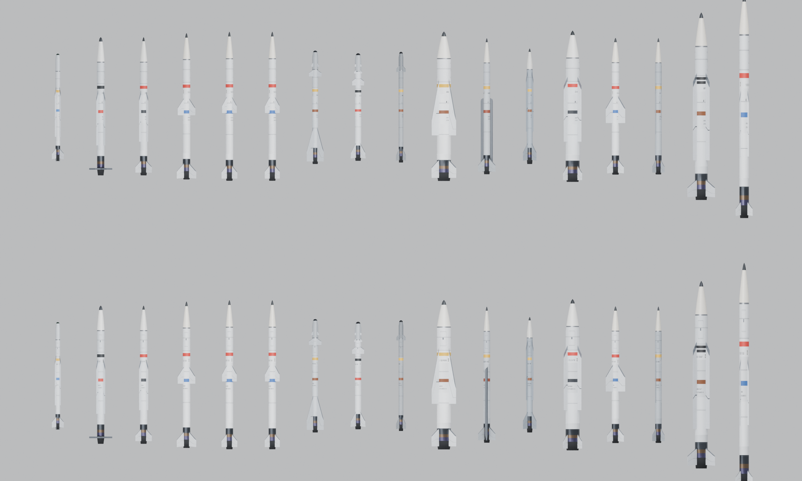 |  |
| 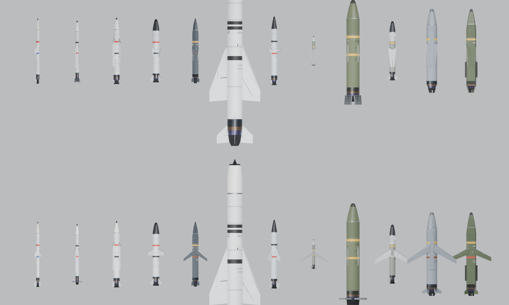 | 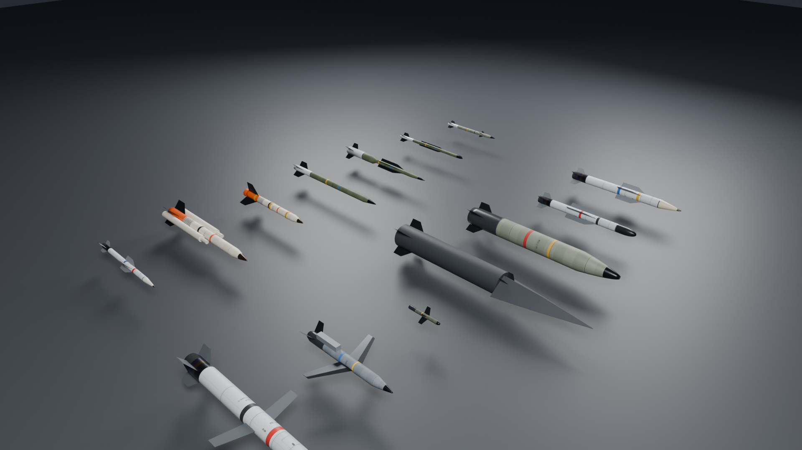 |

## Installation & Vérification

```powershell
.\sync_to_saved_games.ps1
python tools\verify_mod.py
```

- Copier vers `%USERPROFILE%\Saved Games\DCS\Mods\tech\NextGen_BVR_Armory` (mod non destructif : les fichiers d'origine de DCS World ne sont jamais modifiés).
- Polaires aérodynamiques calibrées par Mach dans [`mod/Database/polar_profiles.lua`](mod/Database/polar_profiles.lua).

