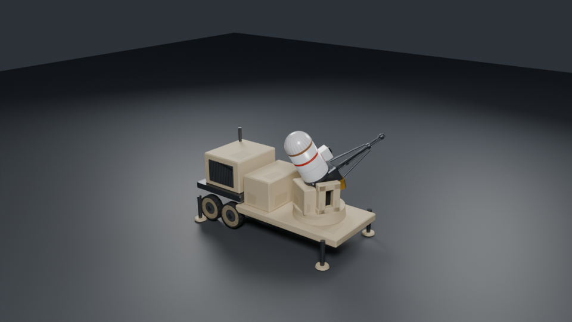

# Centurion C-RAM Phalanx CIWS (NextGen)

> Retour : [Catalogue Général](../CATALOG.md) · [Accueil Mod](../../README.md)  
> Catégorie : **Défense Anti-Aérienne & C-RAM** · Source : `mod/Database/units_air_defense.lua`

## Fiche Unité Sol-Air

| Paramètre | Valeur |
|---|---|
| **ID Unité** | `NG_CRAM_Centurion` |
| **Nom Court Carte** | `C-RAM` |
| **Modèle 3D (`.edm`)** | [`ng_cram_centurion.edm`](../../mod/Shapes/ng_cram_centurion.edm) |
| **Tags DCS** | `Air Defence, SP AAA` |
| **Portée Détection Radar** | `14 km` |
| **Portée d'Engagement** | `2 km` (min `50 m`) |
| **Plafond d'Interception** | `4 km` |
| **Vitesse Route Max** | `0 km/h` |
| **Capteur Radar (`GT.Sensors`)** | `C_RAM_Phalanx` |
| **Munition Embarquée** | `20mm M246 HE-IT C-RAM` |
| **Capacité Chargeur** | `1550` coups/missiles |
| **Temps de Réaction** | `0.25 s` |
| **Cadence / Délai Tir** | `0.0133 s` · Rechargement `120 s` |
| **Dépendance / Chaînage** | `Autonomous` |

## Animations & Connecteurs EDM

- `DrawArg 0` : Azimut tourelle 360° (`CENTER_TOWER`)
- `DrawArg 1` : Élévation berceau `-15° / +85°`
- `DrawArg 23` : Rotation continue du canon rotatif M61A1 6 tubes 20mm (`POINT_GUN_01`)
