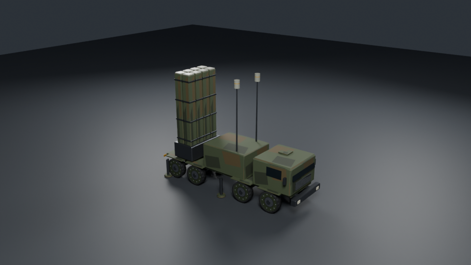

# IRIS-T SLM 8-Cell VLS Truck (NextGen)

> Retour : [Catalogue Général](../CATALOG.md) · [Accueil Mod](../../README.md)  
> Catégorie : **Défense Anti-Aérienne & C-RAM** · Source : `mod/Database/units_air_defense.lua`

## Fiche Unité Sol-Air

| Paramètre | Valeur |
|---|---|
| **ID Unité** | `NG_IRIST_SLM_Launcher` |
| **Nom Court Carte** | `IRIS-TSLM` |
| **Modèle 3D (`.edm`)** | [`ng_irist_slm_ln.edm`](../../mod/Shapes/ng_irist_slm_ln.edm) |
| **Tags DCS** | `Air Defence, SAM SHORAD` |
| **Portée Détection Radar** | `60 km` |
| **Portée d'Engagement** | `45 km` (min `400 m`) |
| **Plafond d'Interception** | `20 km` |
| **Vitesse Route Max** | `70 km/h` |
| **Capteur Radar (`GT.Sensors`)** | `Tor 9A331` |
| **Munition Embarquée** | [`NG_SAM_IRIST_SLM`](../missiles/NG_SAM_IRIST_SLM.md) (IRIS-T SLM Interceptor (NextGen)) |
| **Capacité Chargeur** | `8` coups/missiles |
| **Temps de Réaction** | `1.2 s` |
| **Cadence / Délai Tir** | `0.6 s` · Rechargement `480 s` |
| **Dépendance / Chaînage** | `{ { "self", 1 } }, { { "self", 2 } }, { { "self", 3 } }, { { "NG_TRML_4D_Radar" } }` |

## Animations & Connecteurs EDM

- Connecteurs verticaux / inclinés `CENTER_TOWER`, `POINT_SIGHT_01` et `POINT_MISSILE_01..08`
