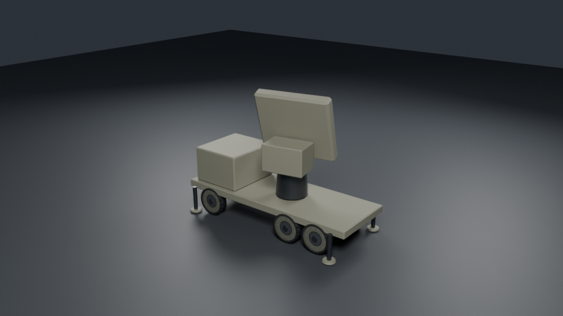

# EL/M-2084 MMR Iron Dome Radar (NextGen)

> Retour : [Catalogue Général](../CATALOG.md) · [Accueil Mod](../../README.md)  
> Catégorie : **Défense Anti-Aérienne & C-RAM** · Source : `mod/Database/units_air_defense.lua`

## Fiche Unité Sol-Air

| Paramètre | Valeur |
|---|---|
| **ID Unité** | `NG_IronDome_ELM2084` |
| **Nom Court Carte** | `ELM-2084` |
| **Modèle 3D (`.edm`)** | [`ng_iron_dome_radar.edm`](../../mod/Shapes/ng_iron_dome_radar.edm) |
| **Tags DCS** | `Air Defence, SAM SR` |
| **Portée Détection Radar** | `250 km` |
| **Portée d'Engagement** | `0 m` (min `0 m`) |
| **Plafond d'Interception** | `40 km` |
| **Vitesse Route Max** | `65 km/h` |
| **Capteur Radar (`GT.Sensors`)** | `NASAMS_Radar_MPQ64F1` |
| **Munition Embarquée** | `N/A` |
| **Capacité Chargeur** | `0` coups/missiles |
| **Temps de Réaction** | `1.0 s` |
| **Cadence / Délai Tir** | `0.0 s` · Rechargement `0 s` |
| **Dépendance / Chaînage** | `Autonomous` |

## Animations & Connecteurs EDM

- `DrawArg 11` : Rotation continue à 360° de l'antenne radar AESA
