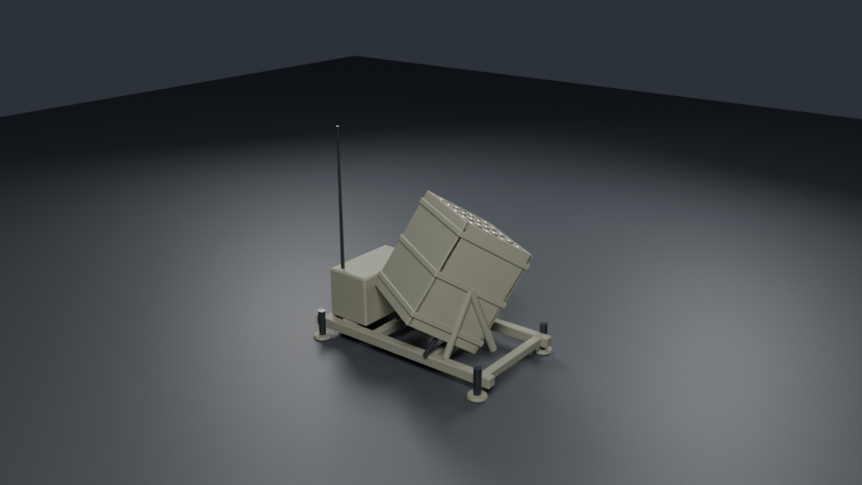

# Iron Dome 20-Cell Tamir Launcher (NextGen)

> Retour : [Catalogue Général](../CATALOG.md) · [Accueil Mod](../../README.md)  
> Catégorie : **Défense Anti-Aérienne & C-RAM** · Source : `mod/Database/units_air_defense.lua`

## Fiche Unité Sol-Air

| Paramètre | Valeur |
|---|---|
| **ID Unité** | `NG_IronDome_Launcher` |
| **Nom Court Carte** | `IronDome` |
| **Modèle 3D (`.edm`)** | [`ng_iron_dome_ln.edm`](../../mod/Shapes/ng_iron_dome_ln.edm) |
| **Tags DCS** | `Air Defence, SAM SHORAD` |
| **Portée Détection Radar** | `75 km` |
| **Portée d'Engagement** | `70 km` (min `400 m`) |
| **Plafond d'Interception** | `15 km` |
| **Vitesse Route Max** | `0 km/h` |
| **Capteur Radar (`GT.Sensors`)** | `Tor 9A331` |
| **Munition Embarquée** | [`NG_SAM_TAMIR`](../missiles/NG_SAM_TAMIR.md) (Tamir Iron Dome Interceptor (NG)) |
| **Capacité Chargeur** | `20` coups/missiles |
| **Temps de Réaction** | `1.0 s` |
| **Cadence / Délai Tir** | `0.45 s` · Rechargement `600 s` |
| **Dépendance / Chaînage** | `{ { "self", 1 } }, { { "self", 2 } }, { { "self", 3 } }, { { "self", 4 } }, { { "NG_IronDome_ELM2084" } }` |

## Animations & Connecteurs EDM

- `DrawArg 0` : Azimut du lanceur 360° (`CENTER_TOWER`) + connecteurs `POINT_MISSILE_01..20`
