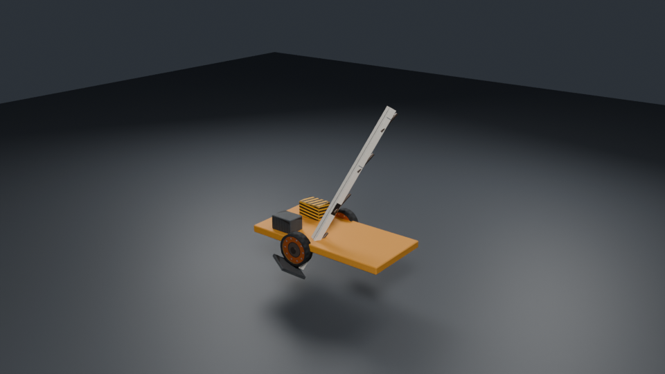

# KEKA Aerospace Troposphere Pad (Troll SAM!)

> Retour : [Catalogue Général](../CATALOG.md) · [Accueil Mod](../../README.md)  
> Catégorie : **Défense Anti-Aérienne & C-RAM** · Source : `mod/Database/units_air_defense.lua`

## Fiche Unité Sol-Air

| Paramètre | Valeur |
|---|---|
| **ID Unité** | `NG_KEKA_LaunchPad` |
| **Nom Court Carte** | `KEKA-Pad` |
| **Modèle 3D (`.edm`)** | [`ng_keka_launcher.edm`](../../mod/Shapes/ng_keka_launcher.edm) |
| **Tags DCS** | `Air Defence, SAM SHORAD` |
| **Portée Détection Radar** | `80 km` |
| **Portée d'Engagement** | `95 km` (min `600 m`) |
| **Plafond d'Interception** | `35 km` |
| **Vitesse Route Max** | `35 km/h` |
| **Capteur Radar (`GT.Sensors`)** | `Tor 9A331` |
| **Munition Embarquée** | [`NG_SAM_KEKA_T6`](../missiles/NG_SAM_KEKA_T6.md) (KEKA Troposphere-6 Booster (Troll!)) |
| **Capacité Chargeur** | `4` coups/missiles |
| **Temps de Réaction** | `2.2 s` |
| **Cadence / Délai Tir** | `1.5 s` · Rechargement `12 s` |
| **Dépendance / Chaînage** | `{ { "self", 1 } }` |

## Animations & Connecteurs EDM

- `DrawArg 0` : Azimut du lanceur 360° (`CENTER_TOWER`) + connecteurs `POINT_MISSILE_01..20`
