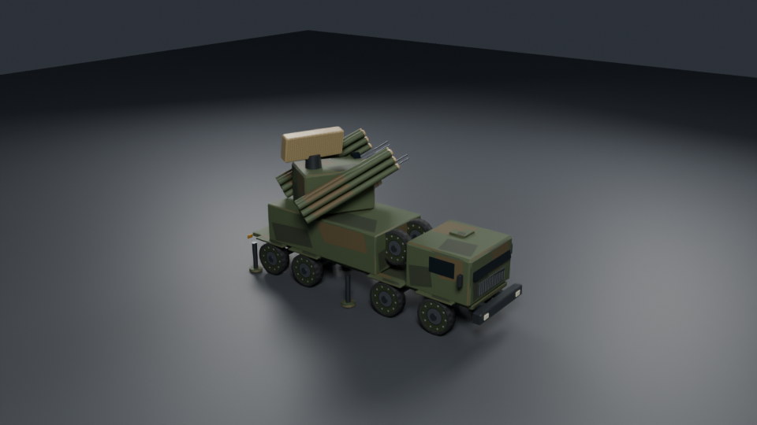

# Pantsir-SM 96K6 SPAAGM (NextGen)

> Retour : [Catalogue Général](../CATALOG.md) · [Accueil Mod](../../README.md)  
> Catégorie : **Défense Anti-Aérienne & C-RAM** · Source : `mod/Database/units_air_defense.lua`

## Fiche Unité Sol-Air

| Paramètre | Valeur |
|---|---|
| **ID Unité** | `NG_Pantsir_SM` |
| **Nom Court Carte** | `PantsirSM` |
| **Modèle 3D (`.edm`)** | [`ng_pantsir_sm.edm`](../../mod/Shapes/ng_pantsir_sm.edm) |
| **Tags DCS** | `Air Defence, SAM SHORAD` |
| **Portée Détection Radar** | `45 km` |
| **Portée d'Engagement** | `32 km` (min `200 m`) |
| **Plafond d'Interception** | `18 km` |
| **Vitesse Route Max** | `75 km/h` |
| **Capteur Radar (`GT.Sensors`)** | `Tor 9A331` |
| **Munition Embarquée** | [`NG_SAM_57E6M`](../missiles/NG_SAM_57E6M.md) (57E6M Pantsir-SM HyperSAM (NG)) |
| **Capacité Chargeur** | `12` coups/missiles |
| **Temps de Réaction** | `1.0 s` |
| **Cadence / Délai Tir** | `0.5 s` · Rechargement `600 s` |
| **Dépendance / Chaînage** | `{ { "self", 1 } }, { { "self", 2 } }` |

## Animations & Connecteurs EDM

- `DrawArg 0` : Azimut tourelle 360° (`CENTER_TOWER`)
- `DrawArg 1` : Élévation 12x tubes 57E6M + bi-tubes 30mm 2A38M
- `DrawArg 11` : Radar de veille Janus rotatif
