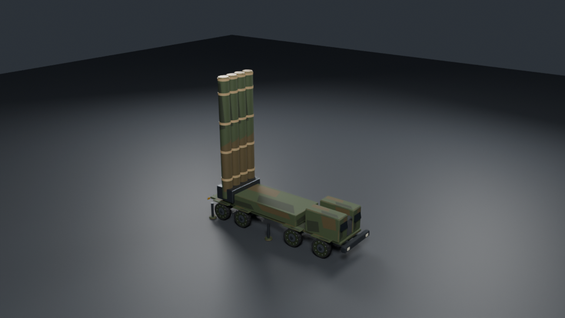

# S-400 Triumf 5P85SM2 40N6 TEL (NextGen)

> Retour : [Catalogue Général](../CATALOG.md) · [Accueil Mod](../../README.md)  
> Catégorie : **Défense Anti-Aérienne & C-RAM** · Source : `mod/Database/units_air_defense.lua`

## Fiche Unité Sol-Air

| Paramètre | Valeur |
|---|---|
| **ID Unité** | `NG_S400_TEL` |
| **Nom Court Carte** | `S-400-TEL` |
| **Modèle 3D (`.edm`)** | [`ng_s400_tel.edm`](../../mod/Shapes/ng_s400_tel.edm) |
| **Tags DCS** | `Air Defence, SAM` |
| **Portée Détection Radar** | `400 km` |
| **Portée d'Engagement** | `380 km` (min `5 km`) |
| **Plafond d'Interception** | `35 km` |
| **Vitesse Route Max** | `60 km/h` |
| **Capteur Radar (`GT.Sensors`)** | `Tor 9A331` |
| **Munition Embarquée** | [`NG_SAM_40N6`](../missiles/NG_SAM_40N6.md) (S-400 40N6 Ultra-Long ABM (NG)) |
| **Capacité Chargeur** | `4` coups/missiles |
| **Temps de Réaction** | `2.0 s` |
| **Cadence / Délai Tir** | `1.2 s` · Rechargement `1400 s` |
| **Dépendance / Chaînage** | `{ { "self", 1 } }, { { "self", 2 } }, { { "self", 3 } }, { { "self", 4 } }` |

## Animations & Connecteurs EDM

- Connecteurs verticaux / inclinés `CENTER_TOWER`, `POINT_SIGHT_01` et `POINT_MISSILE_01..08`
