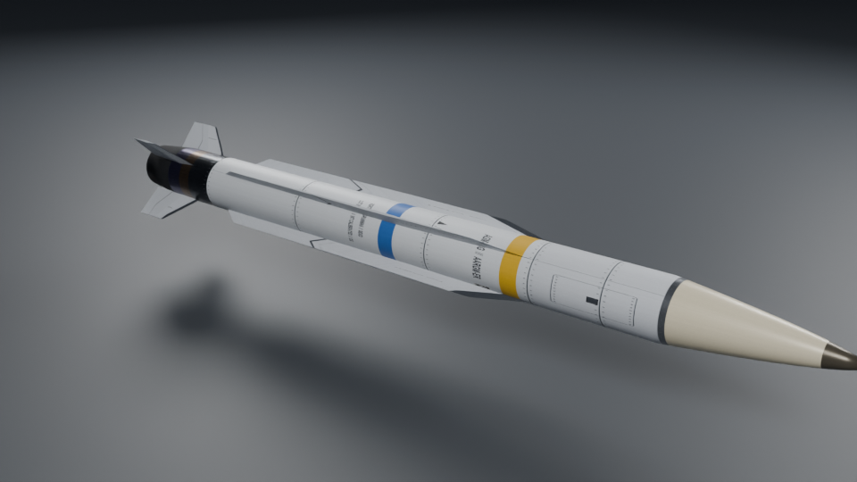

# AGM-88G AARGM-ER (NextGen)

> [Catalogue Général](../CATALOG.md) · [Accueil Mod](../../README.md) · ← [NG_YJ_18A](NG_YJ_18A.md) · [NG_AGM_88E_AARGM](NG_AGM_88E_AARGM.md) →  
> Catégorie : **SEAD / Anti-Radar & Powered Precision** · Fichier source : `mod/Database/weapons_arsenal_ag.lua`

## Fiche Technique

| Paramètre | Valeur |
|---|---|
| **ID Interne** | `NG_AARGM_ER` |
| **CLSID Pylône** | `{NEXTGEN_AARGM_ER}` |
| **Nom Court HUD / RWR** | `AARGM-ER` |
| **Modèle 3D (`.edm`)** | [`ng_aargm_er.edm`](../../mod/Shapes/ng_aargm_er.edm) |
| **Calibre / Diamètre** | `0.292 m` (`292 mm`) |
| **Longueur** | `4.17 m` |
| **Masse au Lancement** | `467.0 kg` |
| **Mach Max** | `Mach 4.0` |
| **Portée Max** | `280 km` |
| **Charge Militaire** | `70.0 kg` |
| **Facteur de Charge Max (`Nr_max`)** | `40 G` |
| **Guidage / Autodirecteur** | Radar Actif / Multi-Mode / INS+GPS (`Head_Type = 2` / Croisière) |
| **Propulsion** | Single/Sustained (175.0 kg fuel, Burn: 22.0s, Isp: 255s) |
| **Résistance ECM (`ccm_k0`)** | `0.03` |
| **Temps de Vie Max** | `140 s` |

## Polaire Aérodynamique & Modèle de Vol

- **Profil utilisé** : `FM_AAM_ULTRA` — **Slender Ultra-Long-Range Supersonic / Ramjet Polar**
- **Détails physiques ([`polar_profiles.lua`](../../mod/Database/polar_profiles.lua))** : Low wave-drag supersonic/ramjet envelope (`Cx0 = 0.38 @ M0 -> 0.74 @ M1.2 -> 0.232 @ M5.0`, sustained low drag above Mach 3).

| Mach | M0.0 | M0.8 | M1.2 | M2.0 | M3.0 | M4.0 | M5.0 |
|---|---|---|---|---|---|---|---|
| **Traînée `Cx0`** | `0.380` | `0.420` | `0.740` | `0.510` | `0.340` | `0.265` | `0.232` |

## Animations & Modèle 3D

- Corps monobloc rigide `+X Forward` sans surface mobile repliable.
