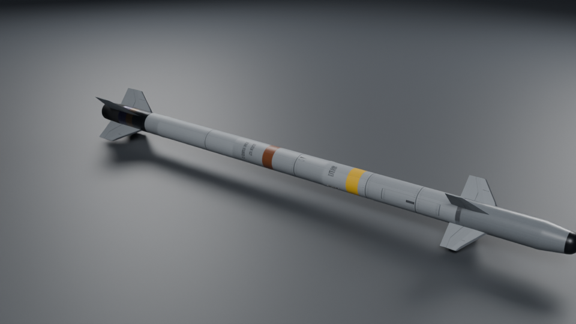

# AIM-9X Block III LOAL (NextGen)

> [Catalogue Général](../CATALOG.md) · [Accueil Mod](../../README.md) · ← [NG_PYTHON_5](NG_PYTHON_5.md) · [NG_PEREGRINE](NG_PEREGRINE.md) →  
> Catégorie : **Air-to-Air WVR & HOBS** · Fichier source : `mod/Database/weapons_arsenal_ag.lua`

## Fiche Technique

| Paramètre | Valeur |
|---|---|
| **ID Interne** | `NG_AIM_9X_BLK3` |
| **CLSID Pylône** | `{NEXTGEN_AIM_9X_BLK3}` |
| **Nom Court HUD / RWR** | `AIM-9X3` |
| **Modèle 3D (`.edm`)** | [`ng_aim9x_b3.edm`](../../mod/Shapes/ng_aim9x_b3.edm) |
| **Calibre / Diamètre** | `0.127 m` (`127 mm`) |
| **Longueur** | `3.02 m` |
| **Masse au Lancement** | `88.0 kg` |
| **Mach Max** | `Mach 3.4` |
| **Portée Max** | `45 km` |
| **Charge Militaire** | `10.0 kg` |
| **Facteur de Charge Max (`Nr_max`)** | `40 G` |
| **Guidage / Autodirecteur** | IIR / Infra-Rouge Passif (`Head_Type = 1`) |
| **Propulsion** | Single/Sustained (31.0 kg fuel, Burn: 5.5s, Isp: 245s) |
| **Résistance ECM (`ccm_k0`)** | `0.03` |
| **Temps de Vie Max** | `80 s` |

## Polaire Aérodynamique & Modèle de Vol

- **Profil utilisé** : `FM_AAM_WVR` — **High-Alpha HOBS Dogfight Polar**
- **Détails physiques ([`polar_profiles.lua`](../../mod/Database/polar_profiles.lua))** : High-lift / thrust-vectoring dogfight curve (`Cya = 0.62..0.92`, low pitch/yaw inertia `Iy=68`, high roll rate `Mxd=14`).

| Mach | M0.0 | M0.8 | M1.2 | M2.0 | M3.0 | M4.0 | M5.0 |
|---|---|---|---|---|---|---|---|
| **Traînée `Cx0`** | `0.420` | `0.500` | `0.960` | `0.750` | `0.580` | `0.480` | `0.420` |

## Animations & Modèle 3D

- Corps monobloc rigide `+X Forward` sans surface mobile repliable.
