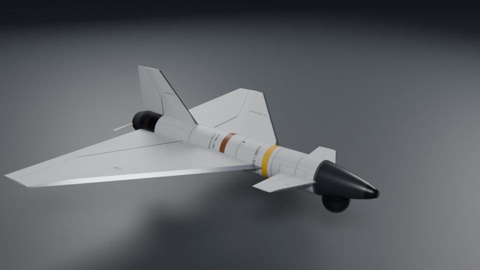

# Anduril ALTIUS-700M Loiter (NG)

> Retour : [Catalogue Général](../CATALOG.md) · [Accueil Mod](../../README.md)  
> Catégorie : **Loitering Munitions & One-Way Drones** · Fichier source : `mod/Database/weapons_arsenal_ag.lua`

## Fiche Technique

| Paramètre | Valeur |
|---|---|
| **ID Interne** | `NG_ALTIUS_700M` |
| **CLSID Pylône** | `{NEXTGEN_ALTIUS_700M}` |
| **Nom Court HUD / RWR** | `ALTIUS7` |
| **Modèle 3D (`.edm`)** | [`ng_harop.edm`](../../mod/Shapes/ng_harop.edm) |
| **Calibre / Diamètre** | `0.200 m` (`200 mm`) |
| **Longueur** | `2.10 m` |
| **Masse au Lancement** | `30.0 kg` |
| **Mach Max** | `Mach 0.3` |
| **Portée Max** | `160 km` |
| **Charge Militaire** | `15.0 kg` |
| **Facteur de Charge Max (`Nr_max`)** | `40 G` |
| **Guidage / Autodirecteur** | Radar Actif / Multi-Mode / INS+GPS (`Head_Type = 2` / Croisière) |
| **Propulsion** | Single/Sustained (9.0 kg fuel, Burn: 1600.0s, Isp: 2800s) |
| **Résistance ECM (`ccm_k0`)** | `0.03` |
| **Temps de Vie Max** | `1800 s` |

## Polaire Aérodynamique & Modèle de Vol

- **Profil utilisé** : `FM_LOITER_DRONE` — **Subsonic Loitering Prop / Jet Drone Polar**
- **Détails physiques (`polar_profiles.lua`)** : Ultra-low cruise drag (`Cx0 = 0.020`, `Sw = 1.15`, `dCydA = {0.08, 0.042}`) for long-endurance loitering munitions.

## Animations & Modèle 3D

- `DrawArg 407` — Rotation continue de l'hélice propulsive
