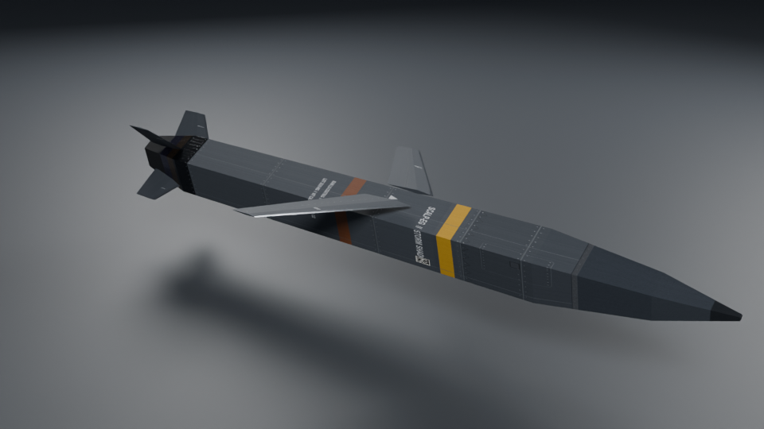

# Blue Spear 5G Sea-Skimmer (NG)

> [Catalogue Général](../CATALOG.md) · [Accueil Mod](../../README.md) · ← [NG_PENGUIN_MK3](NG_PENGUIN_MK3.md) · [NG_MAM_L](NG_MAM_L.md) →  
> Catégorie : **Anti-Ship Missiles (AShM)** · Fichier source : `mod/Database/weapons_tactical_30.lua`

## Fiche Technique

| Paramètre | Valeur |
|---|---|
| **ID Interne** | `NG_BLUE_SPEAR` |
| **CLSID Pylône** | `{NEXTGEN_BLUE_SPEAR}` |
| **Nom Court HUD / RWR** | `BlueSpr` |
| **Modèle 3D (`.edm`)** | [`ng_nsm_jsm.edm`](../../mod/Shapes/ng_nsm_jsm.edm) |
| **Calibre / Diamètre** | `0.380 m` (`380 mm`) |
| **Longueur** | `5.00 m` |
| **Masse au Lancement** | `950.0 kg` |
| **Mach Max** | `Mach 0.94` |
| **Portée Max** | `290 km` |
| **Charge Militaire** | `200.0 kg` |
| **Facteur de Charge Max (`Nr_max`)** | `40 G` |
| **Guidage / Autodirecteur** | Radar Actif / Multi-Mode / INS+GPS (`Head_Type = 2` / Croisière) |
| **Propulsion** | Single/Sustained (260.0 kg fuel, Burn: 950.0s, Isp: 2900s) |
| **Résistance ECM (`ccm_k0`)** | `0.03` |
| **Temps de Vie Max** | `1500 s` |

## Polaire Aérodynamique & Modèle de Vol

- **Profil utilisé** : `FM_CRUISE_STEALTH` — **AGM-84H / Kh-101 Subsonic Stealth Cruise Polar**
- **Détails physiques ([`polar_profiles.lua`](../../mod/Database/polar_profiles.lua))** : High L/D folded-wing turbofan cruise curve (`Cx0 = 0.023` subsonic cruise, `Sw = 1.35`, `addDeplSw = 0.80`, `wingsDeplDelay = 1.0s`, `wingsDeplProcTime = 2.5s`).

| Mach | M0.0 | M0.5 | M0.8 | M1.0 | M1.4 | M2.0 |
|---|---|---|---|---|---|---|
| **Traînée `Cx0`** | `0.023` | `0.023` | `0.035` | `0.450` | `0.290` | `0.245` |

## Animations & Modèle 3D

- `DrawArg 25` — Ailes / empennages repliés sur pylône (`0.0`) -> déployés en vol (`1.0`)
