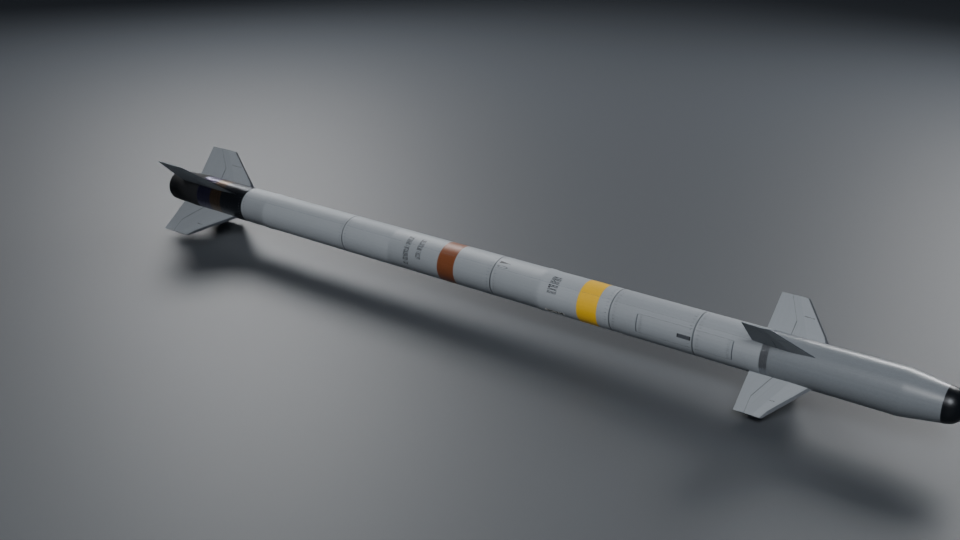

# TUBITAK Bozdogan WVR (NextGen)

> Retour : [Catalogue Général](../CATALOG.md) · [Accueil Mod](../../README.md)  
> Catégorie : **Air-to-Air WVR & HOBS** · Fichier source : `mod/Database/weapons_nextgen.lua`

## Fiche Technique

| Paramètre | Valeur |
|---|---|
| **ID Interne** | `NG_BOZDOGAN` |
| **CLSID Pylône** | `{NEXTGEN_BOZDOGAN}` |
| **Nom Court HUD / RWR** | `Bozdogan` |
| **Modèle 3D (`.edm`)** | [`ng_aim9x_b3.edm`](../../mod/Shapes/ng_aim9x_b3.edm) |
| **Calibre / Diamètre** | `0.160 m` (`160 mm`) |
| **Longueur** | `3.00 m` |
| **Masse au Lancement** | `102.0 kg` |
| **Mach Max** | `Mach 3.8` |
| **Portée Max** | `30 km` |
| **Charge Militaire** | `11.0 kg` |
| **Facteur de Charge Max (`Nr_max`)** | `55 G` |
| **Guidage / Autodirecteur** | IIR / Infra-Rouge Passif (`Head_Type = 1`) |
| **Propulsion** | Single/Sustained (34.0 kg fuel, Burn: 5.0s, Isp: 246s) |
| **Résistance ECM (`ccm_k0`)** | `0.03` |
| **Temps de Vie Max** | `70 s` |

## Polaire Aérodynamique & Modèle de Vol

- **Profil utilisé** : `FM_AAM_WVR` — **High-Alpha HOBS Dogfight Polar**
- **Détails physiques (`polar_profiles.lua`)** : High-lift / thrust-vectoring dogfight curve (`Cya = 0.62..0.92`, low pitch/yaw inertia `Iy=68`, high roll rate `Mxd=14`).

## Animations & Modèle 3D

- Corps monobloc rigide `+X Forward` sans surface mobile repliable.
