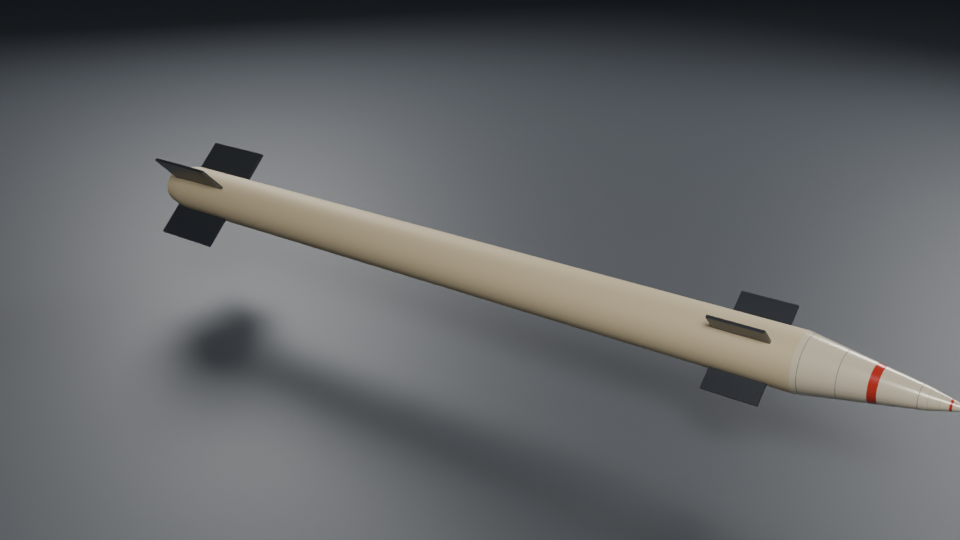

# ER-GMLRS 150km Precision Rocket

> Retour : [Catalogue Général](../CATALOG.md) · [Accueil Mod](../../README.md)  
> Catégorie : **Ballistic, MRBM, ALBM & Precision Artillery** · Fichier source : `mod/Database/weapons_arsenal_ag.lua`

## Fiche Technique

| Paramètre | Valeur |
|---|---|
| **ID Interne** | `NG_ER_GMLRS` |
| **CLSID Pylône** | `{NEXTGEN_ER_GMLRS}` |
| **Nom Court HUD / RWR** | `ER-GMLRS` |
| **Modèle 3D (`.edm`)** | [`ng_gmlrs_m31.edm`](../../mod/Shapes/ng_gmlrs_m31.edm) |
| **Calibre / Diamètre** | `0.254 m` (`254 mm`) |
| **Longueur** | `4.10 m` |
| **Masse au Lancement** | `360.0 kg` |
| **Mach Max** | `Mach 3.2` |
| **Portée Max** | `150 km` |
| **Charge Militaire** | `91.0 kg` |
| **Facteur de Charge Max (`Nr_max`)** | `40 G` |
| **Guidage / Autodirecteur** | Radar Actif / Multi-Mode / INS+GPS (`Head_Type = 2` / Croisière) |
| **Propulsion** | Single/Sustained (135.0 kg fuel, Burn: 11.0s, Isp: 255s) |
| **Résistance ECM (`ccm_k0`)** | `0.03` |
| **Temps de Vie Max** | `140 s` |

## Polaire Aérodynamique & Modèle de Vol

- **Profil utilisé** : `FM_HYPERSONIC` — **9M723 Iskander / Kinzhal / DF-17 Hypersonic Polar**
- **Détails physiques (`polar_profiles.lua`)** : Ultra-low hypersonic drag curve (`Cx0 = 0.36 @ M0 -> 0.52 @ M1.0 -> 0.118 @ M5.0`, `Iy = 3800`) for quasi-ballistic and ABM trajectories.

## Animations & Modèle 3D

- Corps monobloc rigide `+X Forward` sans surface mobile repliable.

## Emports Multi-Racks Compatibles
- `{NEXTGEN_GMLRS_6X}` — **6x ER-GMLRS Air-Launched Pod (NextGen)** (`6x`)
