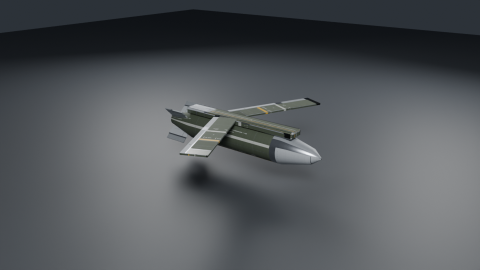

# FAB-1500 M-54 UMPK Glide (NextGen)

> Retour : [Catalogue Général](../CATALOG.md) · [Accueil Mod](../../README.md)  
> Catégorie : **Smart Glide Bombs, PAB & UMPK** · Fichier source : `mod/Database/weapons_tactical_30.lua`

## Fiche Technique

| Paramètre | Valeur |
|---|---|
| **ID Interne** | `NG_FAB_1500_UMPK` |
| **CLSID Pylône** | `{NEXTGEN_FAB_1500_UMPK}` |
| **Nom Court HUD / RWR** | `FAB1500G` |
| **Modèle 3D (`.edm`)** | [`ng_heavy_umpk.edm`](../../mod/Shapes/ng_heavy_umpk.edm) |
| **Calibre / Diamètre** | `0.630 m` (`630 mm`) |
| **Longueur** | `2.80 m` |
| **Masse au Lancement** | `1550.0 kg` |
| **Mach Max** | `Mach 0.95` |
| **Portée Max** | `75 km` |
| **Charge Militaire** | `675.0 kg` |
| **Facteur de Charge Max (`Nr_max`)** | `40 G` |
| **Guidage / Autodirecteur** | Radar Actif / Multi-Mode / INS+GPS (`Head_Type = 2` / Croisière) |
| **Propulsion** | Single/Sustained (5.0 kg fuel, Burn: 300.0s, Isp: 1800s) |
| **Résistance ECM (`ccm_k0`)** | `0.03` |
| **Temps de Vie Max** | `140 s` |

## Polaire Aérodynamique & Modèle de Vol

- **Profil utilisé** : `FM_GLIDE_BOMB` — **LS-6-500 / JSOW High-L/D Folding Glide Polar**
- **Détails physiques (`polar_profiles.lua`)** : Long-range folding-wing glide polar (`Cx0 = 0.028` subsonic, `Sw = 0.65`, `addDeplSw = 0.85`, `maxAoa = 0.32`).

## Animations & Modèle 3D

- `DrawArg 25` — Ailes / empennages repliés sur pylône (`0.0`) -> déployés en vol (`1.0`)
