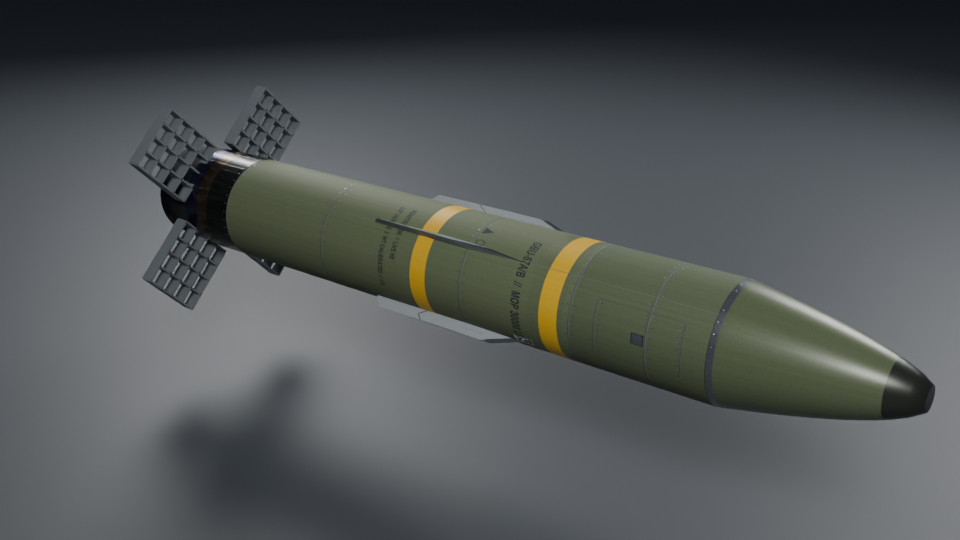

# GBU-57A/B MOP 30,000lb Bunker (NG)

> Retour : [Catalogue Général](../CATALOG.md) · [Accueil Mod](../../README.md)  
> Catégorie : **Smart Glide Bombs, PAB & UMPK** · Fichier source : `mod/Database/weapons_arsenal_ag.lua`

## Fiche Technique

| Paramètre | Valeur |
|---|---|
| **ID Interne** | `NG_GBU_57A_MOP` |
| **CLSID Pylône** | `{NEXTGEN_GBU57A_MOP}` |
| **Nom Court HUD / RWR** | `GBU-57` |
| **Modèle 3D (`.edm`)** | [`ng_gbu57_mop.edm`](../../mod/Shapes/ng_gbu57_mop.edm) |
| **Calibre / Diamètre** | `0.800 m` (`800 mm`) |
| **Longueur** | `6.20 m` |
| **Masse au Lancement** | `13600.0 kg` |
| **Mach Max** | `Mach 1.2` |
| **Portée Max** | `45 km` |
| **Charge Militaire** | `2400.0 kg` |
| **Facteur de Charge Max (`Nr_max`)** | `40 G` |
| **Guidage / Autodirecteur** | Radar Actif / Multi-Mode / INS+GPS (`Head_Type = 2` / Croisière) |
| **Propulsion** | Single/Sustained (2.0 kg fuel, Burn: 180.0s, Isp: 1800s) |
| **Résistance ECM (`ccm_k0`)** | `0.03` |
| **Temps de Vie Max** | `140 s` |

## Polaire Aérodynamique & Modèle de Vol

- **Profil utilisé** : `FM_GLIDE_BOMB` — **LS-6-500 / JSOW High-L/D Folding Glide Polar**
- **Détails physiques (`polar_profiles.lua`)** : Long-range folding-wing glide polar (`Cx0 = 0.028` subsonic, `Sw = 0.65`, `addDeplSw = 0.85`, `maxAoa = 0.32`).

## Animations & Modèle 3D

- `DrawArg 25` — Ailes / empennages repliés sur pylône (`0.0`) -> déployés en vol (`1.0`)
