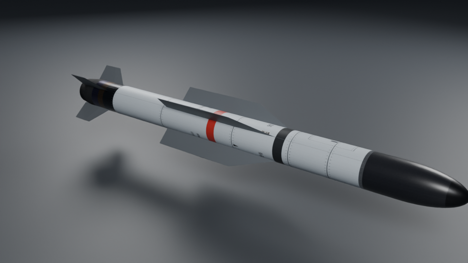

# Grom-E1 Powered Glide-ASM (NextGen)

> Retour : [Catalogue Général](../CATALOG.md) · [Accueil Mod](../../README.md)  
> Catégorie : **ATGM, Guided Rockets & Tactical ASM** · Fichier source : `mod/Database/weapons_tactical_30.lua`

## Fiche Technique

| Paramètre | Valeur |
|---|---|
| **ID Interne** | `NG_GROM_E1` |
| **CLSID Pylône** | `{NEXTGEN_GROM_E1}` |
| **Nom Court HUD / RWR** | `Grom-E1` |
| **Modèle 3D (`.edm`)** | [`ng_kh38_grom.edm`](../../mod/Shapes/ng_kh38_grom.edm) |
| **Calibre / Diamètre** | `0.310 m` (`310 mm`) |
| **Longueur** | `4.20 m` |
| **Masse au Lancement** | `594.0 kg` |
| **Mach Max** | `Mach 1.6` |
| **Portée Max** | `120 km` |
| **Charge Militaire** | `315.0 kg` |
| **Facteur de Charge Max (`Nr_max`)** | `40 G` |
| **Guidage / Autodirecteur** | Radar Actif / Multi-Mode / INS+GPS (`Head_Type = 2` / Croisière) |
| **Propulsion** | Single/Sustained (160.0 kg fuel, Burn: 22.0s, Isp: 255s) |
| **Résistance ECM (`ccm_k0`)** | `0.03` |
| **Temps de Vie Max** | `140 s` |

## Polaire Aérodynamique & Modèle de Vol

- **Profil utilisé** : `FM_AAM_BVR` — **AIM-120C / SD-10 Mach 0.0–5.0 Polar**
- **Détails physiques (`polar_profiles.lua`)** : Supersonic medium/BVR active-missile polar (`Cx0 = 0.468 @ M0 -> 0.880 @ M1.2 -> 0.364 @ M5.0`, `Cya = 0.318..0.518`, `delta_max = 0.349 rad`).

## Animations & Modèle 3D

- Corps monobloc rigide `+X Forward` sans surface mobile repliable.
