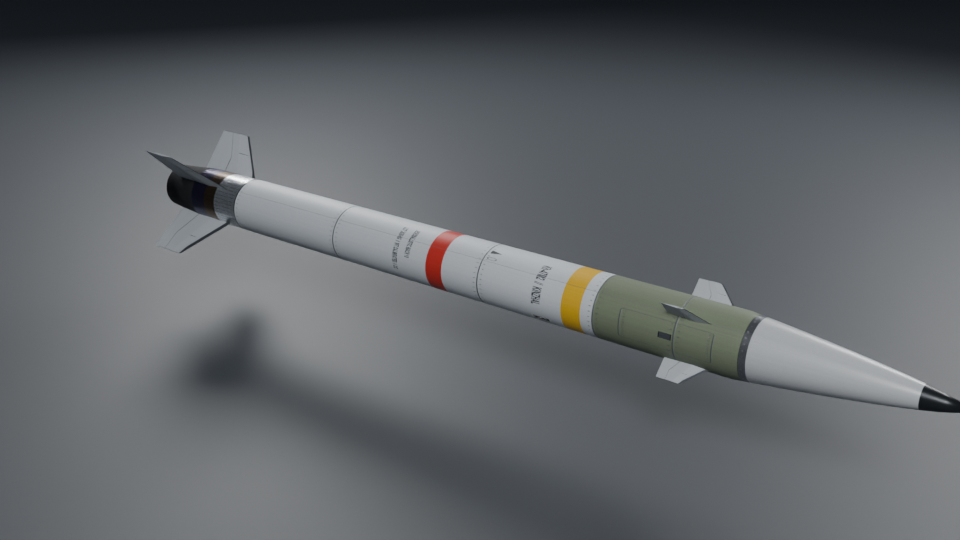

# IAI Rampage Aero-Ballistic (NG)

> [Catalogue Général](../CATALOG.md) · [Accueil Mod](../../README.md) · ← [NG_PRSM_INC1](NG_PRSM_INC1.md) · [NG_AIR_LORA](NG_AIR_LORA.md) →  
> Catégorie : **SEAD / Anti-Radar & Powered Precision** · Fichier source : `mod/Database/weapons_arsenal_ag.lua`

## Fiche Technique

| Paramètre | Valeur |
|---|---|
| **ID Interne** | `NG_IAI_RAMPAGE` |
| **CLSID Pylône** | `{NEXTGEN_IAI_RAMPAGE}` |
| **Nom Court HUD / RWR** | `Rampage` |
| **Modèle 3D (`.edm`)** | [`ng_rampage_lora.edm`](../../mod/Shapes/ng_rampage_lora.edm) |
| **Calibre / Diamètre** | `0.306 m` (`306 mm`) |
| **Longueur** | `4.70 m` |
| **Masse au Lancement** | `570.0 kg` |
| **Mach Max** | `Mach 4.2` |
| **Portée Max** | `250 km` |
| **Charge Militaire** | `150.0 kg` |
| **Facteur de Charge Max (`Nr_max`)** | `40 G` |
| **Guidage / Autodirecteur** | Radar Actif / Multi-Mode / INS+GPS (`Head_Type = 2` / Croisière) |
| **Propulsion** | Single/Sustained (240.0 kg fuel, Burn: 24.0s, Isp: 265s) |
| **Résistance ECM (`ccm_k0`)** | `0.03` |
| **Temps de Vie Max** | `140 s` |

## Polaire Aérodynamique & Modèle de Vol

- **Profil utilisé** : `FM_HYPERSONIC` — **9M723 Iskander / Kinzhal / DF-17 Hypersonic Polar**
- **Détails physiques ([`polar_profiles.lua`](../../mod/Database/polar_profiles.lua))** : Ultra-low hypersonic drag curve (`Cx0 = 0.36 @ M0 -> 0.52 @ M1.0 -> 0.118 @ M5.0`, `Iy = 3800`) for quasi-ballistic and ABM trajectories.

| Mach | M0.0 | M0.8 | M1.2 | M2.0 | M3.0 | M4.0 | M5.0 |
|---|---|---|---|---|---|---|---|
| **Traînée `Cx0`** | `0.360` | `0.370` | `0.510` | `0.310` | `0.188` | `0.140` | `0.118` |

## Animations & Modèle 3D

- Corps monobloc rigide `+X Forward` sans surface mobile repliable.
