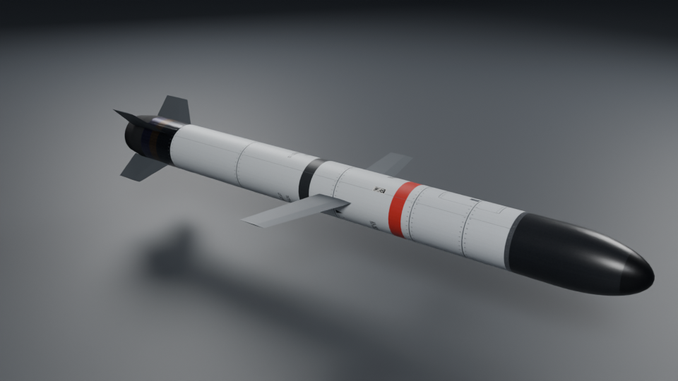

# 3M54 / 3M14 Kalibr Air-Launch (NG)

> Retour : [Catalogue Général](../CATALOG.md) · [Accueil Mod](../../README.md)  
> Catégorie : **Stealth Cruise & Stand-Off** · Fichier source : `mod/Database/weapons_arsenal_ag.lua`

## Fiche Technique

| Paramètre | Valeur |
|---|---|
| **ID Interne** | `NG_KALIBR_3M54` |
| **CLSID Pylône** | `{NEXTGEN_KALIBR_3M54}` |
| **Nom Court HUD / RWR** | `Kalibr` |
| **Modèle 3D (`.edm`)** | [`ng_kalibr_3m54.edm`](../../mod/Shapes/ng_kalibr_3m54.edm) |
| **Calibre / Diamètre** | `0.533 m` (`533 mm`) |
| **Longueur** | `6.20 m` |
| **Masse au Lancement** | `1570.0 kg` |
| **Mach Max** | `Mach 2.9` |
| **Portée Max** | `660 km` |
| **Charge Militaire** | `400.0 kg` |
| **Facteur de Charge Max (`Nr_max`)** | `40 G` |
| **Guidage / Autodirecteur** | Radar Actif / Multi-Mode / INS+GPS (`Head_Type = 2` / Croisière) |
| **Propulsion** | Single/Sustained (480.0 kg fuel, Burn: 1100.0s, Isp: 3100s) |
| **Résistance ECM (`ccm_k0`)** | `0.03` |
| **Temps de Vie Max** | `2000 s` |

## Polaire Aérodynamique & Modèle de Vol

- **Profil utilisé** : `FM_CRUISE_STEALTH` — **AGM-84H / Kh-101 Subsonic Stealth Cruise Polar**
- **Détails physiques (`polar_profiles.lua`)** : High L/D folded-wing turbofan cruise curve (`Cx0 = 0.023` subsonic cruise, `Sw = 1.35`, `addDeplSw = 0.80`, `wingsDeplDelay = 1.0s`, `wingsDeplProcTime = 2.5s`).

## Animations & Modèle 3D

- `DrawArg 25` — Ailes / empennages repliés sur pylône (`0.0`) -> déployés en vol (`1.0`)
