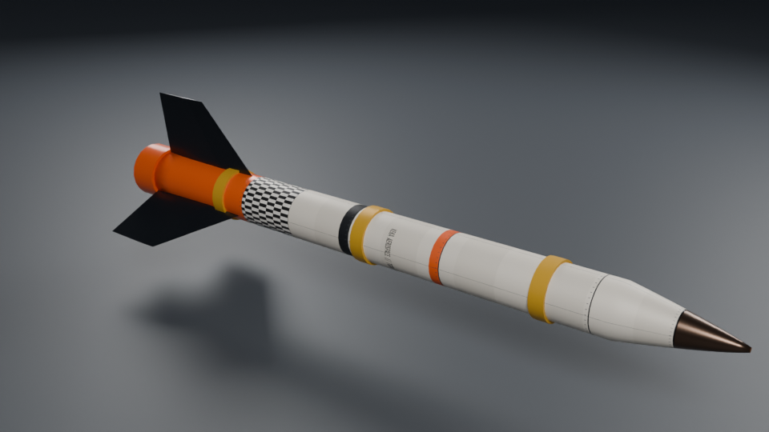

# KEKA Troposphere-5 Viral Cat (Troll!)

> [Catalogue Général](../CATALOG.md) · [Accueil Mod](../../README.md) · ← [NG_KEKA_TROPO4](NG_KEKA_TROPO4.md) · [NG_KEKA_TROPO6_AIR](NG_KEKA_TROPO6_AIR.md) →  
> Catégorie : **KEKA Aerospace Troll Payloads** · Fichier source : `mod/Database/weapons_arsenal_ag.lua`

## Fiche Technique

| Paramètre | Valeur |
|---|---|
| **ID Interne** | `NG_KEKA_TROPO5_AIR` |
| **CLSID Pylône** | `{NEXTGEN_KEKA_TROPO5_AIR}` |
| **Nom Court HUD / RWR** | `KEKA-T5` |
| **Modèle 3D (`.edm`)** | [`ng_keka_tropo5.edm`](../../mod/Shapes/ng_keka_tropo5.edm) |
| **Calibre / Diamètre** | `0.280 m` (`280 mm`) |
| **Longueur** | `3.60 m` |
| **Masse au Lancement** | `195.0 kg` |
| **Mach Max** | `Mach 3.0` |
| **Portée Max** | `45 km` |
| **Charge Militaire** | `55.0 kg` |
| **Facteur de Charge Max (`Nr_max`)** | `40 G` |
| **Guidage / Autodirecteur** | Radar Actif / Multi-Mode / INS+GPS (`Head_Type = 2` / Croisière) |
| **Propulsion** | Single/Sustained (80.0 kg fuel, Burn: 9.0s, Isp: 222s) |
| **Résistance ECM (`ccm_k0`)** | `0.03` |
| **Temps de Vie Max** | `140 s` |

## Polaire Aérodynamique & Modèle de Vol

- **Profil utilisé** : `FM_KEKA_TROLL` — **KEKA Aerospace Troposphère Amateur Wobble Polar**
- **Détails physiques ([`polar_profiles.lua`](../../mod/Database/polar_profiles.lua))** : High base drag from riveted structural collars (`Cx0 = 0.78..1.48`, `wind_sigma = 12.0`, `wind_time = 8.0`) inducing realistic Savanna amateur flight wobble!

| Mach | M0.0 | M0.8 | M1.2 | M2.0 | M3.0 | M4.0 | M5.0 |
|---|---|---|---|---|---|---|---|
| **Traînée `Cx0`** | `0.780` | `0.960` | `1.480` | `1.050` | `0.760` | `0.640` | `0.540` |

## Animations & Modèle 3D

- Corps monobloc rigide `+X Forward` sans surface mobile repliable.

## Emports Multi-Racks Compatibles
- `{NEXTGEN_KEKA_2X}` — **2x KEKA Troposphere-5 Twin Pod (Troll!)** (`2x`)
