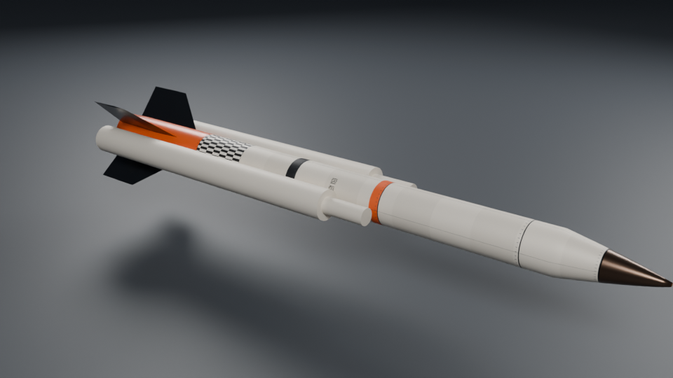

# KEKA Troposphere-6 Strap-On (Troll!)

> Retour : [Catalogue Général](../CATALOG.md) · [Accueil Mod](../../README.md)  
> Catégorie : **KEKA Aerospace Troll Payloads** · Fichier source : `mod/Database/weapons_arsenal_ag.lua`

## Fiche Technique

| Paramètre | Valeur |
|---|---|
| **ID Interne** | `NG_KEKA_TROPO6_AIR` |
| **CLSID Pylône** | `{NEXTGEN_KEKA_TROPO6_AIR}` |
| **Nom Court HUD / RWR** | `KEKA-T6` |
| **Modèle 3D (`.edm`)** | [`ng_keka_tropo6.edm`](../../mod/Shapes/ng_keka_tropo6.edm) |
| **Calibre / Diamètre** | `0.340 m` (`340 mm`) |
| **Longueur** | `5.20 m` |
| **Masse au Lancement** | `440.0 kg` |
| **Mach Max** | `Mach 4.4` |
| **Portée Max** | `120 km` |
| **Charge Militaire** | `140.0 kg` |
| **Facteur de Charge Max (`Nr_max`)** | `40 G` |
| **Guidage / Autodirecteur** | Radar Actif / Multi-Mode / INS+GPS (`Head_Type = 2` / Croisière) |
| **Propulsion** | Single/Sustained (210.0 kg fuel, Burn: 16.0s, Isp: 235s) |
| **Résistance ECM (`ccm_k0`)** | `0.03` |
| **Temps de Vie Max** | `140 s` |

## Polaire Aérodynamique & Modèle de Vol

- **Profil utilisé** : `FM_KEKA_TROLL` — **KEKA Aerospace Troposphère Amateur Wobble Polar**
- **Détails physiques (`polar_profiles.lua`)** : High base drag from riveted structural collars (`Cx0 = 0.78..1.48`, `wind_sigma = 12.0`, `wind_time = 8.0`) inducing realistic Savanna amateur flight wobble!

## Animations & Modèle 3D

- Corps monobloc rigide `+X Forward` sans surface mobile repliable.
