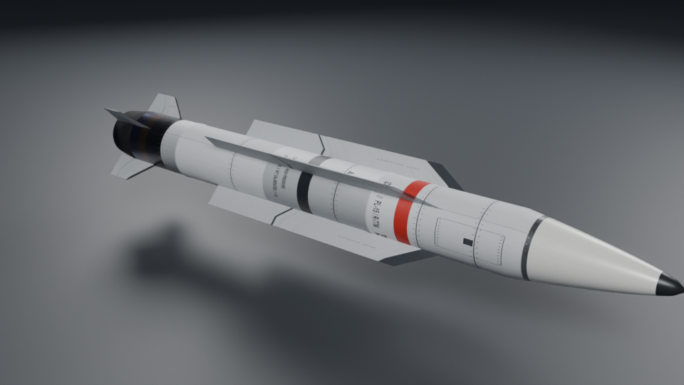

# KS-172 AAM-L AWACS-Killer (NG)

> [Catalogue Général](../CATALOG.md) · [Accueil Mod](../../README.md) · ← [NG_R_37M](NG_R_37M.md) · [NG_AIM_9X_BLK2P](NG_AIM_9X_BLK2P.md) →  
> Catégorie : **Air-to-Air BVR & Long-Range** · Fichier source : `mod/Database/weapons_nextgen.lua`

## Fiche Technique

| Paramètre | Valeur |
|---|---|
| **ID Interne** | `NG_KS_172` |
| **CLSID Pylône** | `{NEXTGEN_KS_172}` |
| **Nom Court HUD / RWR** | `KS-172` |
| **Modèle 3D (`.edm`)** | [`ng_r37m.edm`](../../mod/Shapes/ng_r37m.edm) |
| **Calibre / Diamètre** | `0.400 m` (`400 mm`) |
| **Longueur** | `6.01 m` |
| **Masse au Lancement** | `750.0 kg` |
| **Mach Max** | `Mach 5.5` |
| **Portée Max** | `400 km` |
| **Charge Militaire** | `50.0 kg` |
| **Facteur de Charge Max (`Nr_max`)** | `25 G` |
| **Guidage / Autodirecteur** | Radar Actif / Multi-Mode / INS+GPS (`Head_Type = 2` / Croisière) |
| **Propulsion** | Single/Sustained (380.0 kg fuel, Burn: 24.0s, Isp: 272s) |
| **Résistance ECM (`ccm_k0`)** | `0.02` |
| **Temps de Vie Max** | `340 s` |

## Polaire Aérodynamique & Modèle de Vol

- **Profil utilisé** : `FM_AAM_ULTRA` — **Slender Ultra-Long-Range Supersonic / Ramjet Polar**
- **Détails physiques ([`polar_profiles.lua`](../../mod/Database/polar_profiles.lua))** : Low wave-drag supersonic/ramjet envelope (`Cx0 = 0.38 @ M0 -> 0.74 @ M1.2 -> 0.232 @ M5.0`, sustained low drag above Mach 3).

| Mach | M0.0 | M0.8 | M1.2 | M2.0 | M3.0 | M4.0 | M5.0 |
|---|---|---|---|---|---|---|---|
| **Traînée `Cx0`** | `0.380` | `0.420` | `0.740` | `0.510` | `0.340` | `0.265` | `0.232` |

## Animations & Modèle 3D

- Corps monobloc rigide `+X Forward` sans surface mobile repliable.
