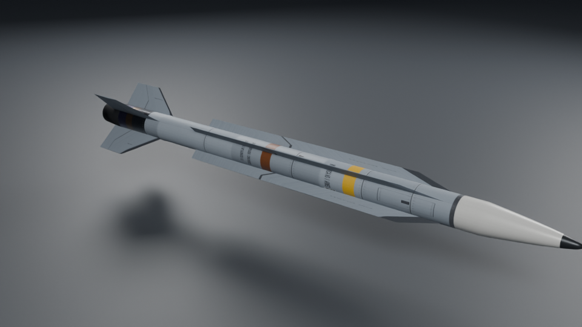

# MBDA MICA EM/RF (NextGen)

> Retour : [Catalogue Général](../CATALOG.md) · [Accueil Mod](../../README.md)  
> Catégorie : **Air-to-Air BVR & Long-Range** · Fichier source : `mod/Database/weapons_nextgen.lua`

## Fiche Technique

| Paramètre | Valeur |
|---|---|
| **ID Interne** | `NG_MICA_RF` |
| **CLSID Pylône** | `{NEXTGEN_MICA_RF}` |
| **Nom Court HUD / RWR** | `MICA-RF` |
| **Modèle 3D (`.edm`)** | [`ng_mica_ng.edm`](../../mod/Shapes/ng_mica_ng.edm) |
| **Calibre / Diamètre** | `0.160 m` (`160 mm`) |
| **Longueur** | `3.10 m` |
| **Masse au Lancement** | `112.0 kg` |
| **Mach Max** | `Mach 4.0` |
| **Portée Max** | `80 km` |
| **Charge Militaire** | `12.0 kg` |
| **Facteur de Charge Max (`Nr_max`)** | `50 G` |
| **Guidage / Autodirecteur** | Radar Actif / Multi-Mode / INS+GPS (`Head_Type = 2` / Croisière) |
| **Propulsion** | Single/Sustained (40.0 kg fuel, Burn: 6.5s, Isp: 245s) |
| **Résistance ECM (`ccm_k0`)** | `0.05` |
| **Temps de Vie Max** | `110 s` |

## Polaire Aérodynamique & Modèle de Vol

- **Profil utilisé** : `FM_AAM_WVR` — **High-Alpha HOBS Dogfight Polar**
- **Détails physiques (`polar_profiles.lua`)** : High-lift / thrust-vectoring dogfight curve (`Cya = 0.62..0.92`, low pitch/yaw inertia `Iy=68`, high roll rate `Mxd=14`).

## Animations & Modèle 3D

- Corps monobloc rigide `+X Forward` sans surface mobile repliable.
