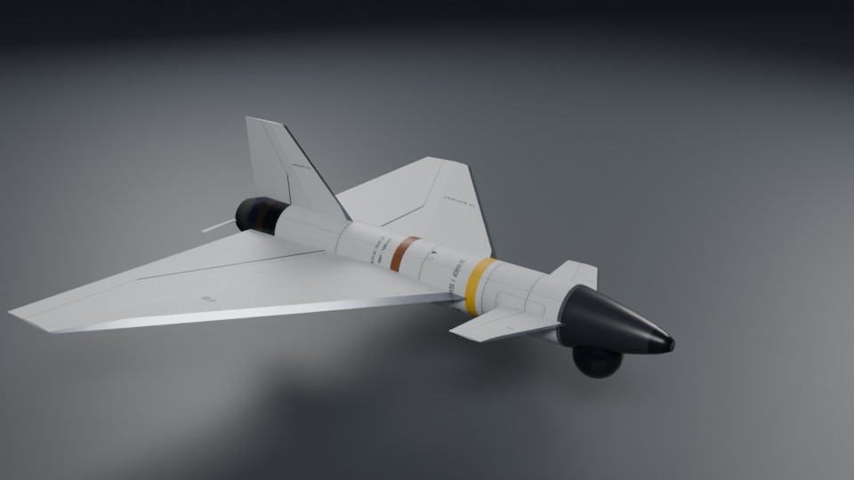

# Orbiter 1K Kingfisher Drone (NG)

> [Catalogue Général](../CATALOG.md) · [Accueil Mod](../../README.md) · ← [NG_RAM_II](NG_RAM_II.md) · [NG_KEKA_NJIWA1](NG_KEKA_NJIWA1.md) →  
> Catégorie : **Loitering Munitions & One-Way Drones** · Fichier source : `mod/Database/weapons_arsenal_ag.lua`

## Fiche Technique

| Paramètre | Valeur |
|---|---|
| **ID Interne** | `NG_ORBITER_1K` |
| **CLSID Pylône** | `{NEXTGEN_ORBITER_1K}` |
| **Nom Court HUD / RWR** | `Orbt-1K` |
| **Modèle 3D (`.edm`)** | [`ng_harop.edm`](../../mod/Shapes/ng_harop.edm) |
| **Calibre / Diamètre** | `0.160 m` (`160 mm`) |
| **Longueur** | `1.70 m` |
| **Masse au Lancement** | `13.0 kg` |
| **Mach Max** | `Mach 0.26` |
| **Portée Max** | `100 km` |
| **Charge Militaire** | `2.5 kg` |
| **Facteur de Charge Max (`Nr_max`)** | `40 G` |
| **Guidage / Autodirecteur** | Radar Actif / Multi-Mode / INS+GPS (`Head_Type = 2` / Croisière) |
| **Propulsion** | Single/Sustained (3.2 kg fuel, Burn: 1200.0s, Isp: 2600s) |
| **Résistance ECM (`ccm_k0`)** | `0.03` |
| **Temps de Vie Max** | `1500 s` |

## Polaire Aérodynamique & Modèle de Vol

- **Profil utilisé** : `FM_LOITER_DRONE` — **Subsonic Loitering Prop / Jet Drone Polar**
- **Détails physiques ([`polar_profiles.lua`](../../mod/Database/polar_profiles.lua))** : Ultra-low cruise drag (`Cx0 = 0.020`, `Sw = 1.15`, `dCydA = {0.08, 0.042}`) for long-endurance loitering munitions.

| Mach | M0.0 | M0.5 | M0.8 | M1.0 | M1.4 | M2.0 |
|---|---|---|---|---|---|---|
| **Traînée `Cx0`** | `0.020` | `0.042` | `0.180` | `0.420` | `0.340` | `0.260` |

## Animations & Modèle 3D

- `DrawArg 407` — Rotation continue de l'hélice propulsive
