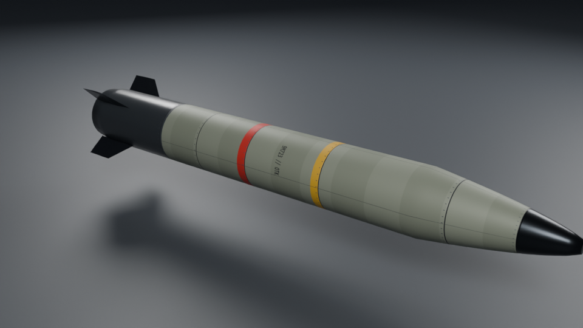

# DRDO Pralay Quasi-Ballistic (NG)

> Retour : [Catalogue Général](../CATALOG.md) · [Accueil Mod](../../README.md)  
> Catégorie : **Ballistic, MRBM, ALBM & Precision Artillery** · Fichier source : `mod/Database/weapons_arsenal_ag.lua`

## Fiche Technique

| Paramètre | Valeur |
|---|---|
| **ID Interne** | `NG_PRALAY` |
| **CLSID Pylône** | `{NEXTGEN_PRALAY}` |
| **Nom Court HUD / RWR** | `Pralay` |
| **Modèle 3D (`.edm`)** | [`ng_iskander_atacms.edm`](../../mod/Shapes/ng_iskander_atacms.edm) |
| **Calibre / Diamètre** | `0.650 m` (`650 mm`) |
| **Longueur** | `6.80 m` |
| **Masse au Lancement** | `5000.0 kg` |
| **Mach Max** | `Mach 6.0` |
| **Portée Max** | `500 km` |
| **Charge Militaire** | `700.0 kg` |
| **Facteur de Charge Max (`Nr_max`)** | `40 G` |
| **Guidage / Autodirecteur** | Radar Actif / Multi-Mode / INS+GPS (`Head_Type = 2` / Croisière) |
| **Propulsion** | Single/Sustained (2200.0 kg fuel, Burn: 36.0s, Isp: 262s) |
| **Résistance ECM (`ccm_k0`)** | `0.03` |
| **Temps de Vie Max** | `140 s` |

## Polaire Aérodynamique & Modèle de Vol

- **Profil utilisé** : `FM_HYPERSONIC` — **9M723 Iskander / Kinzhal / DF-17 Hypersonic Polar**
- **Détails physiques (`polar_profiles.lua`)** : Ultra-low hypersonic drag curve (`Cx0 = 0.36 @ M0 -> 0.52 @ M1.0 -> 0.118 @ M5.0`, `Iy = 3800`) for quasi-ballistic and ABM trajectories.

## Animations & Modèle 3D

- Corps monobloc rigide `+X Forward` sans surface mobile repliable.
