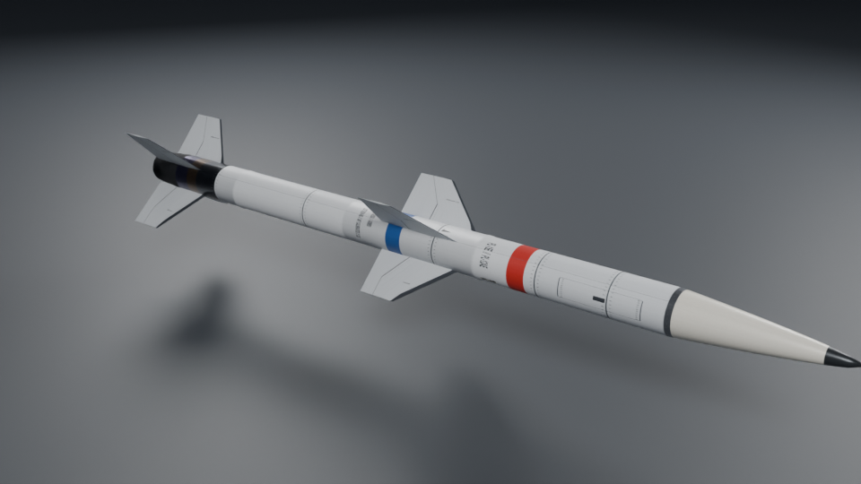

# Denel R-Darter BVR (NextGen)

> [Catalogue Général](../CATALOG.md) · [Accueil Mod](../../README.md) · ← [NG_GOKDOGAN](NG_GOKDOGAN.md) · [NG_MICA_RF](NG_MICA_RF.md) →  
> Catégorie : **Air-to-Air BVR & Long-Range** · Fichier source : `mod/Database/weapons_nextgen.lua`

## Fiche Technique

| Paramètre | Valeur |
|---|---|
| **ID Interne** | `NG_R_DARTER` |
| **CLSID Pylône** | `{NEXTGEN_R_DARTER}` |
| **Nom Court HUD / RWR** | `R-Darter` |
| **Modèle 3D (`.edm`)** | [`ng_pl12a.edm`](../../mod/Shapes/ng_pl12a.edm) |
| **Calibre / Diamètre** | `0.160 m` (`160 mm`) |
| **Longueur** | `3.62 m` |
| **Masse au Lancement** | `120.0 kg` |
| **Mach Max** | `Mach 4.0` |
| **Portée Max** | `75 km` |
| **Charge Militaire** | `18.0 kg` |
| **Facteur de Charge Max (`Nr_max`)** | `40 G` |
| **Guidage / Autodirecteur** | Radar Actif / Multi-Mode / INS+GPS (`Head_Type = 2` / Croisière) |
| **Propulsion** | Single/Sustained (40.0 kg fuel, Burn: 7.5s, Isp: 244s) |
| **Résistance ECM (`ccm_k0`)** | `0.06` |
| **Temps de Vie Max** | `140 s` |

## Polaire Aérodynamique & Modèle de Vol

- **Profil utilisé** : `FM_AAM_BVR` — **AIM-120C / SD-10 Mach 0.0–5.0 Polar**
- **Détails physiques ([`polar_profiles.lua`](../../mod/Database/polar_profiles.lua))** : Supersonic medium/BVR active-missile polar (`Cx0 = 0.468 @ M0 -> 0.880 @ M1.2 -> 0.364 @ M5.0`, `Cya = 0.318..0.518`, `delta_max = 0.349 rad`).

| Mach | M0.0 | M0.8 | M1.2 | M2.0 | M3.0 | M4.0 | M5.0 |
|---|---|---|---|---|---|---|---|
| **Traînée `Cx0`** | `0.468` | `0.479` | `0.880` | `0.720` | `0.555` | `0.444` | `0.364` |

## Animations & Modèle 3D

- Corps monobloc rigide `+X Forward` sans surface mobile repliable.
