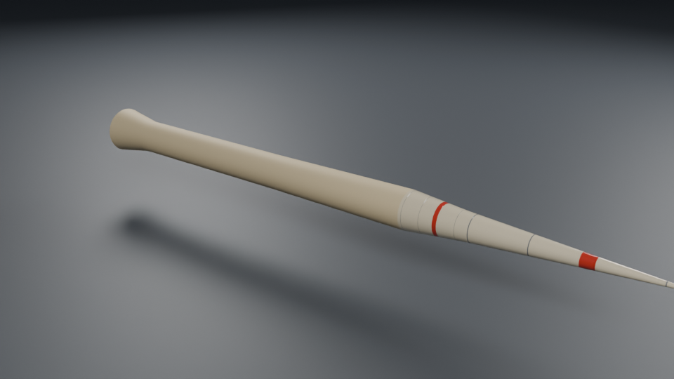

# IAI Arrow 3 Exo-ABM (NextGen)

> Retour : [Catalogue Général](../CATALOG.md) · [Accueil Mod](../../README.md)  
> Catégorie : **SAM & ABM Interceptors** · Fichier source : `mod/Database/weapons_sam_interceptors.lua`

## Fiche Technique

| Paramètre | Valeur |
|---|---|
| **ID Interne** | `NG_SAM_ARROW3` |
| **CLSID Pylône** | `Surface-Launched Only` |
| **Nom Court HUD / RWR** | `Arrow-3` |
| **Modèle 3D (`.edm`)** | [`ng_sam_thaad.edm`](../../mod/Shapes/ng_sam_thaad.edm) |
| **Calibre / Diamètre** | `0.500 m` (`500 mm`) |
| **Longueur** | `7.00 m` |
| **Masse au Lancement** | `1300.0 kg` |
| **Mach Max** | `Mach 8.5` |
| **Portée Max** | `240 km` |
| **Charge Militaire** | `20.0 kg` |
| **Facteur de Charge Max (`Nr_max`)** | `40 G` |
| **Guidage / Autodirecteur** | Radar Actif / Multi-Mode / INS+GPS (`Head_Type = 2` / Croisière) |
| **Propulsion** | Dual-stage (`Boost`: 650.0 kg / 8.5s @ Isp 255s · `March`: 240.0 kg / 16.0s @ Isp 248s) |
| **Résistance ECM (`ccm_k0`)** | `0.03` |
| **Temps de Vie Max** | `280 s` |

## Polaire Aérodynamique & Modèle de Vol

- **Profil utilisé** : `FM_HYPERSONIC` — **9M723 Iskander / Kinzhal / DF-17 Hypersonic Polar**
- **Détails physiques (`polar_profiles.lua`)** : Ultra-low hypersonic drag curve (`Cx0 = 0.36 @ M0 -> 0.52 @ M1.0 -> 0.118 @ M5.0`, `Iy = 3800`) for quasi-ballistic and ABM trajectories.

## Animations & Modèle 3D

- Corps monobloc rigide `+X Forward` sans surface mobile repliable.
