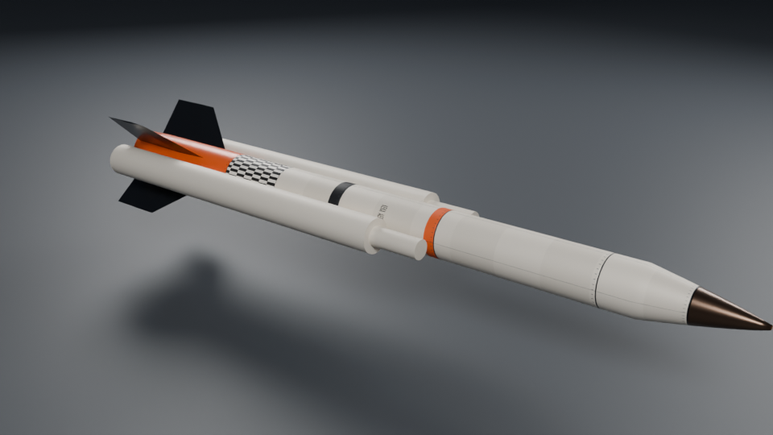

# KEKA Troposphere-6 Booster (Troll!)

> [Catalogue Général](../CATALOG.md) · [Accueil Mod](../../README.md) · ← [NG_SAM_KEKA_T5](NG_SAM_KEKA_T5.md) · [NG_SAM_THAAD](NG_SAM_THAAD.md) →  
> Catégorie : **SAM & ABM Interceptors** · Fichier source : `mod/Database/weapons_sam_interceptors.lua`

## Fiche Technique

| Paramètre | Valeur |
|---|---|
| **ID Interne** | `NG_SAM_KEKA_T6` |
| **CLSID Pylône** | `Surface-Launched Only` |
| **Nom Court HUD / RWR** | `KEKA-T6` |
| **Modèle 3D (`.edm`)** | [`ng_keka_tropo6.edm`](../../mod/Shapes/ng_keka_tropo6.edm) |
| **Calibre / Diamètre** | `0.340 m` (`340 mm`) |
| **Longueur** | `5.20 m` |
| **Masse au Lancement** | `420.0 kg` |
| **Mach Max** | `Mach 4.2` |
| **Portée Max** | `95 km` |
| **Charge Militaire** | `110.0 kg` |
| **Facteur de Charge Max (`Nr_max`)** | `16 G` |
| **Guidage / Autodirecteur** | Radar Actif / Multi-Mode / INS+GPS (`Head_Type = 2` / Croisière) |
| **Propulsion** | Dual-stage (`Boost`: 180.0 kg / 6.5s @ Isp 255s · `March`: 70.0 kg / 10.0s @ Isp 248s) |
| **Résistance ECM (`ccm_k0`)** | `0.03` |
| **Temps de Vie Max** | `150 s` |

## Polaire Aérodynamique & Modèle de Vol

- **Profil utilisé** : `FM_KEKA_TROLL` — **KEKA Aerospace Troposphère Amateur Wobble Polar**
- **Détails physiques ([`polar_profiles.lua`](../../mod/Database/polar_profiles.lua))** : High base drag from riveted structural collars (`Cx0 = 0.78..1.48`, `wind_sigma = 12.0`, `wind_time = 8.0`) inducing realistic Savanna amateur flight wobble!

| Mach | M0.0 | M0.8 | M1.2 | M2.0 | M3.0 | M4.0 | M5.0 |
|---|---|---|---|---|---|---|---|
| **Traînée `Cx0`** | `0.780` | `0.960` | `1.480` | `1.050` | `0.760` | `0.640` | `0.540` |

## Animations & Modèle 3D

- Corps monobloc rigide `+X Forward` sans surface mobile repliable.
