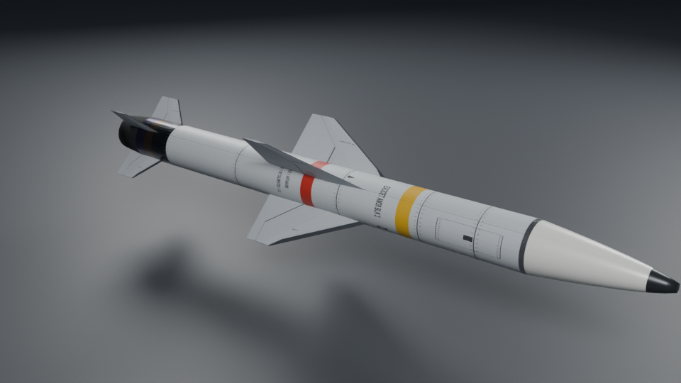

# MBDA Sea Venom / ANL Anti-Ship

> Retour : [Catalogue Général](../CATALOG.md) · [Accueil Mod](../../README.md)  
> Catégorie : **Anti-Ship Missiles (AShM)** · Fichier source : `mod/Database/weapons_tactical_30.lua`

## Fiche Technique

| Paramètre | Valeur |
|---|---|
| **ID Interne** | `NG_SEA_VENOM` |
| **CLSID Pylône** | `{NEXTGEN_SEA_VENOM}` |
| **Nom Court HUD / RWR** | `SeaVenom` |
| **Modèle 3D (`.edm`)** | [`ng_exocet_am39.edm`](../../mod/Shapes/ng_exocet_am39.edm) |
| **Calibre / Diamètre** | `0.200 m` (`200 mm`) |
| **Longueur** | `2.50 m` |
| **Masse au Lancement** | `120.0 kg` |
| **Mach Max** | `Mach 0.9` |
| **Portée Max** | `45 km` |
| **Charge Militaire** | `30.0 kg` |
| **Facteur de Charge Max (`Nr_max`)** | `40 G` |
| **Guidage / Autodirecteur** | Radar Actif / Multi-Mode / INS+GPS (`Head_Type = 2` / Croisière) |
| **Propulsion** | Single/Sustained (28.0 kg fuel, Burn: 180.0s, Isp: 2600s) |
| **Résistance ECM (`ccm_k0`)** | `0.03` |
| **Temps de Vie Max** | `500 s` |

## Polaire Aérodynamique & Modèle de Vol

- **Profil utilisé** : `FM_AAM_BVR` — **AIM-120C / SD-10 Mach 0.0–5.0 Polar**
- **Détails physiques (`polar_profiles.lua`)** : Supersonic medium/BVR active-missile polar (`Cx0 = 0.468 @ M0 -> 0.880 @ M1.2 -> 0.364 @ M5.0`, `Cya = 0.318..0.518`, `delta_max = 0.349 rad`).

## Animations & Modèle 3D

- Corps monobloc rigide `+X Forward` sans surface mobile repliable.
