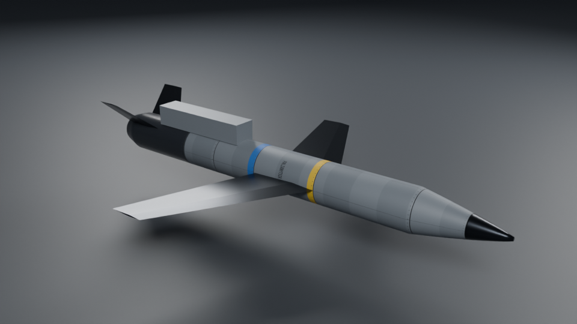

# Shahed-238 / Geran-3 Turbojet (NG)

> Retour : [Catalogue Général](../CATALOG.md) · [Accueil Mod](../../README.md)  
> Catégorie : **Loitering Munitions & One-Way Drones** · Fichier source : `mod/Database/weapons_arsenal_ag.lua`

## Fiche Technique

| Paramètre | Valeur |
|---|---|
| **ID Interne** | `NG_SHAHED_238` |
| **CLSID Pylône** | `{NEXTGEN_SHAHED_238}` |
| **Nom Court HUD / RWR** | `Shahed238` |
| **Modèle 3D (`.edm`)** | [`ng_palianytsia_jet.edm`](../../mod/Shapes/ng_palianytsia_jet.edm) |
| **Calibre / Diamètre** | `0.340 m` (`340 mm`) |
| **Longueur** | `3.50 m` |
| **Masse au Lancement** | `260.0 kg` |
| **Mach Max** | `Mach 0.72` |
| **Portée Max** | `800 km` |
| **Charge Militaire** | `50.0 kg` |
| **Facteur de Charge Max (`Nr_max`)** | `40 G` |
| **Guidage / Autodirecteur** | Radar Actif / Multi-Mode / INS+GPS (`Head_Type = 2` / Croisière) |
| **Propulsion** | Single/Sustained (75.0 kg fuel, Burn: 1500.0s, Isp: 2800s) |
| **Résistance ECM (`ccm_k0`)** | `0.03` |
| **Temps de Vie Max** | `1800 s` |

## Polaire Aérodynamique & Modèle de Vol

- **Profil utilisé** : `FM_CRUISE_STEALTH` — **AGM-84H / Kh-101 Subsonic Stealth Cruise Polar**
- **Détails physiques (`polar_profiles.lua`)** : High L/D folded-wing turbofan cruise curve (`Cx0 = 0.023` subsonic cruise, `Sw = 1.35`, `addDeplSw = 0.80`, `wingsDeplDelay = 1.0s`, `wingsDeplProcTime = 2.5s`).

## Animations & Modèle 3D

- Corps monobloc rigide `+X Forward` sans surface mobile repliable.
