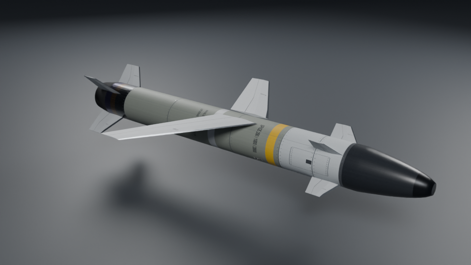

# Rafael SPICE-2000 EO/GPS (NextGen)

> [Catalogue Général](../CATALOG.md) · [Accueil Mod](../../README.md) · ← [NG_SPICE_1000](NG_SPICE_1000.md) · [NG_GBU_38_ER](NG_GBU_38_ER.md) →  
> Catégorie : **Smart Glide Bombs, PAB & UMPK** · Fichier source : `mod/Database/weapons_tactical_30.lua`

## Fiche Technique

| Paramètre | Valeur |
|---|---|
| **ID Interne** | `NG_SPICE_2000` |
| **CLSID Pylône** | `{NEXTGEN_SPICE_2000}` |
| **Nom Court HUD / RWR** | `SPICE2K` |
| **Modèle 3D (`.edm`)** | [`ng_spice_glide.edm`](../../mod/Shapes/ng_spice_glide.edm) |
| **Calibre / Diamètre** | `0.460 m` (`460 mm`) |
| **Longueur** | `4.20 m` |
| **Masse au Lancement** | `990.0 kg` |
| **Mach Max** | `Mach 0.95` |
| **Portée Max** | `75 km` |
| **Charge Militaire** | `450.0 kg` |
| **Facteur de Charge Max (`Nr_max`)** | `40 G` |
| **Guidage / Autodirecteur** | Radar Actif / Multi-Mode / INS+GPS (`Head_Type = 2` / Croisière) |
| **Propulsion** | Single/Sustained (4.0 kg fuel, Burn: 280.0s, Isp: 1800s) |
| **Résistance ECM (`ccm_k0`)** | `0.03` |
| **Temps de Vie Max** | `140 s` |

## Polaire Aérodynamique & Modèle de Vol

- **Profil utilisé** : `FM_GLIDE_BOMB` — **LS-6-500 / JSOW High-L/D Folding Glide Polar**
- **Détails physiques ([`polar_profiles.lua`](../../mod/Database/polar_profiles.lua))** : Long-range folding-wing glide polar (`Cx0 = 0.028` subsonic, `Sw = 0.65`, `addDeplSw = 0.85`, `maxAoa = 0.32`).

| Mach | M0.0 | M0.5 | M0.8 | M1.0 | M1.4 | M2.0 |
|---|---|---|---|---|---|---|
| **Traînée `Cx0`** | `0.028` | `0.030` | `0.055` | `0.480` | `0.310` | `0.255` |

## Animations & Modèle 3D

- `DrawArg 25` — Ailes / empennages repliés sur pylône (`0.0`) -> déployés en vol (`1.0`)
