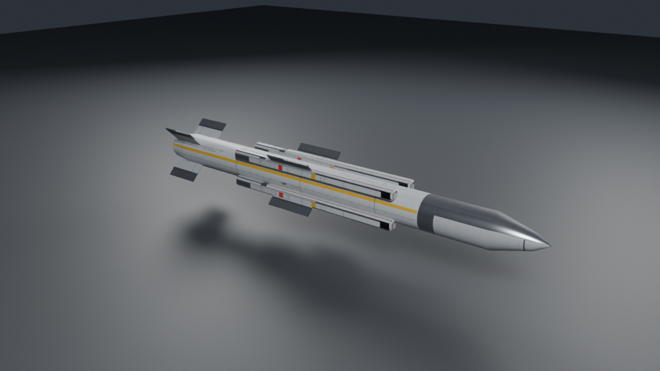

# YJ-12 Supersonic ASM (NextGen)

> Retour : [Catalogue Général](../CATALOG.md) · [Accueil Mod](../../README.md)  
> Catégorie : **Stealth Cruise & Stand-Off** · Fichier source : `mod/Database/weapons_tactical_30.lua`

## Fiche Technique

| Paramètre | Valeur |
|---|---|
| **ID Interne** | `NG_YJ_12` |
| **CLSID Pylône** | `{NEXTGEN_YJ_12}` |
| **Nom Court HUD / RWR** | `YJ-12` |
| **Modèle 3D (`.edm`)** | [`ng_kh31_ramjet.edm`](../../mod/Shapes/ng_kh31_ramjet.edm) |
| **Calibre / Diamètre** | `0.700 m` (`700 mm`) |
| **Longueur** | `6.30 m` |
| **Masse au Lancement** | `2000.0 kg` |
| **Mach Max** | `Mach 3.5` |
| **Portée Max** | `400 km` |
| **Charge Militaire** | `300.0 kg` |
| **Facteur de Charge Max (`Nr_max`)** | `40 G` |
| **Guidage / Autodirecteur** | Radar Actif / Multi-Mode / INS+GPS (`Head_Type = 2` / Croisière) |
| **Propulsion** | Single/Sustained (680.0 kg fuel, Burn: 110.0s, Isp: 310s) |
| **Résistance ECM (`ccm_k0`)** | `0.03` |
| **Temps de Vie Max** | `800 s` |

## Polaire Aérodynamique & Modèle de Vol

- **Profil utilisé** : `FM_AAM_ULTRA` — **Slender Ultra-Long-Range Supersonic / Ramjet Polar**
- **Détails physiques (`polar_profiles.lua`)** : Low wave-drag supersonic/ramjet envelope (`Cx0 = 0.38 @ M0 -> 0.74 @ M1.2 -> 0.232 @ M5.0`, sustained low drag above Mach 3).

## Animations & Modèle 3D

- Corps monobloc rigide `+X Forward` sans surface mobile repliable.
